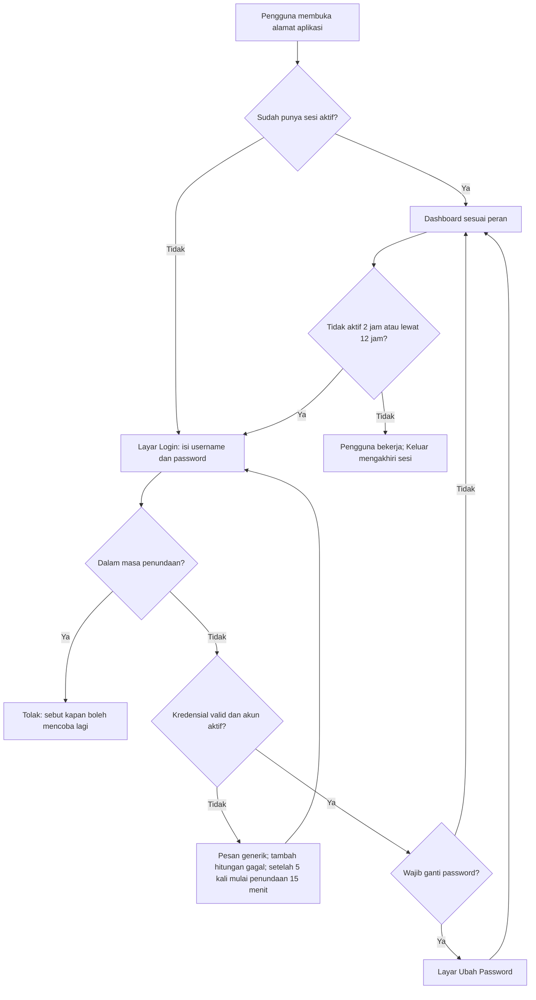
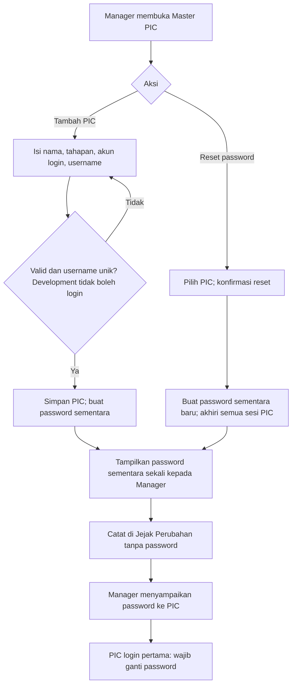
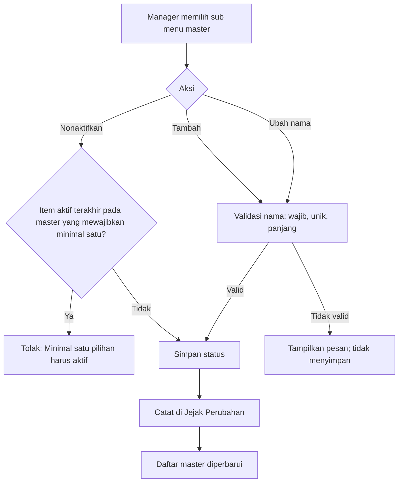
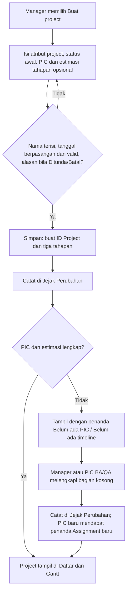
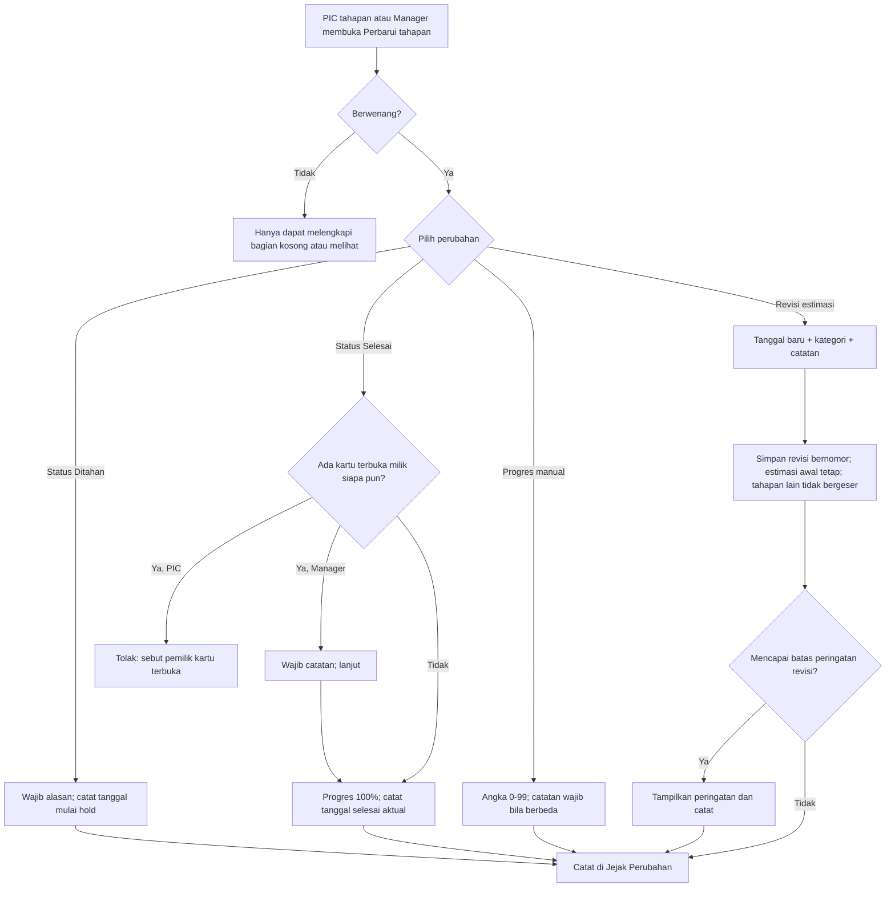
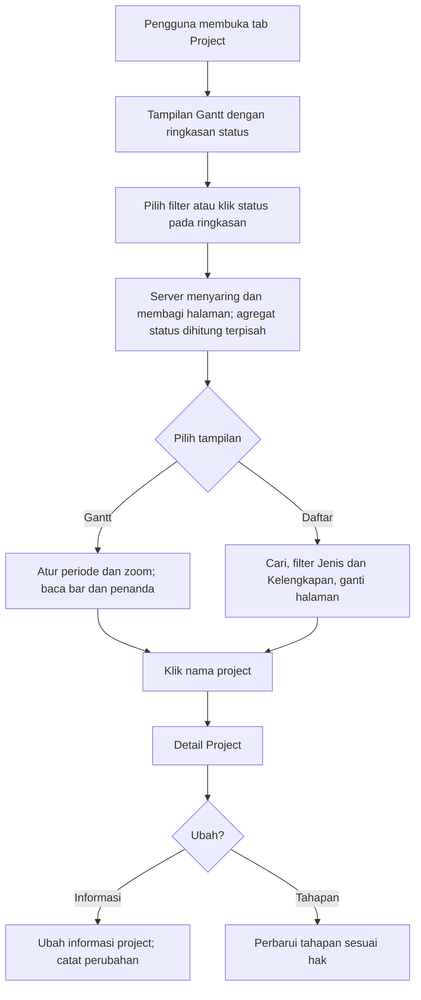
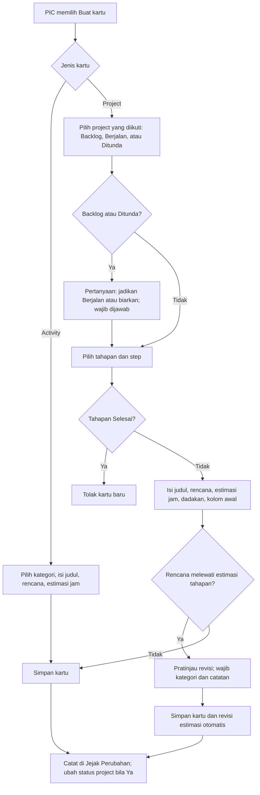
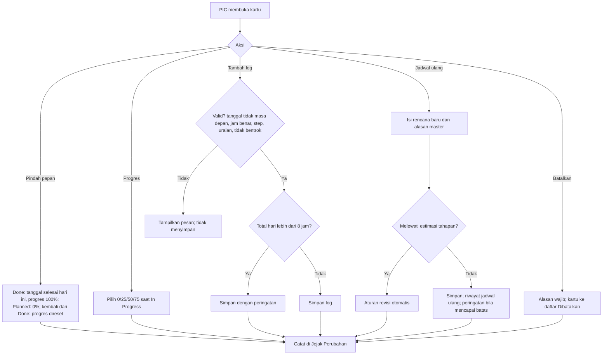
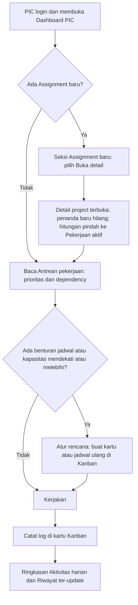
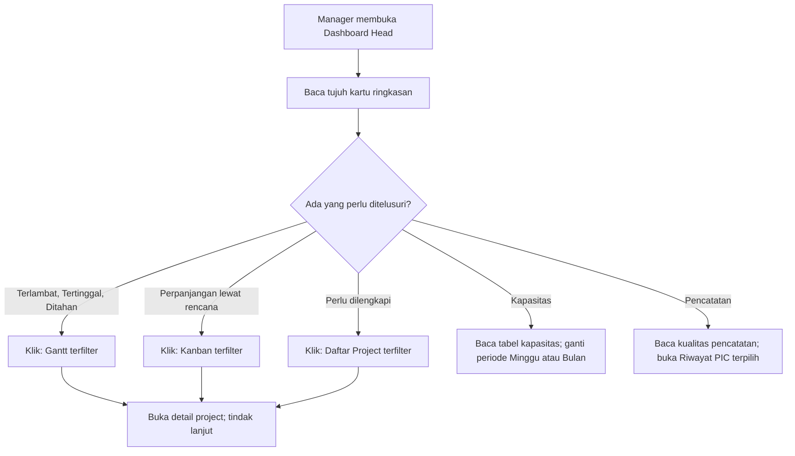

> **ARSIP, SUPERSEDED.** Salinan FSD v1.0 yang disetujui pemilik pada 2026-10-28 (CD-172). Digantikan FSD v1.1 (CR-002, CD-173). Hanya untuk penelusuran; jangan diubah. Versi berlaku: `../fsd.md`.

# Functional Specification Document

| | |
|---|---|
| Application Name | TBD (nama aplikasi belum ditetapkan) |
| Project/Feature Name | PMCP: Pemantauan Tahapan Project BA, Development, QA |
| Version No | 1.0 |
| Version Date | 2026-10-28 |
| Status | **APPROVED** (v1.0 disetujui Pemilik 2026-10-28, CD-172; G2 Functional Baseline) |
| Cakupan penulisan | **Bagian 1 sampai 4 dari 4 (seluruh BR terpetakan)**: Akun, peran, dan Master (BR-01, BR-08, BR-09 sisi tampilan, BR-19); Project, tahapan, Gantt, status, dan estimasi (BR-02, BR-03, BR-05, BR-06, BR-10 s.d. BR-15); Kanban, kartu, log activity, dan rencana kerja (BR-16, BR-17, BR-18, BR-20, BR-21, BR-13 sisi rencana kartu); Dashboard Head dan Dashboard PIC, kapasitas, Assignment baru, dan Riwayat (BR-04, BR-07, BL-43 s.d. BL-46). Bagian 1 sampai 3 sudah direview pemilik dan dinyatakan ok (CD-162, CD-164, CD-166); bagian 4 sudah direview pemilik dan dinyatakan ok (CD-168). Readiness check DEV dan QA selesai (CD-170); keputusan CL-055 dan CL-056 diterima pemilik (CD-171); FSD siap diajukan untuk persetujuan (G2) |

Catatan penulisan: judul bagian mengikuti template FSD pemilik (CD-30); isi dalam bahasa
Indonesia. Informasi yang belum diketahui ditulis `TBD [CL-xxx]` (CD-15). Hal yang diusulkan BA
dan diterima pemilik pada review bagian 1 ditandai **(diterima pemilik, CL-051)**; usulan BA pada bagian 2 yang diterima pemilik ditandai **(diterima pemilik, CL-052)**; usulan BA pada bagian 3 yang diterima pemilik ditandai **(diterima pemilik, CL-053)**; usulan BA pada bagian 4 yang diterima pemilik ditandai **(diterima pemilik, CL-054)**; usulan BA hasil pemeriksaan G2 dan readiness check yang diterima pemilik ditandai **(diterima pemilik, CL-055)** atau **(diterima pemilik, CL-056)**; perubahan hak lihat kartu mengikuti CR-001 (BRD v4.0 APPROVED, CD-169). Rujukan ke BRD memakai ID
BR dan BL dari `ba/brd.md` v4.0 APPROVED (CD-169). FSD tidak mengubah BRD; bila ada pertentangan, BRD
yang berlaku dan pertentangan itu menjadi Clarification (CD-19).

## 2. Document Version & Authorization

### 2.1 Document History / Version

| Date | Author | Version | Change Reference |
|---|---|---|---|
| 2026-10-28 | BA Agent | 1.0 (DRAFT) | Bagian 1 dari 4: Akun, peran, dan Master. Disusun dari BRD v3.5 APPROVED (CD-158), Technology Baseline v1.0 (CD-159), dan clarification-log (CL-049 s.d. CL-051). Bagian 1 direview pemilik dan dinyatakan ok (CD-162); usulan CL-051 diterima. Satu TBD tersisa: prosedur pemulihan bila Manager lupa password (teknis, ditetapkan di Technical Design) |
| 2026-10-28 | BA Agent | 1.0 (DRAFT) | Bagian 2 dari 4 ditambahkan: Project, tahapan, Gantt, status project, dan estimasi (BR-02, BR-03, BR-05, BR-06, BR-10 s.d. BR-15). Usulan BA dicatat di CL-052 dan diterima pemilik (CD-164) |
| 2026-10-28 | BA Agent | 1.0 (DRAFT) | Bagian 3 dari 4 ditambahkan: Kanban, kartu project dan activity, log activity, rencana, jadwal ulang, pembatalan, kepatuhan rencana, dan revisi estimasi otomatis (BR-16, BR-17, BR-18, BR-20, BR-21, BL-24 s.d. BL-39). Usulan BA dicatat di CL-053 dan diterima pemilik (CD-166); hak lihat kartu mengikuti CR-001 |
| 2026-10-28 | BA Agent | 1.0 (DRAFT) | Bagian 4 dari 4 ditambahkan: Dashboard Head BA & QA, Dashboard PIC, kapasitas, Assignment baru, dan menu Riwayat (BR-04, BR-07, BL-43 s.d. BL-46). **Koreksi FR-21-01 butir 4** (bagian 3): kartu activity ikut dihitung pada kapasitas bila memiliki estimasi jam, sejalan dengan BL-43 dan mockup; sebelumnya tertulis tidak dikaitkan ke kapasitas (CL-034f). Usulan BA dicatat di CL-054 dan diterima pemilik (CD-168) |
| 2026-10-28 | BA Agent | 1.0 (DRAFT) | Pemeriksaan Daftar Periksa G2 (§7.2) dijalankan: BL-09 ditambahkan ke kolom Rules FR-02-02; FR-46-01 dan FR-46-02 dipindah menjadi FR-07-08 dan FR-07-09 agar memiliki BR induk (BR-07); tabel field ditambahkan untuk Screen [006], [007], [014], [015]; TBD penghalang pemulihan akun Manager diganti aturan (diterima pemilik, CL-055); aturan ID Kartu ditambahkan (diterima pemilik, CL-055) |
| 2026-10-28 | BA Agent | 1.0 (DRAFT) | Tindak lanjut readiness check DEV dan QA (BA-6, CD-170): konvensi perhitungan tanggal dan hari (NFR-16); definisi kepatuhan, penanda rencana, progres tahapan, tertinggal, kapasitas, pembulatan, dan pemicu revisi otomatis diperjelas; EC dan AC batas ditambah; tabel field layar dilengkapi dan Screen [025] ditambahkan. Usulan BA yang menunggu keputusan pemilik dicatat di CL-056 |
| 2026-10-28 | BA Agent | 1.0 (DRAFT) | Keputusan pemilik atas CL-055 dan CL-056 ("semua setuju"; CD-171): seluruh usulan diterima kecuali **ID Kartu menjadi `KB-nnnnn` lima angka** (diputuskan pemilik); hari kerja hold dikeluarkan dari hitungan laju Tertinggal (FR-05-02 butir 6); target waktu muat tetap TBD dan diterima tertulis oleh pemilik (CD-28). Seluruh penanda "usulan BA" diganti "diterima pemilik" |
| 2026-10-28 | Pemilik | 1.0 (APPROVED, CD-172) | FSD v1.0 disetujui Pemilik tanpa perubahan isi; G2 Functional Baseline terpenuhi. Perubahan berikutnya hanya lewat Change Request |

### 2.2 Document Authorization

| Versi | Status | Penyetujui | Tanggal | Rujukan |
|---|---|---|---|---|
| 1.0 | APPROVED (G2) | Pemilik (Head of Business Analyst, Human Approver) | 2026-10-28 | CD-172 |

Persetujuan hanya oleh Pemilik (Human Approver) dan dicatat di `decision-log.md`. Agent tidak
menyetujui FSD buatannya sendiri. Satu TBD yang tersisa dan sudah diterima tertulis oleh pemilik
(CD-28, CD-171): target waktu muat (NFR-08, FR-15-01, NFR-14, CL-050). Perubahan sesudah ini hanya
lewat Change Request yang disetujui.

## 3. Functional Specification Document

### 3.1 Project Overview

FSD ini menjabarkan perilaku sistem PMCP dari sudut pandang fungsional, untuk mendukung BR-01 s.d. BR-21
pada BRD v4.0. Sistem memungkinkan **Manager** (Head of BA dan Head QA) memantau project dan tiga
tahapannya (BA, Development, QA), dan memungkinkan **PIC BA** dan **PIC QA** melihat kapan mereka
harus bekerja, memperbarui tahapan, mengelola rencana kerja lewat Kanban, dan mencatat aktivitas.

Pengguna utama: Manager (satu peran, CL-012), PIC BA, dan PIC QA (login); PIC Development hanya
dicatat sebagai nama dan tidak login (CL-013). Pengguna kurang dari 20 orang, diakses hanya dari
jaringan kantor (CL-049, CL-050).

Pendekatan: aplikasi web internal berbasis akun dengan hak akses per peran yang ditegakkan di
server. Pilihan teknis (modular monolith, PostgreSQL, server lokal) ada di Technology Baseline
v1.0 dan bukan bagian FSD ini (CD-19). Analisis alternatif pendekatan dikerjakan bersama DEV
(CD-18): alternatif dan alasan pemilihan tercatat di `dev/technology-baseline.md` §5 dan §6.
Kendala yang memengaruhi: data kerja multi-pengguna (RK-04) sehingga hak akses dan jejak
perubahan wajib di server; password dan sesi mengikuti kebijakan yang disetujui pemilik (§3.4.2).

**Cakupan bagian 1:** login dan sesi, ganti dan reset password, hak akses menurut peran,
Master (PIC, Aplikasi Terdampak, Kategori Alasan Revisi Estimasi, Step Tahapan, Kategori
Activity, Alasan Jadwal Ulang), dan layar Jejak Perubahan. Pencatatan jejak itu sendiri terjadi
di setiap bagian lain dan didefinisikan aturannya di sini (NFR-04).

### 3.2 Project Deliverables

Pemetaan BR ke FR. **Seluruh BR kini terpetakan ke FR** (bagian 1 sampai 4); G2 dapat diajukan setelah
bagian 4 direview pemilik.

| BR | Judul singkat | FR | Bagian FSD |
|---|---|---|---|
| BR-01 | Akun dan peran | FR-01-01 s.d. FR-01-06 | 1 (selesai) |
| BR-08 | Master | FR-08-01 s.d. FR-08-06 | 1 (selesai) |
| BR-19 | Master Step Tahapan | FR-19-01 | 1 (selesai) |
| BR-09 | Jejak perubahan | FR-09-01 (layar). Aturan pencatatan: NFR-04 | 1 (layar), 2 dan 3 (peristiwa yang dicatat; selesai) |
| BR-02 | Project dengan tiga tahapan | FR-02-01, FR-02-02 | 2 (selesai) |
| BR-03 | Atribut tahapan | FR-03-01 (dan FR-02-02, FR-10-01 untuk penanda kelengkapan) | 2 (selesai) |
| BR-05 | Update tahapan | FR-05-01, FR-05-02 | 2 (selesai) |
| BR-06 | Development tanpa login | FR-06-01 | 2 (selesai) |
| BR-10 | Daftar Project | FR-10-01, FR-10-02 | 2 (selesai) |
| BR-11 | Detail Project | FR-11-01, FR-11-02 | 2 (selesai) |
| BR-12 | Gantt | FR-12-01, FR-12-02, FR-12-03 | 2 (selesai) |
| BR-13 | Perubahan estimasi, hold, dan aktual | FR-13-01 s.d. FR-13-04; FR-13-05 (revisi otomatis dari rencana kartu, BL-39) | 2 dan 3 (selesai) |
| BR-14 | Status project | FR-14-01, FR-14-02 | 2 (selesai) |
| BR-15 | Performa dan data besar | FR-15-01, NFR-08 | 2 (selesai) |
| BR-16 | Kanban | FR-16-01, FR-16-02, FR-16-03 | 3 (selesai) |
| BR-17 | Kartu Kanban project | FR-17-01, FR-17-02, FR-17-03 | 3 (selesai) |
| BR-18 | Log activity pada kartu | FR-18-01 | 3 (selesai) |
| BR-20 | Log activity pada detail project | FR-20-01, FR-20-02 | 3 (selesai) |
| BR-21 | Kanban sebagai pelacak rencana kerja | FR-21-01 s.d. FR-21-05 | 3 (selesai) |
| BR-04 | Monitoring oleh Manager (kini Dashboard Head BA & QA, BL-43) | FR-04-01 s.d. FR-04-06 (dan FR-10-02 untuk filter) | 4 (selesai) |
| BR-07 | Jadwal kerja PIC (kini Dashboard PIC, BL-44, BL-45, BL-46) | FR-07-01 s.d. FR-07-09 | 4 (selesai) |

Setiap FR memastikan BR terkait terdukung penuh di tingkat sistem. BR-01, BR-08, BR-19 (bagian 1)
dan BR-02, BR-03, BR-05, BR-06, BR-10 s.d. BR-15 (bagian 2) sudah terpetakan; BL yang relevan
tercantum pada kolom Rules (§3.4.1).

### 3.3 Key Features and Functionalities

#### 3.3.1 List of Features

**[FR-01-01] Login**
- [FR-01-01.01] Sistem harus memungkinkan pengguna dengan akun aktif masuk memakai username dan password.
- [FR-01-01.02] Sistem harus menolak login yang salah tanpa membocorkan apakah username atau password yang salah.
- [FR-01-01.03] Sistem harus menunda percobaan login berikutnya setelah percobaan gagal berulang.
- [FR-01-01.04] Sistem harus mewajibkan penggantian password sebelum menu lain dapat dipakai bila akun ditandai wajib ganti.
- [FR-01-01.05] Sistem harus mengakhiri sesi yang tidak aktif atau melewati batas waktu maksimum.

**[FR-01-02] Ganti password sendiri**
- [FR-01-02.01] Sistem harus memungkinkan pengguna yang login mengganti password sendiri.
- [FR-01-02.02] Sistem harus menegakkan aturan password.
- [FR-01-02.03] Sistem harus mengakhiri sesi lain milik akun yang sama setelah password diganti.

**[FR-01-03] Logout**
- [FR-01-03.01] Sistem harus memungkinkan pengguna keluar dan mengakhiri sesinya.

**[FR-01-04] Hak akses menurut peran**
- [FR-01-04.01] Sistem harus menampilkan menu sesuai peran.
- [FR-01-04.02] Sistem harus menegakkan hak akses di server pada setiap permintaan.
- [FR-01-04.03] Sistem harus menolak akses di luar hak dengan pesan yang jelas.

**[FR-01-05] Password sementara dan reset oleh Manager**
- [FR-01-05.01] Sistem harus membuat password sementara saat Manager membuat akun atau mereset password, dan menampilkannya sekali.
- [FR-01-05.02] Sistem harus mewajibkan PIC mengganti password sementara pada login pertama.
- [FR-01-05.03] Sistem harus mengakhiri semua sesi akun yang direset.

**[FR-01-06] Akun Manager awal**
- [FR-01-06.01] Sistem harus tersedia dengan satu akun Manager sejak instalasi, dibuat lewat prosedur terkontrol di luar layar aplikasi (diterima pemilik, CL-051).

**[FR-08-01] Master PIC**
- [FR-08-01.01] Sistem harus memungkinkan Manager melihat daftar PIC.
- [FR-08-01.02] Sistem harus memungkinkan Manager menambah PIC (BA, Development, QA), dengan atau tanpa akun login.
- [FR-08-01.03] Sistem harus memungkinkan Manager mengubah nama PIC.
- [FR-08-01.04] Sistem harus memungkinkan Manager menonaktifkan dan mengaktifkan kembali PIC.
- [FR-08-01.05] Sistem harus memungkinkan Manager mereset password akun PIC.

**[FR-08-02] Master Aplikasi Terdampak** (memuat aturan umum master pilihan, dirujuk FR-08-03 s.d. FR-08-05 dan FR-19-01)
- [FR-08-02.01] Sistem harus memungkinkan Manager melihat, menambah, mengubah nama, dan menonaktifkan/mengaktifkan aplikasi.

**[FR-08-03] Master Kategori Alasan Revisi Estimasi dan batas peringatan revisi**
- [FR-08-03.01] Sistem harus memungkinkan Manager mengelola kategori alasan revisi estimasi.
- [FR-08-03.02] Sistem harus memungkinkan Manager mengatur batas peringatan revisi.

**[FR-08-04] Master Kategori Activity**
- [FR-08-04.01] Sistem harus memungkinkan Manager mengelola kategori activity di luar project.

**[FR-08-05] Master Alasan Jadwal Ulang dan batas peringatan jadwal ulang**
- [FR-08-05.01] Sistem harus memungkinkan Manager mengelola alasan jadwal ulang.
- [FR-08-05.02] Sistem harus memungkinkan Manager mengatur batas peringatan jadwal ulang.

**[FR-08-06] Sub menu Master**
- [FR-08-06.01] Sistem harus menampilkan Master sebagai sub menu terpisah, satu master per waktu.

**[FR-19-01] Master Step Tahapan**
- [FR-19-01.01] Sistem harus memungkinkan Manager mengelola step per tahapan (BA dan QA), termasuk urutannya.

**[FR-09-01] Jejak Perubahan**
- [FR-09-01.01] Sistem harus memungkinkan Manager melihat jejak perubahan, terbaru di atas.

**[FR-02-01] Membuat project**
- [FR-02-01.01] Sistem harus memungkinkan Manager membuat project dengan atribut project.
- [FR-02-01.02] Sistem harus membuat ID Project otomatis dan tiga tahapan (BA, Development, QA).
- [FR-02-01.03] Sistem harus memungkinkan Manager menentukan status awal project beserta alasannya bila Ditunda atau Batal.

**[FR-02-02] PIC dan estimasi tahapan saat project dibuat**
- [FR-02-02.01] Sistem harus memungkinkan PIC dan estimasi tanggal tiap tahapan diisi atau dikosongkan.
- [FR-02-02.02] Sistem harus menyimpan estimasi pertama yang diisi sebagai estimasi awal.

**[FR-03-01] Melengkapi dan mengubah PIC dan timeline tahapan**
- [FR-03-01.01] Sistem harus memungkinkan PIC BA/QA mana pun melengkapi PIC dan timeline tahapan yang masih kosong.
- [FR-03-01.02] Sistem harus memungkinkan PIC tahapan mengubah PIC tahapannya.
- [FR-03-01.03] Sistem harus membatasi perubahan bagian yang sudah terisi kepada Manager dan PIC tahapan sesuai hak.

**[FR-05-01] Memperbarui status tahapan**
- [FR-05-01.01] Sistem harus memungkinkan PIC tahapan atau Manager mengubah status tahapan (Belum Mulai, Berjalan, Ditahan, Selesai).
- [FR-05-01.02] Sistem harus menegakkan syarat Ditahan (alasan) dan Selesai (tidak ada kartu terbuka).
- [FR-05-01.03] Sistem harus mengisi tanggal aktual mulai dan selesai.

**[FR-05-02] Progres tahapan**
- [FR-05-02.01] Sistem harus menghitung progres tahapan dari kartu semua PIC.
- [FR-05-02.02] Sistem harus memungkinkan penyesuaian manual dengan catatan.
- [FR-05-02.03] Sistem harus menandai tahapan yang tertinggal dari laju.

**[FR-06-01] Tahapan Development**
- [FR-06-01.01] Sistem harus memungkinkan Manager memperbarui tahapan Development karena PIC Development tidak login.

**[FR-10-01] Daftar Project**
- [FR-10-01.01] Sistem harus menampilkan daftar project dengan pagination, pencarian, dan filter.
- [FR-10-01.02] Sistem harus menandai project yang perencanaannya belum lengkap dan memfilternya.

**[FR-10-02] Tab Project dengan satu bar filter**
- [FR-10-02.01] Sistem harus menampilkan tab Project dengan pilihan tampilan Daftar dan Gantt yang memakai satu bar filter.

**[FR-11-01] Detail Project**
- [FR-11-01.01] Sistem harus memungkinkan pengguna membuka detail project dari Daftar, Gantt, dan Dashboard.
- [FR-11-01.02] Sistem harus menampilkan informasi project, tahapan, jadwal, riwayat estimasi dan penahanan, serta riwayat perubahan.

**[FR-11-02] Mengubah informasi project**
- [FR-11-02.01] Sistem harus memungkinkan Manager dan PIC BA/QA mengubah informasi project dan mencatat perubahannya.

**[FR-12-01] Gantt**
- [FR-12-01.01] Sistem harus menampilkan tahapan semua project pada garis waktu dengan periode, zoom, urutan, dan paging per project.

**[FR-12-02] Bar dan penanda Gantt**
- [FR-12-02.01] Sistem harus menampilkan estimasi terkini, estimasi awal, aktual, hold, revisi, dan keterlambatan pada bar.

**[FR-12-03] Filter PIC pada Gantt**
- [FR-12-03.01] Sistem harus menyaring project menurut PIC tanpa menyembunyikan tahapan PIC lain.

**[FR-13-01] Estimasi awal dan revisi estimasi**
- [FR-13-01.01] Sistem harus menyimpan estimasi awal dan setiap revisi estimasi dengan alasan.

**[FR-13-04] Peringatan revisi berulang**
- [FR-13-04.01] Sistem harus memberi peringatan bila tahapan direvisi berulang.

**[FR-13-02] Hold**
- [FR-13-02.01] Sistem harus mencatat penahanan tahapan beserta alasan dan periodenya.

**[FR-13-03] Keterlambatan dan tanggal aktual**
- [FR-13-03.01] Sistem harus menandai tahapan terlambat tanpa mengubah tanggal secara otomatis.

**[FR-14-01] Status project**
- [FR-14-01.01] Sistem harus menyimpan status project (Backlog, Berjalan, Ditunda, Batal, Selesai) dan mencatat perubahannya.

**[FR-14-02] Ringkasan jumlah per status**
- [FR-14-02.01] Sistem harus menampilkan ringkasan jumlah project per status yang dapat diklik untuk menyaring.

**[FR-15-01] Penyaringan dan paging di server**
- [FR-15-01.01] Sistem harus memuat hanya data yang tampil pada layar berdaftar besar.

**[FR-16-01] Papan Kanban**
- [FR-16-01.01] Sistem harus menampilkan tiga papan (Planned, In Progress, Done) berisi kartu project dan kartu activity.
- [FR-16-01.02] Sistem harus menyediakan filter periode, PIC, jenis, dan pencarian.
- [FR-16-01.03] Sistem harus membatasi PIC pada kartu miliknya dan Manager pada tampilan baca saja.

**[FR-16-02] Memindahkan kartu**
- [FR-16-02.01] Sistem harus memungkinkan PIC pemilik memindahkan kartunya antar papan dengan seret atau tombol panah.

**[FR-16-03] Progres kartu**
- [FR-16-03.01] Sistem harus memungkinkan PIC pemilik mengisi progres kartu In Progress.

**[FR-17-01] Membuat kartu project**
- [FR-17-01.01] Sistem harus memungkinkan PIC membuat kartu rencana untuk project dan tahapan yang ia ikuti.

**[FR-17-02] Konfirmasi ubah status project**
- [FR-17-02.01] Sistem harus menanyakan apakah status project diubah menjadi Berjalan saat project berstatus Backlog atau Ditunda dipilih.

**[FR-17-03] Informasi pada kartu**
- [FR-17-03.01] Sistem harus menampilkan informasi project dan tahapan pada kartu.

**[FR-21-01] Membuat kartu activity dan kartu dadakan**
- [FR-21-01.01] Sistem harus memungkinkan PIC membuat kartu activity di luar project dengan kategori dari master.
- [FR-21-01.02] Sistem harus memungkinkan PIC menandai kartu sebagai dadakan.

**[FR-21-02] Rencana dan penanda otomatis**
- [FR-21-02.01] Sistem harus menyimpan rencana kartu (rentang tanggal, estimasi jam) dan menandai otomatis apakah rencana berjalan.

**[FR-21-03] Jadwal ulang**
- [FR-21-03.01] Sistem harus memungkinkan PIC memindahkan rencana kartu ke tanggal lain dengan alasan dari master.

**[FR-21-04] Pembatalan kartu**
- [FR-21-04.01] Sistem harus memungkinkan PIC membatalkan kartu yang belum Done dengan alasan.

**[FR-21-05] Kepatuhan rencana**
- [FR-21-05.01] Sistem harus menghitung dan menampilkan kepatuhan rencana per PIC dan periode, terlihat semua pengguna.

**[FR-13-05] Rencana melewati estimasi tahapan**
- [FR-13-05.01] Sistem harus merevisi estimasi tahapan secara otomatis saat rencana kartu melewati estimasi tahapan, dengan pratinjau dan alasan.

**[FR-18-01] Log activity pada kartu**
- [FR-18-01.01] Sistem harus memungkinkan PIC pemilik mencatat dan menghapus log activity pada kartunya.
- [FR-18-01.02] Sistem harus menampilkan total waktu kartu dan total per step.

**[FR-20-01] Log activity pada detail project**
- [FR-20-01.01] Sistem harus menampilkan semua log kartu project pada detail project dengan ringkasan, filter, dan pembagian halaman.

**[FR-20-02] Rencana kerja pada detail project**
- [FR-20-02.01] Sistem harus menampilkan Rencana kerja project pada detail project (BR-20, CR-001).

**[FR-04-01] Kartu ringkasan Dashboard Head**
- [FR-04-01.01] Sistem harus menampilkan tujuh kartu ringkasan pada Dashboard Head dan membuka layar terfilter saat kartu yang dapat diklik dipilih.

**[FR-04-02] Project terlambat atau berisiko**
- [FR-04-02.01] Sistem harus menampilkan tahapan terlambat atau berisiko diurut dari keterlambatan terlama.

**[FR-04-03] Tahapan jatuh tempo dalam 7 hari**
- [FR-04-03.01] Sistem harus menampilkan tahapan berjalan yang jatuh tempo dalam 7 hari.

**[FR-04-04] Beban dan kapasitas tim**
- [FR-04-04.01] Sistem harus menampilkan beban dan kapasitas tiap PIC menurut periode yang dipilih.

**[FR-04-05] Pekerjaan yang sedang ditangani**
- [FR-04-05.01] Sistem harus menampilkan jumlah tahapan dan kartu BA dan QA minggu berjalan.

**[FR-04-06] Pencatatan aktivitas dan realisasi**
- [FR-04-06.01] Sistem harus menampilkan kualitas pencatatan aktivitas tiap PIC minggu berjalan.

**[FR-07-01] Kartu ringkasan Dashboard PIC**
- [FR-07-01.01] Sistem harus menampilkan lima kartu ringkasan pribadi pada Dashboard PIC.

**[FR-07-02] Assignment baru**
- [FR-07-02.01] Sistem harus menandai tahapan yang baru ditugaskan kepada PIC sampai detail project dibuka.
- [FR-07-02.02] Sistem harus menampilkan daftar Assignment baru pada Dashboard PIC.

**[FR-07-03] Antrean pekerjaan**
- [FR-07-03.01] Sistem harus menampilkan tahapan aktif PIC menurut prioritas, tenggat, dan dependency.

**[FR-07-04] Timeline proyek saya**
- [FR-07-04.01] Sistem harus menampilkan garis waktu penugasan pribadi dan benturan jadwal.

**[FR-07-05] Kapasitas**
- [FR-07-05.01] Sistem harus menghitung kapasitas dan utilisasi sesuai aturan yang berlaku.
- [FR-07-05.02] Sistem harus menyediakan pilihan periode Minggu atau Bulan beserta rincian pada Dashboard PIC.

**[FR-07-06] Aktivitas harian (ringkasan)**
- [FR-07-06.01] Sistem harus menampilkan ringkasan kartu project dan kartu activity (Planned, In Progress, Terlambat) tanpa daftar.

**[FR-07-07] Riwayat ringkas pada dashboard**
- [FR-07-07.01] Sistem harus menampilkan ringkasan tahapan selesai dengan tautan ke menu Riwayat.

**[FR-07-08] Riwayat: Tahapan selesai**
- [FR-07-08.01] Sistem harus menampilkan daftar tahapan selesai dengan pencarian, filter, dan pagination.

**[FR-07-09] Riwayat: Aktivitas harian**
- [FR-07-09.01] Sistem harus menampilkan apa yang dikerjakan per hari dari log kartu Kanban.

#### 3.3.2 Edge Cases

**[FR-01-01] Login**
- [EC-01-01.01] Jika username atau password kosong, sistem harus menampilkan pesan bahwa keduanya wajib diisi tanpa memproses login.
- [EC-01-01.02] Jika akun nonaktif, sistem harus menolak dengan pesan yang sama seperti password salah.
- [EC-01-01.03] Jika ada percobaan login selama masa penundaan, sistem harus menolak walau password benar dan menyebut kapan boleh mencoba lagi, dengan pesan yang sama untuk username yang tidak dikenal.
- [EC-01-01.04] Jika sesi kedaluwarsa saat pengguna sedang mengisi formulir, sistem harus mengarahkan ke login dan data yang belum disimpan tidak tersimpan; setelah login ulang pengguna kembali ke menu awal.
- [EC-01-01.05] Jika pengguna membuka alamat menu tanpa login, sistem harus mengarahkan ke login.

**[FR-01-02] Ganti password**
- [EC-01-02.01] Jika password saat ini salah, sistem harus menolak tanpa mengubah apa pun dan menghitungnya sebagai percobaan gagal.
- [EC-01-02.02] Jika password baru sama dengan password saat ini, kurang dari 12 karakter, sama dengan username, atau termasuk daftar password umum, sistem harus menolak dengan alasan.
- [EC-01-02.03] Jika konfirmasi tidak sama dengan password baru, sistem harus menolak.
- [EC-01-02.04] Jika password baru lebih dari 128 karakter atau memuat spasi saja, sistem harus menolak; contoh password umum seperti "password12345" harus ditolak (sumber daftar password umum ditetapkan di Technical Design).

**[FR-01-04] Hak akses**
- [EC-01-04.01] Jika PIC membuka alamat menu Master secara langsung, sistem harus menolak (akses ditolak) dan tidak menampilkan data master.
- [EC-01-04.02] Jika peran akun diubah atau akun dinonaktifkan saat sesi berjalan, hak baru harus berlaku pada permintaan berikutnya.

**[FR-01-05] Password sementara**
- [EC-01-05.01] Jika Manager menutup layar password sementara sebelum mencatatnya, password itu tidak dapat ditampilkan lagi; Manager harus mereset ulang.
- [EC-01-05.02] Jika PIC belum pernah login setelah reset, reset berikutnya menggantikan password sementara sebelumnya.

**[FR-01-06] Manager awal**
- [EC-01-06.01] Jika Manager tidak dapat login karena lupa password, pemulihan tidak tersedia lewat layar aplikasi; ditangani lewat prosedur darurat terkontrol pada FR-01-06 butir 3 (diterima pemilik, CL-055); rincian teknis ditetapkan di Technical Design.

**[FR-08-01] Master PIC**
- [EC-08-01.01] Jika username yang diisi sudah dipakai (tanpa membedakan huruf besar kecil), sistem harus menolak.
- [EC-08-01.02] Jika PIC bertahapan Development diberi akun login, sistem harus menolak karena PIC Development tidak login (BR-06).
- [EC-08-01.03] Jika Manager menonaktifkan PIC yang masih menjadi PIC tahapan yang belum Selesai, sistem harus menampilkan daftar project terdampak dan meminta konfirmasi; penugasan tidak dilepas otomatis (diterima pemilik, CL-051).
- [EC-08-01.04] Jika ada permintaan menonaktifkan akun Manager lewat Master PIC atau permintaan langsung, sistem harus menolak.
- [EC-08-01.05] Jika PIC dinonaktifkan, kartu miliknya tetap tampil di Kanban dan tetap dihitung pada kepatuhan dan kapasitas periode yang sudah lewat; PIC itu tidak dapat membuat kartu baru dan tidak muncul pada pilihan PIC baru.

**[FR-08-02] Master pilihan umum (Aplikasi, Kategori Alasan Revisi, Kategori Activity, Alasan Jadwal Ulang, Step)**
- [EC-08-02.01] Jika nama kosong atau hanya spasi, sistem harus menolak dengan pesan nama wajib diisi.
- [EC-08-02.02] Jika nama sudah ada pada master yang sama (tanpa membedakan huruf besar kecil), sistem harus menolak.
- [EC-08-02.03] Jika nama melebihi batas panjang, sistem harus menolak dengan pesan batas panjang dan tidak memotong teks secara diam-diam.
- [EC-08-02.04] Jika Manager menonaktifkan item aktif terakhir pada master yang mewajibkan minimal satu aktif, sistem harus menolak dengan pesan "Minimal satu pilihan harus aktif."
- [EC-08-02.05] Jika item dinonaktifkan saat sedang tampil di data lama, data lama tetap menampilkan nama item.
- [EC-08-02.06] Jika dua Manager (atau dua sesi) menambah nama yang sama bersamaan, sistem harus menyimpan satu dan menolak yang lain dengan pesan nama sudah ada.

**[FR-08-03] / [FR-08-05] Batas peringatan**
- [EC-08-03.01] Jika batas bukan bilangan bulat 1 sampai 20, sistem harus menolak dengan pesan "Isi bilangan bulat 1 sampai 20."
- [EC-08-03.02] Jika batas diturunkan, tahapan atau kartu yang sudah melewati batas baru ditandai peringatan pada tampilan berikutnya tanpa mengubah riwayat revisi atau jadwal ulang.

**[FR-19-01] Step Tahapan**
- [EC-19-01.01] Jika Manager membuka sub menu Step Tahapan, tahapan Development tidak ditawarkan karena belum punya step (BR-19).
- [EC-19-01.02] Jika step yang sudah dipakai di log diubah namanya, log lama tetap menampilkan nama saat dicatat (BL-28).
- [EC-19-01.03] Jika step paling atas dinaikkan atau paling bawah diturunkan, sistem harus menonaktifkan tombol tersebut.

**[FR-09-01] Jejak Perubahan**
- [EC-09-01.01] Jika belum ada perubahan tercatat, sistem harus menampilkan pesan kosong "Belum ada perubahan tercatat."
- [EC-09-01.02] Jika catatan terlalu banyak untuk satu layar, sistem harus membaginya per halaman (BR-15).

**[FR-02-01] / [FR-02-02] Membuat project**
- [EC-02-01.01] Jika Nama project kosong, sistem harus menolak dengan pesan nama wajib diisi.
- [EC-02-01.02] Jika Request date bukan dd/mm/yyyy yang valid, sistem harus menolak.
- [EC-02-01.03] Jika status Ditunda atau Batal dipilih tanpa alasan, sistem harus menolak dengan pesan "Isi alasan untuk status ...".
- [EC-02-01.04] Jika hanya salah satu estimasi (mulai atau selesai) diisi, atau selesai sebelum mulai, sistem harus menolak dengan pesan tanggal berpasangan dan urutan.
- [EC-02-01.05] Jika tanggal tahapan tumpang tindih atau urutan antar tahapan terbalik, sistem harus tetap menyimpan dan hanya menampilkan informasi (BL-02).
- [EC-02-01.06] Jika Aplikasi terdampak yang dipilih dinonaktifkan sebelum disimpan, sistem harus menolak pilihan itu dan meminta memilih ulang.
- [EC-02-01.07] Jika dua project dibuat bersamaan, sistem harus memberi ID berbeda tanpa duplikasi.
- [EC-02-01.08] Jika isian melebihi panjang maksimum (nama project 100, no. referensi 50, business owner 100, department 100, alasan 200, deskripsi 1000, judul rencana 120, catatan 300), sistem harus menolak dengan pesan batas panjang; isian tepat pada batas harus diterima.
- [EC-02-01.09] Request date di masa depan diterima selama dd/mm/yyyy valid.

**[FR-03-01] Melengkapi PIC dan timeline**
- [EC-03-01.01] Jika PIC yang bukan PIC tahapan mencoba mengubah bagian yang sudah terisi (bukan PIC), sistem harus menolak.
- [EC-03-01.02] Jika PIC yang dipilih tidak sesuai tahapan (mis. PIC QA pada tahapan BA), sistem harus menolak.
- [EC-03-01.03] Jika PIC mengosongkan semua PIC tahapan miliknya, sistem harus mengizinkan dan mencatatnya; tahapan kembali ditandai "Belum ada PIC".

**[FR-05-01] Status tahapan**
- [EC-05-01.01] Jika status Ditahan dipilih tanpa alasan, sistem harus menolak dengan pesan "Isi alasan ditahan."
- [EC-05-01.02] Jika PIC memilih Selesai sementara ada kartu terbuka milik siapa pun di tahapan itu, sistem harus menolak dengan menyebut pemilik kartu terbuka.
- [EC-05-01.03] Jika Manager memilih Selesai sementara ada kartu terbuka, sistem harus mewajibkan catatan (minimal 3 karakter) dan mencatatnya.
- [EC-05-01.04] Jika PIC yang bukan PIC tahapan mencoba mengubah status atau progres, sistem harus menolak.
- [EC-05-01.05] Jika status Belum Mulai dipilih sementara ada angka progres manual lebih dari 0, sistem harus menolak (hitungan sistem dari kartu tidak menghalangi).
- [EC-05-01.06] Jika PIC mencoba membuka kembali tahapan yang sudah Selesai, sistem harus menolak; jika Manager membukanya tanpa catatan atau pada project berstatus Selesai, sistem harus menolak dengan alasan (diterima pemilik, CL-052).
- [EC-05-01.07] Jika dua pengguna menyimpan perubahan pada tahapan yang sama hampir bersamaan, sistem harus menolak penyimpanan yang berdasarkan data lama dengan pesan data telah berubah dan meminta memuat ulang (diterima pemilik, CL-052).

**[FR-05-02] Progres**
- [EC-05-02.01] Jika progres manual bukan bilangan bulat 0 sampai 99, sistem harus menolak; progres 100% hanya lewat Selesai.
- [EC-05-02.02] Jika angka manual berbeda dari nilai yang berlaku dan catatan kosong atau kurang dari 3 karakter, sistem harus menolak.
- [EC-05-02.03] Jika tahapan belum memiliki kartu, sistem harus memakai angka manual langsung tanpa catatan wajib.
- [EC-05-02.04] Jika salah satu dari dua PIC tahapan belum memiliki kartu, sistem harus menampilkan peringatan tanpa mengubah angka.
- [EC-05-02.05] Jika total hari kerja estimasi tahapan nol atau tahapan tanpa timeline, sistem harus tidak menghitung penanda tertinggal.

**[FR-10-01] / [FR-10-02] Daftar dan filter**
- [EC-10-01.01] Jika tidak ada project yang cocok dengan filter, sistem harus menampilkan pesan kosong dan tombol Reset filter.
- [EC-10-01.02] Jika filter diubah saat berada di halaman lanjut, sistem harus kembali ke halaman 1.
- [EC-10-01.03] Jika filter "Belum ada PIC" atau "Belum ada timeline" dipilih, sistem harus menampilkan project yang minimal satu tahapannya kosong (CL-022).
- [EC-10-01.04] Jika project tidak memiliki estimasi sama sekali, kolom Estimasi harus menampilkan "Belum ada timeline"; bila hanya sebagian tahapan memiliki estimasi, rentang tampil dengan keterangan "sebagian tahapan".
- [EC-10-01.05] Jika Business owner kosong dan Department terisi (atau sebaliknya), bagian kosong ditampilkan "-".

**[FR-11-01] / [FR-11-02] Detail dan ubah informasi**
- [EC-11-01.01] Jika project yang dibuka tidak ditemukan, sistem harus menampilkan pesan "Project tidak ditemukan."
- [EC-11-02.01] Jika Nama project dikosongkan, sistem harus menolak.
- [EC-11-02.02] Jika status Selesai dipilih sementara ada tahapan belum Selesai, sistem harus menolak dengan menyebut tahapan tersebut (BL-21).
- [EC-11-02.03] Jika tidak ada isian yang berbeda, sistem harus menampilkan "Tidak ada perubahan untuk disimpan." dan tidak mencatat apa pun.
- [EC-11-02.04] Jika project sudah memakai aplikasi yang kini nonaktif, aplikasi itu tetap tampil terpilih (bertanda nonaktif) agar tidak terhapus tanpa disengaja.

**[FR-12-01] Gantt**
- [EC-12-01.01] Jika tahapan tidak memiliki timeline, sistem tidak menggambarnya sebagai bar tetapi tetap menampilkan barisnya dengan keterangan "Belum ada timeline".
- [EC-12-01.02] Jika estimasi tahapan seluruhnya di luar periode yang tampil, bar tidak digambar; bila sebagian di luar periode, bar dipotong dan diberi penanda berlanjut.
- [EC-12-01.03] Jika periode "sampai" dipilih lebih awal dari "dari", sistem harus menyesuaikan periode lain agar tidak terbalik.
- [EC-12-01.04] Jika filter dan periode menghasilkan nol project, sistem harus menampilkan pesan kosong.
- [EC-12-01.05] Jika project tidak memiliki timeline sama sekali, project ditaruh di urutan terakhir menurut ID.

**[FR-13-01] / [FR-13-04] Revisi estimasi**
- [EC-13-01.01] Jika estimasi baru sama dengan estimasi terkini, sistem harus menolak.
- [EC-13-01.02] Jika kategori atau catatan alasan kosong, sistem harus menolak.
- [EC-13-01.03] Jika hanya salah satu tanggal estimasi baru diisi, atau selesai sebelum mulai, sistem harus menolak.
- [EC-13-01.04] Jika tahapan belum memiliki estimasi awal, pengisian tanggal diperlakukan sebagai estimasi awal (bukan revisi).
- [EC-13-01.05] Jika jumlah revisi sebelum revisi yang sedang disimpan sudah sama dengan atau lebih dari batas peringatan (mis. 3 pada batas 3), sistem harus menampilkan peringatan di dialog sebelum menyimpan dan tetap mengizinkan; setelah revisi yang jumlahnya mencapai batas, sistem menampilkan pemberitahuan dan mencatatnya (FR-13-04).
- [EC-13-01.06] Jika catatan atau alasan wajib berisi spasi saja, sistem harus menganggapnya kosong dan menolak (berlaku untuk semua catatan wajib).

**[FR-13-02] Hold**
- [EC-13-02.01] Jika tahapan dilanjutkan dari Ditahan, sistem harus menyarankan tetapi tidak mewajibkan revisi estimasi.
- [EC-13-02.02] Jika tahapan sedang Ditahan dan melewati estimasi, sistem tidak boleh menghitungnya terlambat.

**[FR-13-03] Terlambat**
- [EC-13-03.01] Jika project tidak berstatus Berjalan, tahapannya tidak boleh ditandai terlambat (BL-22).
- [EC-13-03.02] Jika tahapan selesai setelah estimasi terkini, sistem harus menampilkan keterlambatan terhadap estimasi terkini; jika selesai tepat waktu terhadap estimasi terkini tetapi melewati estimasi awal, sistem harus menampilkan selisih terhadap estimasi awal.

**[FR-14-01] Status project**
- [EC-14-01.01] Jika Ditunda atau Batal dipilih tanpa alasan, sistem harus menolak.
- [EC-14-01.02] Jika project baru dibuat dengan status Selesai, sistem harus menolak karena Selesai hanya bila semua tahapan Selesai (BL-21).
- [EC-14-01.03] Jika status project berubah dari Berjalan ke status lain, peringatan keterlambatan pada tahapannya harus hilang pada tampilan berikutnya (BL-22).

**[FR-15-01] Server**
- [EC-15-01.01] Jika koneksi ke server terputus saat memuat daftar, sistem harus menampilkan pesan gagal memuat dengan tombol coba lagi dan tidak menampilkan data sebagian yang menyesatkan.

**[FR-16-01] / [FR-16-02] / [FR-16-03] Papan, pemindahan, progres**
- [EC-16-01.01] Jika PIC mencoba mengubah, memindahkan, menjadwal ulang, atau membatalkan kartu milik PIC lain, atau menghapus log milik PIC lain, lewat permintaan langsung, sistem harus menolak (PIC hanya mengelola kartu miliknya; kartu rekan hanya baca, BL-29, CR-001).
- [EC-16-01.02] Jika Manager mencoba membuat, memindahkan, atau mengubah kartu, sistem harus menolak (Manager hanya baca, BL-29).
- [EC-16-01.03] Jika tidak ada kartu pada suatu papan, sistem harus menampilkan keterangan "Belum ada kartu".
- [EC-16-01.04] Jika kartu Done tidak beririsan dengan periode terpilih, kartu itu tidak ditampilkan; kartu belum Done selalu ditampilkan (BL-37).
- [EC-16-02.01] Jika kartu dipindahkan kembali dari Done ke In Progress, sistem harus mengosongkan tanggal selesai, mereset progres ke 0%, dan meminta PIC memilih progres ulang ("Progres perlu diisi") (BL-40a).
- [EC-16-02.02] Jika kartu dipindahkan ke Done, sistem harus mengisi tanggal selesai hari ini dan progres 100%.
- [EC-16-02.03] Jika kartu dibatalkan, sistem tidak boleh mengizinkannya dipindahkan.
- [EC-16-02.04] Jika kartu dipindahkan dari In Progress ke Planned, progres direset 0% dan log yang sudah ada tetap tersimpan.
- [EC-16-03.01] Jika progres dipilih pada kartu Planned atau Done, sistem harus menolak karena progres Planned 0% dan Done 100%.

**[FR-17-01] / [FR-17-02] Kartu project**
- [EC-17-01.01] Jika PIC memilih project yang tidak ia ikuti sebagai PIC, sistem harus menolak walau permintaan dikirim langsung (BL-24).
- [EC-17-01.02] Jika project berstatus Batal atau Selesai, sistem harus menolak (BL-25).
- [EC-17-01.03] Jika semua tahapan PIC pada project itu sudah Selesai, sistem harus menolak kartu baru dengan pesan "Tahapan ini sudah selesai, sehingga tidak dapat dibuatkan kartu rencana baru." (BL-39e).
- [EC-17-01.04] Karena setiap PIC memiliki satu tahapan tetap (FR-08-01), tahapan kartu project otomatis tahapan PIC itu; PIC tidak dapat membuat kartu untuk tahapan Development (PIC Development tidak login) maupun tahapan yang bukan miliknya.
- [EC-17-01.05] Jika PIC memilih project Backlog atau Ditunda dan belum menjawab konfirmasi, sistem harus menolak penyimpanan dengan pesan "Tentukan dulu: ubah status project menjadi Berjalan, atau biarkan seperti sekarang."
- [EC-17-01.06] Jika tahapan belum memiliki step aktif pada master, sistem harus tetap mengizinkan kartu tanpa step; log baru pada kartu itu tidak dapat dicatat sampai ada step aktif (FR-18-01).
- [EC-17-01.07] Jika PIC telah dilepas dari tahapan, kartu yang sudah ada tetap tersimpan dan terlihat, tetapi PIC tidak dapat membuat kartu baru untuk tahapan itu.

**[FR-21-01] / [FR-21-02] Kartu activity, dadakan, rencana**
- [EC-21-01.01] Jika Judul rencana kurang dari 3 karakter, sistem harus menolak.
- [EC-21-01.02] Jika rencana mulai atau selesai tidak valid, atau selesai sebelum mulai, sistem harus menolak.
- [EC-21-01.03] Jika Estimasi jam tidak lebih dari 0 atau lebih dari 80, sistem harus menolak.
- [EC-21-01.04] Jika kategori activity belum dipilih, sistem harus menolak.
- [EC-21-02.01] Jika kartu sudah Done tepat pada atau sebelum tanggal selesai rencana, penandanya "Sesuai rencana"; jika sesudahnya, "Terlambat n hr".
- [EC-21-02.02] Jika tanggal selesai rencana lewat dan kartu belum Done, penandanya "Melewati rencana n hr" dan bertambah setiap hari.
- [EC-21-02.03] Jika total jam log melebihi estimasi jam, sistem harus menambah penanda "Melebihi estimasi jam" tanpa memblokir log.

**[FR-21-03] Jadwal ulang**
- [EC-21-03.01] Jika alasan belum dipilih, sistem harus menolak.
- [EC-21-03.02] Jika rencana baru sama dengan rencana saat ini, sistem harus menolak.
- [EC-21-03.03] Jika jadwal ulang yang sedang disimpan menjadikan jumlah jadwal ulang kartu itu sama dengan atau lebih dari batas peringatan (mis. ke-3 pada batas 3), sistem harus menampilkan peringatan dan tetap mengizinkan.
- [EC-21-03.04] Jika kartu sudah Done atau dibatalkan, sistem harus tidak menyediakan Jadwal ulang.
- [EC-21-03.05] Jika jadwal ulang pada kartu project membuat rencana melewati estimasi tahapan, sistem harus memakai aturan FR-13-05.

**[FR-21-04] Pembatalan**
- [EC-21-04.01] Jika alasan pembatalan kosong, sistem harus menolak.
- [EC-21-04.02] Jika kartu Done, sistem harus tidak menyediakan pembatalan.
- [EC-21-04.03] Jika kartu dibatalkan, kartu harus keluar dari papan dan dari perhitungan kepatuhan, tetap tampil di daftar "Dibatalkan" dengan alasan, dan progres kartu itu tidak lagi dihitung ke tahapan, sedangkan log yang sudah tercatat tetap dihitung pada jam Aktual dan Riwayat (FR-18-01).

**[FR-21-05] Kepatuhan**
- [EC-21-05.01] Jika belum ada kartu rencana yang jatuh tempo pada periode, kepatuhan harus ditampilkan "-" (bukan 0%).
- [EC-21-05.02] Jika PIC tidak memiliki rencana maupun kartu dadakan pada periode, baris PIC itu tidak ditampilkan.
- [EC-21-05.03] Jika periode "rentang tanggal" dipilih dengan format tidak valid, sistem harus memakai nilai valid terakhir dan menampilkan pesan.

**[FR-13-05] Revisi otomatis**
- [EC-13-05.01] Jika kategori atau catatan alasan revisi kosong saat rencana melewati estimasi tahapan, sistem harus menolak penyimpanan kartu; tidak ada pilihan menyimpan tanpa merevisi.
- [EC-13-05.02] Jika tahapan Selesai, sistem harus menolak kartu baru untuk tahapan itu, dan menolak jadwal ulang kartu terbuka milik tahapan itu (kartu terbuka pada tahapan Selesai hanya mungkin akibat Manager melewati syarat, FR-05-01 butir 4) yang membuat rencana melewati estimasi.
- [EC-13-05.03] Jika rencana mulai lebih awal dari estimasi mulai tahapan, sistem hanya memberi informasi dan tidak memajukan estimasi mulai.
- [EC-13-05.04] Jika PIC yang sama memperpanjang tahapan yang sama beberapa kali pada hari yang sama, sistem harus menggabungkannya menjadi satu revisi yang diperbarui, tanpa menambah hitungan revisi.
- [EC-13-05.05] Jika tahapan belum memiliki estimasi, sistem harus menawarkan rentang rencana sebagai estimasi awal.
- [EC-13-05.06] Jika estimasi tahapan lebih panjang dari rencana kartu terakhir, sistem hanya menyarankan memperpendek, tidak mengubah otomatis.

**[FR-18-01] Log activity**
- [EC-18-01.01] Jika tanggal log di masa depan, sistem harus menolak.
- [EC-18-01.02] Jika jam selesai tidak setelah jam mulai, sistem harus menolak.
- [EC-18-01.03] Jika uraian kosong, sistem harus menolak.
- [EC-18-01.04] Jika kartu project dan step belum dipilih, sistem harus menolak (step wajib dari step aktif tahapan kartu).
- [EC-18-01.05] Jika rentang waktu log bentrok dengan log PIC yang sama pada tanggal yang sama (termasuk pada kartu lain), sistem harus menolak dengan menyebut log yang bentrok.
- [EC-18-01.06] Jika total waktu PIC pada satu hari melebihi 8 jam, sistem harus menampilkan peringatan dan tetap menyimpan (CL-005).
- [EC-18-01.07] Jika PIC menghapus log, sistem harus meminta konfirmasi; setelah dihapus, total waktu kartu diperbarui.
- [EC-18-01.08] Jika step dinonaktifkan atau diubah namanya di master, log lama tetap menampilkan nama saat dicatat (BL-28).

**[FR-20-01] Log di detail project**
- [EC-20-01.01] Jika project belum memiliki log, sistem harus menampilkan "Belum ada log activity."
- [EC-20-01.02] Jika filter tahapan atau PIC tidak menghasilkan log, sistem harus menampilkan pesan kosong tanpa mengubah ringkasan seluruh project.

**[FR-04-01] s.d. [FR-04-06] Dashboard Head**
- [EC-04-01.01] Jika tidak ada tahapan terlambat atau berisiko, bagian 1 harus menampilkan "Tidak ada tahapan terlambat atau berisiko."; jika tidak ada jatuh tempo dalam 7 hari, bagian 2 menampilkan "Tidak ada tahapan yang jatuh tempo dalam 7 hari."
- [EC-04-01.02] Jika lebih dari 8 tahapan berisiko, sistem harus menampilkan 8 teratas dan keterangan "Menampilkan 8 dari N tahapan berisiko; lihat selengkapnya di tab Project."
- [EC-04-01.03] Jika tahapan tidak memiliki timeline, sistem tidak boleh menghitungnya terlambat atau jatuh tempo dan menampilkan "-" pada kolom tenggat.
- [EC-04-01.04] Jika project berstatus Batal atau Selesai, tahapannya tidak boleh masuk hitungan Dashboard Head.
- [EC-04-01.05] Jika PIC memiliki kartu tanpa estimasi jam pada periode kapasitas, sistem harus menampilkan "n kartu tanpa estimasi jam" pada baris PIC dan tidak menghitung kartu itu.
- [EC-04-01.06] Jika hari ini akhir pekan, hari kerja berjalan dihitung Senin sampai Jumat (lima hari, 40 jam); pada hari kerja, hari ini dihitung penuh 8 jam walau hari belum selesai sehingga rasio pagi hari dapat rendah.
- [EC-04-01.07] Jika kartu ringkasan diklik tetapi hasil filter kosong, layar tujuan harus menampilkan pesan kosong dengan tombol reset.

**[FR-07-01] s.d. [FR-07-07] Dashboard PIC**
- [EC-07-01.01] Jika PIC tidak memiliki tahapan aktif, sistem harus menampilkan "Tidak ada tahapan aktif untuk Anda."
- [EC-07-02.01] Jika PIC membuka detail project dari layar mana pun (Daftar, Gantt, Dashboard, Riwayat), penanda Assignment baru untuk project itu harus hilang dan hitungan pindah ke Pekerjaan aktif.
- [EC-07-02.02] Jika PIC menambahkan dirinya sendiri sebagai PIC, atau PIC Development ditambahkan, sistem tidak boleh menandainya sebagai baru.
- [EC-07-02.03] Jika PIC dilepas dari tahapan sebelum membuka detail, penanda barunya harus hilang.
- [EC-07-02.04] Jika estimasi tahapan berubah setelah PIC membuka detail, sistem tidak boleh menandainya baru lagi.
- [EC-07-03.01] Jika tahapan sebelumnya belum selesai, kolom Dependency harus menampilkan "Menunggu {tahapan}" dan estimasi selesainya, tanpa memblokir pekerjaan.
- [EC-07-04.01] Jika dua tahapan PIC tumpang tindih sedikitnya satu hari kerja, sistem harus menampilkan peringatan Benturan jadwal dengan rentang tanggalnya; jika tidak ada, menampilkan "Tidak ada benturan jadwal antar tahapan Anda."
- [EC-07-05.01] Jika periode kapasitas berpindah ke bulan lain, rincian harus berubah dari harian ke mingguan dan kembali ke bawaan saat memilih "Minggu ini" atau "Bulan ini".
- [EC-07-05.02] Jika utilisasi tepat 98% atau 102%, status harus Mendekati kapasitas (batas dalam rentang 98 sampai 102).
- [EC-07-06.01] Jika PIC tidak memiliki kartu terbuka pada suatu jenis, panel jenis itu harus menampilkan angka 0 dan komposisi kosong.
- [EC-07-06.02] Jika kartu terlambat dihitung pada Terlambat, kartu itu tetap terhitung juga pada Planned atau In Progress (tidak ganda pada jumlah kartu terbuka).

**[FR-07-08] / [FR-07-09] Riwayat**
- [EC-07-08.01] Jika tidak ada tahapan selesai yang cocok dengan filter, sistem harus menampilkan "Tidak ada tahapan selesai yang cocok dengan filter."
- [EC-07-09.01] Jika tanggal yang dipilih tidak valid, sistem harus mempertahankan tanggal sebelumnya dan menampilkan pesan.
- [EC-07-09.02] Jika hari yang dipilih adalah akhir pekan tanpa log, sistem tidak boleh menampilkannya sebagai hari kosong dalam mode Minggu; dalam mode Hari, sistem menampilkan "Tidak ada aktivitas tercatat."
- [EC-07-09.03] Jika tanggal belum tiba, sistem harus menampilkan "Belum ada catatan (tanggal belum tiba)." tanpa penilaian Baik/Kurang/Rendah.
- [EC-07-09.04] Jika PIC mencoba membuka Riwayat PIC lain lewat permintaan langsung, sistem harus menolak; hanya Manager yang dapat memilih PIC.

### 3.4 System Requirements

#### 3.4.1 Functional Requirements

**Matriks hak akses menurut peran (acuan FR-01-04)**

| Menu / kemampuan | Manager | PIC BA / PIC QA |
|---|---|---|
| Dashboard | Dashboard Head BA & QA | Dashboard PIC (milik sendiri) |
| Project (Gantt dan Daftar) | Lihat semua; membuat project; mengubah informasi project, PIC, timeline, status, progres, hold, dan revisi estimasi tahapan mana pun (FR-02, FR-03, FR-05, FR-11-02, FR-13) | Lihat semua; mengubah informasi project (FR-11-02); melengkapi PIC dan timeline yang kosong dan mengubah PIC tahapannya sendiri (FR-03-01); memperbarui status, progres, hold, dan revisi estimasi tahapannya sendiri (FR-05, FR-13); tidak membuat project |
| Kanban | Lihat kartu semua PIC, baca saja (BL-29) | Lihat kartu semua PIC; kelola kartu milik sendiri (BL-29, CR-001) |
| Riwayat | Pilih PIC; lihat semua PIC | Hanya milik sendiri (CL-046) |
| Master (semua sub menu) | Ya | **Tidak** |
| Ganti password sendiri | Ya | Ya |

Table 1 — List of Functional Requirements (bagian 1)

| FR-ID | Functional Requirement Description | Rules | Input | Output |
|---|---|---|---|---|
| FR-01-01 | Sistem harus memungkinkan pengguna dengan akun aktif masuk dengan username dan password (BR-01). | 1. Username tidak membedakan huruf besar kecil; password membedakan. 2. Login salah: pesan generik "Username atau password salah." untuk username tidak dikenal, password salah, maupun akun nonaktif. 3. Setelah 5 kali gagal berturut-turut pada satu username, percobaan berikutnya ditunda 15 menit; hitungan di-reset oleh login berhasil. Penundaan tidak mengunci permanen (Technology Baseline §8). Penghitung gagal berlaku **per username dan juga per sumber alamat jaringan** (ambang per sumber ditetapkan di Technical Design) agar satu pihak tidak mudah mengunci akun orang lain; pesan penundaan **sama untuk username yang tidak dikenal**; salah password saat ganti password memakai penghitung yang sama dengan login (diterima pemilik, CL-056). 4. Akun dengan penanda wajib ganti password diarahkan ke Ubah Password sebelum menu lain (FR-01-05). 5. Sesi berakhir bila tidak aktif 2 jam atau mencapai 12 jam sejak login; sesi lewat batas mengarahkan ke login. 6. Setelah login pengguna masuk ke Dashboard sesuai peran. 7. Login berhasil dan gagal dicatat di Jejak Perubahan tanpa memuat password (NFR-04); untuk username yang tidak dikenal, nilai yang diketik **tidak dicatat** (hanya waktu dan sumber) karena pengguna dapat salah mengetik password pada kolom username (diterima pemilik, CL-056). **(diterima pemilik, CL-051)** AC: login dengan username dan password benar membuka Dashboard sesuai peran. AC: login salah menampilkan pesan generik yang sama untuk ketiga penyebab. AC: sesi yang sudah 12 jam sejak login ditolak pada permintaan berikutnya walau aktif. AC: setelah penundaan 15 menit lewat, login dengan password benar berhasil dan hitungan gagal kembali 0. AC: percobaan ke-6 setelah 5 gagal ditolak walau password benar sampai penundaan lewat. AC: sesi tanpa aktivitas 2 jam mengarahkan ke login saat permintaan berikutnya. | Username, password | Sesi aktif dan Dashboard, atau pesan kesalahan |
| FR-01-02 | Sistem harus memungkinkan pengguna yang login mengganti password sendiri (BR-01). | 1. Wajib mengisi password saat ini, password baru, dan konfirmasi. 2. Password baru: minimal 12 karakter, maksimal 128, tidak sama dengan username atau password saat ini, tidak termasuk daftar password umum; tidak ada aturan huruf besar, angka, atau simbol wajib (Technology Baseline §8). 3. Setelah berhasil, semua sesi lain akun itu berakhir; sesi yang sedang dipakai berlanjut. 4. Penanda wajib ganti dihapus. 5. Penggantian dicatat di Jejak Perubahan tanpa memuat password. AC: password baru 11 karakter ditolak. AC: setelah ganti, login di perangkat lain dengan sesi lama diarahkan ke login. | Password saat ini, password baru, konfirmasi | Pesan berhasil atau pesan kesalahan per aturan |
| FR-01-03 | Sistem harus menyediakan Keluar yang mengakhiri sesi (BR-01). | Setelah keluar, tombol kembali pada browser tidak boleh menampilkan data yang membutuhkan login. AC: setelah keluar, membuka alamat Dashboard mengarah ke login. | Aksi Keluar | Halaman login |
| FR-01-04 | Sistem harus menampilkan menu dan menegakkan hak akses menurut peran (BR-01, BL-29). | 1. Menu sesuai matriks di atas (Manager: Dashboard, Project, Kanban, Riwayat, Master; PIC: Dashboard, Project, Kanban, Riwayat). 2. Peran diambil dari akun di server; tidak ada isian atau parameter dari klien yang menentukan peran. 3. Setiap permintaan data dicek peran dan, untuk data milik PIC, kepemilikannya, di server (RK-04). 4. Permintaan di luar hak ditolak dengan pesan "Anda tidak memiliki akses ke halaman ini." dan dicatat sebagai percobaan akses ditolak. 5. Satu akun memiliki satu peran (AS-02, belum dikonfirmasi). AC: PIC tidak melihat menu Master dan permintaan langsung ke datanya ditolak. AC: PIC tidak dapat mengubah, memindahkan, menjadwal ulang, membatalkan kartu, atau menghapus log milik PIC lain walau mengubah ID pada permintaan; kartu rekan hanya dapat dibuka baca saja. | Permintaan pengguna | Tampilan sesuai hak atau penolakan |
| FR-01-05 | Sistem harus membuat password sementara untuk akun baru dan reset oleh Manager, serta mewajibkan penggantiannya (BR-01, CL-009). | 1. Password sementara dibuat sistem secara acak, memenuhi aturan FR-01-02, dan **ditampilkan sekali** kepada Manager; tidak disimpan dalam bentuk dapat dibaca. 2. Manager tidak dapat melihat password yang sedang dipakai PIC. 3. Akun dengan password sementara bertanda wajib ganti sampai PIC menggantinya (FR-01-02). 4. Reset mengakhiri semua sesi akun itu dan menghapus penundaan login. 5. Reset dan pembuatan akun dicatat di Jejak Perubahan tanpa memuat password. AC: password sementara tampil sekali dan tidak dapat ditampilkan lagi. AC: PIC yang login dengan password sementara hanya dapat membuka Ubah Password. | Pilihan PIC dan aksi "Reset password" atau "Tambah PIC" dengan akun | Password sementara tampil sekali |
| FR-01-06 | Sistem harus tersedia dengan satu akun Manager sejak instalasi (BR-01). **(diterima pemilik, CL-051)** | 1. Akun Manager awal dibuat lewat prosedur terkontrol saat instalasi, bukan lewat layar aplikasi, dan wajib mengganti passwordnya pada login pertama. 2. Rilis ini hanya satu peran Manager (CL-012); akun Manager tambahan bukan bagian rilis ini dan memerlukan Change Request. 3. **Pemulihan akun Manager** bukan fitur aplikasi: bila Manager lupa password, password direset lewat prosedur darurat terkontrol oleh DEV atau tim infra atas permintaan tertulis pemilik; hasilnya password sementara dengan wajib ganti (FR-01-05) dan kejadian dicatat di Jejak Perubahan (diterima pemilik, CL-055). AC: setelah instalasi tersedia tepat satu akun Manager aktif. | Prosedur instalasi | Akun Manager aktif |
| FR-08-01 | Sistem harus memungkinkan Manager mengelola daftar PIC (BR-08a, BR-01, BR-06). | 1. Daftar menampilkan Nama, Tahapan (BA, Development, QA), Login (Ya/Tidak), Username, Status (Aktif/Nonaktif). 2. Tambah PIC: Nama wajib (maks 100); Tahapan wajib; Akun login hanya untuk BA dan QA; bila login, Username wajib (4 sampai 30 karakter huruf kecil, angka, titik, garis bawah, atau strip; unik tanpa membedakan huruf besar kecil; huruf besar yang diketik diubah menjadi huruf kecil saat disimpan) dan sistem membuat password sementara (FR-01-05). Aturan username diterima pemilik (AS-05, CL-051). 3. PIC Development dicatat sebagai nama saja tanpa akun (BR-06). PIC BA atau QA **tanpa akun login** tetap dapat dipilih sebagai PIC tahapan (dicatat sebagai nama), tetapi tidak dapat login, tidak memiliki kartu, tidak dihitung pada kapasitas dan pencatatan Dashboard Head, dan tahapannya diperbarui oleh Manager (diterima pemilik, CL-056). Setiap PIC memiliki satu tahapan tetap. 4. Ubah nama diperbolehkan; **Tahapan dan Username tidak dapat diubah** setelah dibuat (diterima pemilik, CL-051). 5. PIC tidak dihapus permanen; nonaktif berarti tidak dapat login (bila punya akun), tidak muncul di pilihan PIC baru, tetapi tetap tampil pada data lama (BL-10). 6. Menonaktifkan PIC yang masih ditugaskan pada tahapan belum Selesai memerlukan konfirmasi setelah daftar project terdampak ditampilkan; penugasan tidak dilepas otomatis (diterima pemilik, CL-051). 7. Akun Manager bukan bagian Master PIC dan tidak dapat dinonaktifkan lewat layar mana pun. 8. Semua perubahan dicatat di Jejak Perubahan (NFR-04). 9. Hanya Manager (FR-01-04). AC: menambah PIC QA dengan username baru menghasilkan password sementara yang tampil sekali. AC: PIC Development tidak dapat diberi akun login. AC: PIC nonaktif tidak muncul di pilihan PIC saat membuat project tetapi tetap tampil di project lamanya. | Nama, Tahapan, Akun login (Ya/Tidak), Username | Daftar PIC diperbarui, password sementara (bila akun baru atau reset) |
| FR-08-02 | Sistem harus memungkinkan Manager mengelola master Aplikasi Terdampak dan menjadi acuan **aturan umum master pilihan** (BR-08c, BL-10, CL-015). | Aturan umum (berlaku juga untuk FR-08-03, FR-08-04, FR-08-05, FR-19-01 kecuali dinyatakan lain): a. Tambah: nama wajib, spasi di tepi dibuang, unik pada master yang sama tanpa membedakan huruf besar kecil; panjang maksimum sesuai master (Aplikasi 50, AS-06). b. Ubah nama: validasi sama. Nama dirujuk lewat ID pada Aplikasi, sehingga nama baru tampil di semua project; pada master lain nama **disimpan pada data transaksi** sehingga riwayat tidak berubah. c. Nonaktifkan/aktifkan: item nonaktif tidak dapat dipilih untuk isian baru tetapi tetap tampil pada data lama. d. Tidak ada hapus permanen (BL-10). e. Kolom **Dipakai** menampilkan jumlah penggunaan, hanya baca. f. Setiap perubahan dicatat di Jejak Perubahan (waktu server, pelaku, pesan) (NFR-04). g. Hanya Manager. Khusus Aplikasi: nilai awal Precentia Life, Group Insurance, AJK, Microsite, ELSA, ERIS, ESS; tidak ada minimum aktif; "Dipakai" = jumlah project. AC: menambah "ESS" saat sudah ada ditolak. AC: aplikasi nonaktif tidak muncul di pilihan project baru tetapi tampil di project yang sudah memakainya. | Nama aplikasi; aksi ubah nama atau nonaktif/aktif | Daftar aplikasi diperbarui, pesan berhasil atau kesalahan |
| FR-08-03 | Sistem harus memungkinkan Manager mengelola master Kategori Alasan Revisi Estimasi dan batas peringatan revisi (BR-08b, BL-18, BL-39). | 1. Aturan umum FR-08-02 dengan maksimum 50 karakter; **minimal satu kategori aktif**; "Dipakai" = jumlah revisi. 2. Nilai awal sesuai BRD: Ditahan lalu dilanjutkan, Terlambat dari estimasi, Perubahan scope, Perubahan sumber daya, Lainnya. Ditambah nilai awal keenam **"Pekerjaan dadakan"** (diterima pemilik, CL-051): mockup memuatnya karena BL-39 menyebut dadakan project dapat memperpanjang estimasi, walau BR-08 hanya menyebut lima nilai. 3. **Kategori bawaan sistem** "Ditahan lalu dilanjutkan" dan "Terlambat dari estimasi" dipilih otomatis oleh sistem pada dialog (FR-13-03, FR-13-02); keduanya **tidak dapat diubah nama atau dinonaktifkan** (diterima pemilik, CL-056). 4. Batas peringatan revisi: bilangan bulat 1 sampai 20, nilai awal 3; peringatan tampil saat tahapan sudah direvisi sebanyak batas (BL-18). Perubahan batas dicatat. AC: menonaktifkan kategori aktif terakhir ditolak. AC: batas 0 atau 21 ditolak; batas 3 tersimpan dan tercatat. | Nama kategori; aksi; batas (angka) | Daftar kategori dan batas diperbarui |
| FR-08-04 | Sistem harus memungkinkan Manager mengelola master Kategori Activity untuk kartu di luar project (BL-36). | 1. Aturan umum FR-08-02 dengan maksimum 60 karakter; **minimal satu kategori aktif**; "Dipakai" = jumlah kartu. 2. Nilai awal (mengikuti mockup, diterima pemilik, CL-051 dan CL-034d): Rapat departemen, Tata kelola BA/QA, Dokumentasi & SOP, Administrasi, Pelatihan & berbagi pengetahuan, Dukungan produksi, Koordinasi internal, Lainnya. AC: nama kategori pada kartu lama tidak berubah saat master diubah namanya. | Nama kategori; aksi | Daftar kategori diperbarui |
| FR-08-05 | Sistem harus memungkinkan Manager mengelola master Alasan Jadwal Ulang dan batas peringatan jadwal ulang (BL-33). | 1. Aturan umum FR-08-02 dengan maksimum 60 karakter; **minimal satu alasan aktif**; "Dipakai" = jumlah perpindahan jadwal. 2. Nilai awal (mengikuti mockup, diterima pemilik, CL-051): Scope atau requirement berubah, Menunggu pihak lain, Prioritas berubah, Estimasi terlalu optimis, Sumber daya terbatas, Lainnya. 3. Batas peringatan: bilangan bulat 1 sampai 20, nilai awal 3; peringatan tidak memblokir (BL-33). AC: batas 3 tersimpan dan tercatat; nilai di luar 1 sampai 20 ditolak. | Nama alasan; aksi; batas | Daftar alasan dan batas diperbarui |
| FR-08-06 | Sistem harus menampilkan Master sebagai sub menu per master (BL-47). | 1. Sub menu berurutan: Aplikasi Terdampak, Kategori Alasan Revisi, Step Tahapan, Kategori Activity, Alasan Jadwal Ulang, PIC, Jejak Perubahan. 2. Satu master tampil per waktu; bawaan Aplikasi Terdampak; sub menu terpilih ditandai. 3. Berpindah sub menu menutup mode ubah nama yang sedang terbuka tanpa menyimpannya. 4. Jejak Perubahan ditempatkan di sini oleh BA dan bukan master (BL-47, CL-048). AC: membuka Master menampilkan hanya Aplikasi Terdampak; memilih "PIC" menggantikan tampilan dengan Master PIC. | Pilihan sub menu | Master terpilih tampil |
| FR-19-01 | Sistem harus memungkinkan Manager mengelola step per tahapan BA dan QA (BR-19, CL-006, BL-28). | 1. Aturan umum FR-08-02 dengan maksimum 60 karakter, unik **per tahapan**; **minimal satu step aktif per tahapan**. 2. Pilihan tahapan hanya Business Analyst dan Quality Assurance; Development tidak memiliki step. 3. Urutan dapat dinaikkan/diturunkan; urutan dipakai pada pilihan step di log. 4. Nilai awal BA: Intake & Asesmen Awal, Analisis Requirement, Definisi Business Rule, Dokumentasi Requirement, Review & Validasi, Konfirmasi Bisnis/User, Handover, Dukungan Klarifikasi, BA Closure. Nilai awal QA: Tinjau Scope & Requirement, Test Planning, Skenario & Test Case, Data & Environment Uji, Eksekusi Test, Dokumentasi Defect, Retest & Regresi, Review Hasil Uji, Sign-off & Closure. 5. Nama step disimpan pada log; mengubah nama atau menonaktifkan tidak mengubah log lama (BL-28). "Dipakai" = jumlah log. AC: menurunkan step terakhir tidak mungkin (tombol nonaktif). AC: step nonaktif tidak muncul pada pilihan log baru tetapi tetap tampil di log lama. | Tahapan; nama step; aksi; arah urutan | Daftar step diperbarui |
| FR-09-01 | Sistem harus memungkinkan Manager melihat Jejak Perubahan (BR-09, BL-07). | 1. Daftar terbaru di atas, kolom Waktu (dd/mm/yyyy jam:menit:detik, waktu server Asia/Jakarta), Oleh, Perubahan (pesan ringkas, ID project bila ada, dan daftar field dengan nilai lama dan baru). 2. Hanya baca; tidak ada ubah atau hapus (BL-07). 3. Pagination 10, 20, atau 50 baris; saringan Jenis (Semua, Project, Kartu, Master, Akun, Keamanan; Kartu = kartu, log, jadwal ulang, pembatalan; Akun = pembuatan, reset, nonaktif, ganti password; Keamanan = login dan akses ditolak) dan Pelaku (diterima pemilik, CL-056) (diterima pemilik, CL-051). 4. Peristiwa yang dicatat didefinisikan per FR di setiap bagian FSD dan aturan umumnya di NFR-04. AC: perubahan master yang baru disimpan muncul di urutan teratas. AC: tidak ada tombol ubah atau hapus pada catatan. | Saringan dan halaman | Daftar catatan |
| FR-02-01 | Sistem harus memungkinkan Manager membuat project beserta atributnya (BR-02, BR-14). | 1. Hanya Manager yang dapat membuat project (BL-41). 2. **ID Project** dibuat sistem, tidak diisi pengguna, berformat `PRJ-` diikuti nomor berurutan tiga angka atau lebih (diterima pemilik, CL-052), unik, tidak dapat diubah. 3. **Nama project** wajib (maksimum 100 karakter). Opsional: No. referensi (50, mis. nomor JIRA), Jenis project (New atau Change Request), Aplikasi terdampak (satu atau lebih, hanya aplikasi aktif dari master, FR-08-02), Business owner (100), Department (100), Request date (dd/mm/yyyy valid), Deskripsi (1000). Batas panjang mengikuti mockup (AS-05, diterima pemilik CL-052). 4. **Status project** dipilih saat membuat, bawaan Backlog; pilihan Backlog, Berjalan, Ditunda, Batal; **Selesai tidak ditawarkan** (BL-21). Ditunda atau Batal wajib alasan (maksimum 200) (BL-20). 5. Sistem membuat tepat tiga tahapan: BA, Development, QA (BL-01), berstatus Belum Mulai, progres 0%. 6. Tumpang tindih atau urutan terbalik tanggal antar tahapan hanya menjadi informasi, tidak menolak (BL-02). 7. Setelah disimpan, pengguna kembali ke Daftar Project, project tampil di urutan teratas dengan pesan berhasil, dan pembuatan dicatat di Jejak Perubahan (BL-07, BL-23). 8. Jika perencanaan belum lengkap, sistem menampilkan pemberitahuan bahwa project dapat dicari lewat filter Kelengkapan perencanaan. AC: project dengan nama saja dan status Backlog tersimpan dengan tiga tahapan "Belum ada PIC" dan "Belum ada timeline". AC: status Ditunda tanpa alasan ditolak. AC: ID Project tidak dapat diisi atau diubah pengguna. | Atribut project, status dan alasan, PIC dan estimasi tiap tahapan (FR-02-02) | Project tersimpan dengan ID, tampil di daftar |
| FR-02-02 | Sistem harus memungkinkan PIC dan estimasi tanggal tiap tahapan diisi atau dikosongkan saat project dibuat (BR-03, CL-022). | 1. PIC opsional per tahapan, satu atau lebih; hanya PIC aktif yang sesuai tahapan (BA: PIC BA; Development: PIC Development; QA: PIC QA). 2. Estimasi mulai dan selesai **berpasangan**: keduanya diisi atau keduanya kosong; selesai tidak boleh sebelum mulai (BL-03); format dd/mm/yyyy valid; tanggal tampil dd/mm/yyyy dan tidak bergeser antar zona waktu, zona bisnis Asia/Jakarta (BL-09). 3. Estimasi pertama yang diisi tersimpan sebagai **estimasi awal** dan tidak dapat diubah (BL-11). 4. Tahapan tanpa PIC ditandai "Belum ada PIC"; tanpa estimasi ditandai "Belum ada timeline" dan berstatus tampilan "Belum dijadwalkan"; tahapan itu tidak dianggap terlambat dan tidak digambar sebagai bar di Gantt (BR-03). 5. PIC login yang ditambahkan menghasilkan penanda Assignment baru bagi PIC itu (BL-45; tampilan di bagian 4). AC: mengisi estimasi mulai tanpa estimasi selesai ditolak. AC: estimasi awal tersimpan sama dengan tanggal yang diisi dan tidak berubah oleh revisi. | PIC dan estimasi tiap tahapan | Tahapan tersimpan dengan penanda kelengkapan |
| FR-03-01 | Sistem harus memungkinkan PIC BA/QA mana pun melengkapi PIC dan timeline tahapan yang masih kosong, dan PIC tahapan mengubah PIC tahapannya (BR-03, BL-06, CL-022, CL-025). | 1. Manager dapat mengubah PIC dan timeline tahapan mana pun. 2. PIC BA/QA mana pun dapat mengisi PIC dan/atau timeline tahapan mana pun (termasuk Development) **yang masih kosong**. 3. Bagian yang sudah terisi hanya dapat diubah Manager, kecuali: PIC tahapan itu dapat **mengubah PIC tahapannya** (serah terima, penambahan, atau pengurangan; alasan tidak diwajibkan, tercatat siapa dan kapan) dan dapat merevisi estimasi lewat FR-13-01. 4. Tanggal estimasi yang sudah ada tidak dapat ditimpa langsung; perubahan lewat revisi beralasan (BL-12). 5. PIC yang bukan PIC tahapan itu tidak dapat mengubah status dan progres (FR-05-01). 6. Belum ada tenggat pelengkapan dan belum ada notifikasi (CL-022). 7. Setiap perubahan dicatat (BL-07). AC: PIC QA dapat mengisi PIC tahapan Development yang kosong. AC: PIC BA yang bukan PIC tahapan QA tidak dapat mengubah PIC tahapan QA yang sudah terisi. | Pilihan PIC, tanggal | PIC dan timeline diperbarui, tercatat |
| FR-05-01 | Sistem harus memungkinkan PIC tahapan atau Manager memperbarui status tahapan (BR-05, BR-06, BL-05, BL-06, BL-13, BL-15). | 1. Status tahapan: **Belum Mulai, Berjalan, Ditahan, Selesai**. 2. Yang berwenang mengubah status dan progres: PIC tahapan itu (BA atau QA) dan Manager; tahapan Development hanya Manager (BR-06). 3. **Ditahan** wajib alasan (maksimum 300); sistem mencatat tanggal mulai hold (FR-13-02). 4. **Selesai**: progres otomatis 100%. Syarat: **tidak ada kartu terbuka milik siapa pun** di tahapan itu; bila ada, ditolak dengan menyebut pemilik kartu terbuka. **Manager** boleh melewati syarat itu dengan catatan wajib (minimal 3 karakter) yang dicatat (BL-40d). 5. Status **Belum Mulai** hanya dapat dipilih bila tidak ada angka progres **manual** lebih dari 0; progres **hitungan sistem** dari kartu tetap ditampilkan walau status Belum Mulai karena kartu tidak mengubah status tahapan (BL-27), dan status tidak berubah otomatis. 6. **Tanggal aktual** (BL-15): mulai aktual terisi saat pertama kali Berjalan; selesai aktual saat Selesai. Bila Selesai tanpa pernah Berjalan, mulai aktual diisi estimasi mulai terkini, atau tanggal hari ini bila belum ada estimasi (diterima pemilik, CL-052). 7. **Status tampilan** turunan dari data, dievaluasi berurutan dan yang pertama cocok dipakai: (1) Selesai; (2) "Ditahan sejak dd/mm"; (3) "Terlambat n hari" (FR-13-03); (4) Berjalan; (5) "Belum dijadwalkan" (tanpa timeline); (6) "Seharusnya sudah mulai" (Belum Mulai dengan estimasi mulai lewat atau hari ini); (7) Belum mulai. Perpindahan status: dari Belum Mulai, Berjalan, atau Ditahan ke status lain yang berbeda diizinkan sesuai butir 3 sampai 5; dari Selesai hanya lewat butir 9. 8. Perubahan status dicatat (BL-07). 9. **Membuka kembali tahapan yang sudah Selesai** hanya oleh Manager dengan catatan wajib (minimal 3 karakter); status kembali Berjalan, tanggal selesai aktual dikosongkan (mulai aktual tetap), progres mengikuti hitungan sistem (maksimum 99%); ditolak bila project berstatus Selesai (ubah status project lebih dulu, FR-14-01); dicatat (diterima pemilik, CL-052). PIC tidak dapat membuka kembali. AC: PIC memilih Selesai saat ada kartu terbuka milik rekannya ditolak dengan menyebut nama rekan itu. AC: Manager memilih Selesai dengan catatan tersimpan dan tercatat. AC: setelah Berjalan pertama kali, mulai aktual terisi hari itu. AC: PIC tidak dapat membuka kembali tahapan Selesai; Manager dapat dengan catatan, dan tanggal selesai aktual kosong sesudahnya. AC: tahapan berstatus Berjalan tanpa timeline berstatus tampilan "Berjalan" (bukan "Belum dijadwalkan"). AC: tahapan Belum Mulai dengan kartu Done menampilkan progres hitungan sistem lebih dari 0 tanpa mengubah status. | Status, alasan ditahan, catatan Manager | Status dan tanggal aktual diperbarui, tercatat |
| FR-05-02 | Sistem harus menghitung dan menampilkan progres tahapan serta memungkinkan penyesuaian manual (BR-05, BL-08, BL-40). | 1. **Hitungan sistem**: rata-rata progres semua kartu aktif tahapan itu dari semua PIC, dibobot jumlah hari kerja rencana kartu (minimal 1); hasil dibulatkan ke bilangan bulat terdekat (NFR-16); kartu dibatalkan tidak dihitung; **maksimum 99%** selama tahapan belum Selesai. Tahapan yang semua kartunya dibatalkan diperlakukan sebagai tahapan tanpa kartu (butir 4). Progres kartu didefinisikan di bagian 3 (BL-40a). 2. Tahapan dengan dua PIC memakai **satu angka gabungan**; detail menampilkan rincian per PIC (jumlah kartu dan progres), terlihat semua pengguna. Bila salah satu PIC belum punya kartu di tahapan itu, tampil peringatan; angka tidak berubah. 3. **Penyesuaian manual**: salah satu PIC tahapan atau Manager boleh menimpa progres (bilangan bulat 0 sampai 99) dengan **catatan wajib** (minimal 3 karakter) bila angka berbeda dari nilai yang berlaku (angka manual terakhir bila ada, bila tidak hitungan sistem saat itu); tampil tanda "disesuaikan manual oleh ..."; hitungan sistem tetap terlihat; dicatat di Jejak Perubahan (nilai terakhir berlaku); dapat dikembalikan ke hitungan sistem. Angka manual **tetap berlaku walau kartu berubah sesudahnya**, sampai dikembalikan ke hitungan sistem atau tahapan Selesai; penanda Tertinggal, Dashboard, dan Gantt memakai angka yang berlaku, sedangkan hitungan sistem tetap ditampilkan sebagai pembanding (mengikuti mockup, CL-056). 4. Tahapan **tanpa kartu rencana** diisi manual langsung tanpa catatan wajib. 5. Progres 100% hanya lewat status Selesai. 6. **Tertinggal dari laju**: progres diharapkan = (hari kerja dari estimasi mulai sampai **kemarin**, tanpa hari kerja hold) dibagi (total hari kerja estimasi tahapan, tanpa hari kerja hold), maksimum 100% dan dibulatkan (hari kerja = Senin sampai Jumat, libur nasional belum dihitung, BL-39, NFR-16). Hari ini tidak dihitung; bila estimasi selesai sudah lewat, dihitung sampai estimasi selesai. **Hari kerja pada periode hold dikeluarkan** dari pembilang dan penyebut (hold = dari tanggal mulai hold sampai hari sebelum dilanjutkan; hold yang masih berjalan dihitung sampai kemarin), sehingga tahapan yang baru dilanjutkan dari hold tidak otomatis Tertinggal (diputuskan pemilik, CL-056). Bernilai 0 bila estimasi mulai hari ini atau belum tiba, atau bila penyebut nol. Tahapan berstatus Berjalan pada project Berjalan dengan progres lebih rendah dari progres diharapkan lebih dari **20 poin persen** diberi penanda "Tertinggal" di Gantt, kartu tahapan, dan detail project (detail menyebut PIC dengan progres terendah). Dihitung di level tahapan, bukan per PIC. AC: dua kartu dengan bobot 5 dan 5 hari kerja berprogres 100% dan 0% menghasilkan progres tahapan 50%. AC: angka manual berbeda tanpa catatan ditolak. AC: tahapan 10 hari kerja dengan 8 hari kerja yang sudah lewat (sampai kemarin) dan progres 50% ditandai Tertinggal (diharapkan 80%, selisih 30 poin). AC: selisih tepat 20 poin tidak ditandai Tertinggal; selisih 21 poin ditandai. AC: tahapan 10 hari kerja dengan 6 hari kerja yang sudah lewat, 3 di antaranya hold, menghasilkan progres diharapkan (6 − 3) ÷ (10 − 3) = 43%; progres 20% ditandai Tertinggal (selisih 23 poin), sedangkan tanpa pengecualian hold diharapkan 60%. AC: angka manual 30% tetap tampil 30% setelah kartu tahapan bertambah Done, sampai dikembalikan ke hitungan sistem. | Progres manual, catatan, pilihan kembali ke hitungan sistem | Progres tahapan, rincian per PIC, penanda Tertinggal |
| FR-06-01 | Sistem harus memungkinkan Manager memperbarui tahapan Development karena PIC Development tidak login (BR-06, CL-013). | 1. PIC Development dicatat sebagai nama (FR-08-01), tidak login, dan tidak memiliki kartu. 2. Hanya Manager yang mengubah status dan progres tahapan Development; PIC BA/QA hanya dapat melengkapi PIC dan timeline Development yang masih kosong (FR-03-01). 3. Progres tahapan Development diisi manual (tidak ada kartu). AC: PIC BA tidak melihat tombol Perbarui status pada tahapan Development yang PIC dan timeline-nya sudah terisi. | Status, progres tahapan Development | Tahapan Development diperbarui oleh Manager |
| FR-10-01 | Sistem harus menampilkan Daftar Project dengan pagination, pencarian, dan filter (BR-10). | 1. Kolom: ID, Nama project (tautan ke detail, nomor referensi di bawahnya), Jenis, Aplikasi terdampak, Business owner (format "Nama / Department"; bagian kosong "-"), Estimasi (rentang terawal sampai terakhir; "Belum ada timeline" atau "sebagian tahapan"), **Tahapan dan PIC** (tiap tahapan: nama semua PIC dan status), Status project (dengan penanda terlambat bila project Berjalan dan ada tahapan terlambat, BL-22). 2. Urutan: ID terbaru di atas (diterima pemilik, CL-052). 3. Pagination dengan pilihan jumlah baris 5, 10, atau 20 (bawaan 5, mengikuti mockup, diterima pemilik CL-052). 4. Pencarian: ID, nama, nomor referensi, aplikasi terdampak, nama PIC. 5. Filter **Jenis Project** dan **Kelengkapan perencanaan**: Semua, Belum lengkap (PIC atau timeline), Belum ada PIC, Belum ada timeline, Sudah lengkap. "Belum ada PIC" berarti minimal satu tahapan tanpa PIC; "Belum ada timeline" berarti minimal satu tahapan tanpa estimasi tanggal (CL-022). 6. Klik baris membuka Detail Project. 7. Tombol Buat project hanya untuk Manager (BL-41); PIC hanya melihat dan membuka detail. AC: filter "Belum ada PIC" menampilkan project yang minimal satu tahapannya tanpa PIC. AC: mencari nama PIC menampilkan project yang memuat PIC itu. AC: mengubah filter mengembalikan ke halaman 1. | Kata kunci, filter, halaman, jumlah baris | Daftar project sesuai filter |
| FR-10-02 | Sistem harus menampilkan tab Project dengan dua tampilan, Daftar dan Gantt, yang memakai satu bar filter (BR-10, BR-12, BL-41). | 1. Pilihan tampilan Daftar \| Gantt; tampilan awal **Gantt**; tampilan terakhir diingat selama sesi. 2. **Satu bar filter bersama** dan tidak hilang saat berpindah tampilan: cari, nama project (pilihan ganda, dapat dicari dengan mengetik), status project, PIC, tahapan, status tahapan, jenis project, kelengkapan perencanaan, dan "hanya milik saya" (PIC). 3. Project tampil bila memenuhi semua filter dan minimal satu tahapannya memenuhi filter tahapan. Filter Tahapan dan Status tahapan menyembunyikan baris tahapan yang tidak cocok pada Gantt; filter PIC menyaring project dan tidak menyembunyikan tahapan (FR-12-03). 4. Filter aktif tampil sebagai penanda yang dapat dihapus satu per satu, dan tersedia Reset semua. 5. Pengaturan periode dan skala waktu hanya pada tampilan Gantt. 6. Ringkasan jumlah per status project (FR-14-02) tampil di atas kedua tampilan. AC: berpindah dari Gantt ke Daftar mempertahankan filter yang sedang aktif. AC: filter nama project mendukung memilih lebih dari satu project. | Pilihan tampilan, filter | Tampilan Daftar atau Gantt yang terfilter |
| FR-11-01 | Sistem harus memungkinkan pengguna membuka dan melihat Detail Project (BR-11). | 1. Detail dapat dibuka dari Daftar Project, Gantt, Dashboard, dan Riwayat; Manager dan PIC dapat membuka **semua** project (asumsi, CL-018). 2. Isi: **Informasi project** (ID, no. referensi, jenis, status project beserta alasan bila Ditunda atau Batal, business owner, department, request date, aplikasi terdampak, estimasi keseluruhan, deskripsi); **Tahapan** (tiga kotak: PIC, estimasi terkini, estimasi awal bila berbeda, jumlah revisi, aktual, progres beserta rincian per PIC dan tanda penyesuaian manual, status, penanda Tertinggal dan revisi berulang, tombol aksi menurut hak); **Jadwal** (garis waktu project itu); **Rencana kerja** dan **Log activity** (bagian 3); **Riwayat estimasi dan penahanan**; **Riwayat perubahan** project (BL-07). 3. Estimasi keseluruhan diturunkan dari tahapan (tanggal mulai terawal sampai selesai terakhir); tampil "(sebagian tahapan)" bila kurang dari tiga tahapan memiliki estimasi, dan "Belum ada timeline" bila tidak ada. 4. Tahapan yang PIC atau timeline-nya kosong menampilkan peringatan "Perencanaan belum lengkap" dan tombol Lengkapi PIC/timeline sesuai hak (FR-03-01). 5. Tumpang tindih tahapan (tahapan berikutnya mulai sebelum yang sebelumnya selesai) ditampilkan sebagai informasi, tidak memblokir (BL-02). 6. Membuka detail oleh PIC menandai Assignment baru sebagai sudah dilihat (BL-45). AC: kotak tahapan Development tidak menampilkan tombol Perbarui bagi PIC BA. AC: project tanpa timeline menampilkan pesan bahwa jadwal akan muncul setelah estimasi diisi. | ID project | Layar Detail Project |
| FR-11-02 | Sistem harus memungkinkan Manager dan PIC BA/QA mengubah informasi project dan mencatat perubahannya (BR-11, BL-07, CL-018, CL-019). | 1. Field dapat diubah: nama (wajib), no. referensi, jenis, business owner, department, request date, aplikasi terdampak, deskripsi, status project (FR-14-01). **ID dan estimasi keseluruhan tidak dapat diubah langsung.** 2. Hak: Manager dan PIC BA/QA yang login, untuk **semua** project (asumsi, CL-019); PIC Development tidak login. 3. Aplikasi terdampak yang kini nonaktif tetap tampil terpilih bila project sudah memakainya (BL-10). 4. Aplikasi baru yang dipilih harus aktif. 5. Tidak ada perubahan: tampil "Tidak ada perubahan untuk disimpan." dan tidak ada catatan. 6. Setiap perubahan dicatat per field: pelaku, waktu server, nilai lama, nilai baru, dan tampil di Riwayat perubahan project dan Jejak Perubahan (BL-07). Perubahan alasan status dicatat. 7. Mengubah hak tahapan (status, progres, PIC, tanggal) tidak termasuk di sini (FR-05-01, FR-03-01). AC: mengubah nama project menghasilkan satu catatan "Nama project: lama menjadi baru" beserta pelaku dan waktu. AC: status Selesai ditolak bila ada tahapan belum Selesai. | Field informasi, status dan alasan | Informasi project diperbarui, tercatat |
| FR-12-01 | Sistem harus menampilkan Gantt tahapan semua project untuk semua peran (BR-12, BR-14, BL-41). | 1. Setiap project tampil sebagai kelompok: nama (tautan ke detail), ID, **penanda status project** di bawah nama, dan tiga baris tahapan (BA, Development, QA) dengan PIC dan progres; tidak ada bagian berjudul status dan tidak ada fitur ciut (CL-030). 2. **Periode** bulan ke bulan dengan pilihan Dari dan Sampai, dapat digeser maju dan mundur per bulan, dan kembali ke bulan ini; bawaan bulan ini sampai dua bulan ke depan (diterima pemilik, mengikuti mockup, CL-052). 3. **Zoom** hari, minggu, atau bulan. 4. Garis hari ini, akhir pekan diarsir, header tanggal dan kolom nama tetap terlihat saat menggulir; area dapat digulir vertikal dan horizontal. 5. **Urutan** menurut tanggal mulai project (estimasi mulai paling awal di antara tahapannya, dari yang terawal); project tanpa timeline di urutan terakhir menurut ID (CL-031). 6. **Paging per project** (bukan per baris atau per tanggal): bawaan 10 project per halaman, pilihan 5, 10, 20, 50; berganti filter, periode, atau ukuran halaman kembali ke halaman 1; ringkasan jumlah per status tetap menghitung seluruh project (CL-029). 7. Klik nama project membuka detail; klik tahapan membuka dialog Perbarui tahapan bila berhak (FR-05-01, FR-03-01). 8. Legenda warna dan penanda; opsi menampilkan atau menyembunyikan estimasi awal dan aktual. AC: 25 project dengan ukuran halaman 10 menghasilkan 3 halaman dan project terawal di halaman 1. AC: tahapan tanpa timeline tidak digambar tetapi barisnya tetap tampil. AC: berganti ukuran halaman kembali ke halaman 1. | Periode, zoom, filter, halaman | Gantt halaman yang diminta |
| FR-12-02 | Sistem harus menampilkan estimasi terkini, estimasi awal, aktual, hold, revisi, dan keterlambatan pada bar Gantt (BR-12, BR-13, BL-17). | 1. Bar menunjukkan **estimasi terkini**; warna dasar menurut tahapan (BA, Development, QA); bagian gelap menunjukkan progres. 2. **Estimasi awal** (garis putus-putus) tampil bila berbeda dari terkini; **aktual** berupa garis di bawah bar dengan jeda saat hold; **hold** berpola garis miring dan ikon jeda; **jumlah revisi** (R n). 3. Bagian estimasi terkini yang melewati estimasi awal (tambahan waktu hasil revisi) berwarna **kuning bergaris** di dalam bar; bagian aktual yang melewati estimasi terkini (telat murni) berwarna **merah bergaris** setelah ujung bar dengan "+n hr"; bar yang terlambat diberi garis tepi merah (CL-027). 4. Tahapan **selesai** tetap menampilkan tanggal selesai aktual, jumlah revisi atau "Tanpa revisi", estimasi awal, dan penanda "Telat +n hari" (selesai setelah estimasi terkini) atau "Lewat estimasi awal +n hari" (tepat waktu terhadap estimasi terkini tetapi melewati estimasi awal) (CL-026). 5. Tahapan belum selesai yang direvisi menampilkan jumlah revisi dan estimasi awal. 6. Penanda Tertinggal (FR-05-02) dan revisi berulang (FR-13-04) tampil pada bar atau catatannya. 7. Lapisan estimasi awal dan aktual dapat disembunyikan lewat opsi "Tampilkan estimasi awal dan aktual". AC: tahapan direvisi dua kali menampilkan R2 dan garis estimasi awal. AC: tahapan selesai 3 hari setelah estimasi terkini menampilkan "Telat +3 hari". | Data tahapan | Bar Gantt dengan penanda |
| FR-12-03 | Sistem harus menyaring project menurut PIC di Gantt tanpa menyembunyikan tahapan PIC lain (BR-12, CL-021). | 1. Memilih PIC menyaring **project**: hanya project yang melibatkan PIC itu tampil; seluruh tahapan pada project itu tetap tampil, termasuk tahapan PIC lain; tahapan milik PIC terpilih disorot. 2. PIC melihat tahapan PIC lain; tahapan milik sendiri ditandai dan dapat difilter lewat "Hanya milik saya", yang menyaring tahapan. 3. Filter tahapan, status tahapan, dan periode tetap berlaku pada tahapan. AC: memilih PIC Rina menampilkan project berisi Rina, termasuk tahapan Development dan QA milik orang lain di project itu. AC: "Hanya milik saya" hanya menampilkan tahapan milik PIC yang login. | Pilihan PIC, hanya milik saya | Gantt terfilter |
| FR-13-01 | Sistem harus menyimpan estimasi awal dan setiap revisi estimasi (BR-13, BL-11, BL-12, BL-16, BL-19). | 1. **Estimasi awal** (pertama kali diisi, mulai dan selesai) tersimpan dan tidak dapat diubah. 2. Setiap perubahan tanggal sesudahnya adalah **revisi bernomor** (Revisi 1, 2, ...), tidak menimpa; wajib **kategori alasan** (dari master aktif, FR-08-03) dan **catatan** (minimal 3 karakter, maksimum 300); nama kategori disimpan pada revisi; tercatat estimasi sebelum dan sesudah, pelaku, dan waktu. 3. Estimasi baru harus lengkap (mulai dan selesai), selesai tidak sebelum mulai, dan tidak sama dengan estimasi terkini. 4. Revisi dapat dilakukan Manager dan PIC tahapan yang bersangkutan **tanpa persetujuan**; PIC lain tidak (BL-16). 5. Perubahan estimasi satu tahapan **tidak menggeser tahapan lain**; hanya peringatan tumpang tindih (BL-19). 6. Revisi yang berasal dari rencana kartu Kanban diatur di bagian 3 (BL-39) dan memakai penomoran yang sama. AC: revisi pertama setelah estimasi awal diberi nomor 1 dan estimasi awal tidak berubah. AC: revisi tanpa kategori ditolak. | Tanggal baru, kategori, catatan | Revisi tersimpan, estimasi terkini diperbarui |
| FR-13-02 | Sistem harus mencatat penahanan (hold) tahapan (BR-13, BL-13). | 1. Status Ditahan mensyaratkan alasan; tanggal mulai hold dicatat sistem. 2. Selama ditahan tahapan **tidak dihitung terlambat**. 3. Saat dilanjutkan, sistem **menyarankan** (tidak mewajibkan) revisi estimasi; periode hold (dari, sampai), alasan, dan pelaku tersimpan sebagai riwayat dan tampil di Riwayat estimasi dan penahanan. 4. Mengubah alasan hold dicatat dengan nilai lama dan baru. AC: tahapan ditahan melewati estimasi tidak ditandai terlambat. AC: riwayat hold memuat tanggal mulai, tanggal lanjut, dan alasan. | Alasan hold | Riwayat hold |
| FR-13-03 | Sistem harus menandai tahapan terlambat dan menampilkan selisih tanggal aktual (BR-13, BL-04, BL-14, BL-15, BL-22). | 1. Tahapan terlambat bila estimasi terkini terlewati, status belum Selesai, tidak Ditahan, dan project **Berjalan** (BL-22); keterlambatan berarti estimasi selesai terkini **sebelum hari ini** (estimasi selesai hari ini belum terlambat); **n hari = hari kalender** (NFR-16); hari keterlambatan dihitung terhadap estimasi terkini dan estimasi awal. 2. **Sistem tidak mengubah tanggal otomatis**; PIC atau Manager memilih membiarkan tercatat terlambat atau merevisi dengan kategori "Terlambat dari estimasi" (kategori terpilih otomatis di dialog). 3. Selisih aktual terhadap estimasi terkini dan estimasi awal ditampilkan di detail project dan Gantt. 4. Project Backlog, Ditunda, Batal, atau Selesai tidak memunculkan peringatan keterlambatan. AC: tahapan dengan estimasi selesai kemarin pada project Berjalan tampil "Terlambat 1 hari". AC: dengan hari ini Rabu 28/10/2026, estimasi selesai Jumat 23/10/2026 tampil "Terlambat 5 hari"; estimasi selesai 28/10/2026 belum terlambat. AC: tahapan yang sama pada project Ditunda tidak tampil terlambat. | Tanggal, status project | Penanda dan hitungan terlambat |
| FR-13-04 | Sistem harus memberi peringatan bila tahapan direvisi berulang (BR-13, BL-18). | 1. Bila jumlah revisi mencapai **batas peringatan** (master, nilai awal 3, FR-08-03), sistem menampilkan penanda pada kartu tahapan, detail project, dan Gantt; peringatan di dialog sebelum revisi berikutnya; dan pemberitahuan setelah revisi yang mencapai batas, dicatat di Jejak Perubahan. 2. Peringatan tidak memblokir revisi. AC: revisi ke-3 pada batas 3 menampilkan pemberitahuan dan tercatat. AC: revisi ke-4 tetap dapat disimpan setelah peringatan. | Jumlah revisi, batas | Peringatan |
| FR-14-01 | Sistem harus menyimpan status project dan mencatat perubahannya (BR-14, BL-20, BL-21, BL-22, BL-23). | 1. Status project: **Backlog, Berjalan, Ditunda, Batal, Selesai**; dipilih pengguna dan berbeda dari status tahapan. 2. Dipilih saat membuat project (bawaan Backlog) dan dapat diubah di informasi project (FR-11-02). 3. Ditunda dan Batal wajib alasan (maksimum 200), yang tampil di daftar dan detail; status lain mengosongkan alasan. 4. **Selesai** hanya bila semua tahapan Selesai; project baru tidak dapat langsung Selesai. 5. Peringatan keterlambatan hanya untuk project Berjalan (FR-13-03). 6. Perubahan status dicatat: pelaku, waktu, status lama dan baru, alasan (BL-23). 7. Perubahan status project dari konfirmasi pada pembuatan kartu Kanban diatur di bagian 3 (BL-38). 8. Perpindahan status project: semua status dapat diubah ke status lain oleh yang berwenang dengan syarat butir 3 dan 4 (mis. Batal atau Selesai dapat dibuka kembali ke Backlog atau Berjalan). Kartu terbuka pada project yang menjadi Batal, Ditunda, atau Selesai tetap ada di Kanban dan tetap dihitung pada kartu, kapasitas, dan kepatuhan PIC (catatan kerja PIC, BL-27); hanya kartu baru yang ditolak untuk project Batal atau Selesai (FR-17-01). AC: mengubah status dari Backlog ke Berjalan tercatat dengan pelaku dan waktu. AC: Selesai ditolak bila ada tahapan Berjalan. | Status, alasan | Status project diperbarui, tercatat |
| FR-14-02 | Sistem harus menampilkan ringkasan jumlah project per status yang dapat diklik untuk menyaring (BR-14). | 1. Di atas tab Project (Daftar dan Gantt) tampil jumlah Semua, Backlog, Berjalan, Ditunda, Batal, Selesai. 2. Jumlah menghitung **seluruh project**, bukan hanya halaman atau hasil filter lain, dan dihitung sebagai agregat terpisah (BR-15). 3. Klik status menyaring daftar dan Gantt; klik lagi melepas penyaringan. AC: klik "Berjalan" hanya menampilkan project Berjalan pada Daftar dan Gantt. AC: jumlah Semua sama dengan jumlah seluruh project. | Klik status | Jumlah per status dan filter status |
| FR-15-01 | Sistem harus memuat hanya data yang tampil pada layar berdaftar besar (BR-15). | 1. Penyaringan, pencarian, dan pembagian halaman pada Gantt, Daftar Project, dan Jejak Perubahan dilakukan **di server**, bukan di browser. 2. Jumlah per status pada ringkasan dihitung sebagai agregat terpisah. 3. Target waktu muat TBD [CL-050]: volume data belum ada; ditetapkan setelah ada perkiraan (NFR-08). AC: halaman ke-2 hanya memuat baris halaman itu, bukan seluruh project. AC: ringkasan status tidak berubah saat berpindah halaman. | Filter, halaman | Data satu halaman dan agregat |
| FR-16-01 | Sistem harus menampilkan papan Kanban untuk tim dengan tiga papan dan filter (BR-16, BL-27, BL-29, BL-37). | 1. Tiga papan: **Planned (Direncanakan), In Progress (Sedang dikerjakan), Done (Selesai)**, masing-masing dengan jumlah kartu. 2. Dua jenis kartu: **Kanban project** dan **Kanban activity** (di luar project) dengan struktur kartu yang sama; kartu adalah **item rencana kerja**, bukan satu kartu per project dan tahapan. 3. Papan memuat kartu yang belum Done dan kartu yang rencana atau tanggal selesainya beririsan dengan periode terpilih; kartu dibatalkan tidak tampil di papan (BL-35, BL-37). 4. Filter: Periode (Minggu ini, Minggu lalu, Bulan ini, Rentang tanggal), PIC, Jenis (Semua, Project, Activity), Cari (judul, ID, nama project atau kategori), dan "Hanya kartu yang memperpanjang estimasi tahapan". 5. **Hak (BL-29, CR-001, diputuskan pemilik):** PIC **melihat kartu semua PIC** pada papan (bawaan filter PIC "Saya"; PIC dapat memilih Semua PIC atau PIC tertentu) tetapi **hanya mengelola kartu miliknya** (membuat, memindahkan, mengubah progres, menjadwal ulang, membatalkan, dan mencatat atau menghapus log); kartu PIC lain dapat dibuka hanya baca. Angka kepatuhan semua PIC (FR-21-05) dan log di detail project (FR-20-01) terlihat semua pengguna. **Manager melihat kartu semua PIC (dapat difilter) secara baca saja.** Hanya PIC yang dapat membuat dan memindahkan kartu. 6. Kartu kerja adalah **catatan kerja PIC** dan **tidak mengubah status tahapan maupun status project** (BL-27); satu-satunya pengaruh ke tahapan: progres (FR-05-02), revisi estimasi otomatis (FR-13-05), dan konfirmasi status project (FR-17-02). 7. Daftar "Dibatalkan" (jumlah) tampil di bawah papan dengan judul, PIC, alasan, dan waktu. AC: PIC Rina dapat melihat kartu Sari dengan memilih PIC Sari atau Semua PIC, tetapi tidak dapat memindahkan atau mengubah kartu itu. AC: Manager melihat kartu semua PIC dan tidak melihat tombol buat atau pindah. AC: kartu Done yang selesai bulan lalu tidak tampil bila periode Minggu ini. | Periode, PIC, jenis, kata kunci | Papan Kanban sesuai filter |
| FR-16-02 | Sistem harus memungkinkan PIC pemilik memindahkan kartu antar papan (BR-17, BL-37, BL-40a). | 1. Pemindahan lewat seret ke papan lain atau tombol panah kiri/kanan (tombol sebagai alternatif keyboard); hanya PIC pemilik kartu. 2. Ke **Done**: tanggal selesai = hari ini, progres 100%. Kembali dari Done: tanggal selesai dikosongkan dan, bila ke In Progress, progres direset 0% dan "Progres perlu diisi" ditampilkan sampai PIC memilih. 3. Ke **Planned**: progres 0%. 4. Pemindahan dicatat sebagai riwayat progres kartu (siapa, kapan, dari-ke). 5. Memindahkan kartu tidak mengubah status tahapan atau project (BL-27). AC: kartu dipindah ke Done pada tanggal hari ini mencatat tanggal selesai hari ini. AC: kartu dikembalikan ke In Progress menampilkan "Progres perlu diisi". | Kartu, papan tujuan | Papan diperbarui, riwayat progres kartu |
| FR-16-03 | Sistem harus memungkinkan PIC pemilik mengisi progres kartu (BL-40a). | 1. Planned = 0% dan Done = 100% (tidak dapat diisi). 2. Saat In Progress, PIC pemilik memilih **0, 25, 50, atau 75%**; belum diisi dianggap 0% (sistem tidak menebak dari jam log). 3. Setiap perubahan progres dicatat (siapa, kapan, dari-ke); alasan tidak wajib. 4. Berlaku untuk kartu project dan activity; hanya kartu project memengaruhi progres tahapan (FR-05-02) dengan bobot hari kerja rencana kartu. AC: memilih 50% pada kartu In Progress menyimpan 50% dan mencatat dari-ke. AC: kartu Planned tidak menyediakan pilihan progres. | Pilihan progres | Progres kartu dan riwayat |
| FR-17-01 | Sistem harus memungkinkan PIC membuat kartu rencana project (BR-17, BL-24, BL-25, BL-31). | 1. PIC memilih project yang diprosesnya; hanya project yang **ia ikuti sebagai PIC** (dipaksa di server, BL-24) dengan status **Backlog, Berjalan, atau Ditunda**; Batal dan Selesai tidak ditampilkan dan ditolak di server (BL-25). Pilihan project dapat dicari dengan mengetik ID atau nama. 2. **Tahapan yang diproses** terisi otomatis dari tahapan tetap PIC itu (BA atau QA) pada project yang ia ikuti; PIC tidak dapat memilih tahapan lain atau Development; PIC memilih opsional **step** dari master aktif tahapan itu. 3. **Judul rencana** wajib (minimal 3, maksimum 120 karakter), **rencana mulai dan selesai** wajib (dd/mm/yyyy valid, selesai tidak sebelum mulai), **estimasi jam** opsional (lebih dari 0 sampai 80 jam, boleh desimal), **dadakan** (kotak centang, FR-21-01), **kolom awal** Planned atau In Progress. 4. Tahapan Selesai ditolak; bila semua tahapan PIC pada project itu Selesai, project tidak dapat dibuatkan kartu baru. 5. Rencana yang melewati estimasi tahapan memicu pratinjau dan revisi otomatis (FR-13-05). 6. Setelah disimpan kartu tampil di kolom awal dengan pesan berhasil; pembuatan dicatat di Jejak Perubahan. 7. **ID Kartu** dibuat sistem berformat `KB-nnnnn`: `KB-` diikuti nomor berurutan **lima angka** dengan nol di depan (KB-00001, KB-00002, ...), unik dan tidak dapat diubah; berlaku juga untuk kartu activity (diputuskan pemilik, CL-055). Batas format 99.999 kartu; bila terlampaui, format diperluas lewat Change Request. AC: PIC tidak dapat memilih project yang tidak diikutinya. AC: project Batal tidak muncul di pilihan. AC: kartu dengan estimasi jam 0 ditolak. | Project, tahapan, step, judul, rencana, estimasi jam, dadakan, kolom awal | Kartu tersimpan di papan |
| FR-17-02 | Sistem harus menanyakan apakah status project diubah menjadi Berjalan saat PIC memilih project Backlog atau Ditunda (BL-38). | 1. Saat memilih project **Backlog** atau **Ditunda**, sistem menampilkan pertanyaan yang mudah dipahami: untuk Backlog "Project ... masih berstatus Backlog (belum dimulai). Karena Anda akan mulai mengerjakannya, ubah status project menjadi Berjalan?" dengan tombol "Ya, jadikan Berjalan" dan "Biarkan Backlog"; untuk Ditunda "... saat ini Ditunda (alasan: ...). Karena Anda akan melanjutkan pengerjaannya, ..." dengan tombol "Ya, jadikan Berjalan" dan "Biarkan Ditunda". 2. **Jawaban wajib** sebelum menyimpan; "Biarkan" tetap membuat kartu. 3. Perubahan status hanya diterapkan **saat kartu disimpan**; dicatat (siapa, kapan, status lama dan baru, sebab kartu); alasan status Ditunda dihapus bila menjadi Berjalan. 4. PIC boleh mengubah status project lewat konfirmasi ini (sejalan hak ubah informasi project, FR-11-02). 5. Project Berjalan tidak memunculkan pertanyaan. AC: menjawab "Ya" lalu menyimpan mengubah status menjadi Berjalan dan tercatat dengan sebab kartu. AC: membatalkan pembuatan kartu tidak mengubah status project. | Jawaban konfirmasi | Status project (bila Ya) dan kartu |
| FR-17-03 | Sistem harus menampilkan informasi project dan tahapan pada kartu (BR-17). | Kartu project menampilkan: jenis kartu, **ID Project dan nama project**, **status project**, **tahapan yang diproses** dan step, **estimasi waktu pengerjaan** (estimasi terkini tahapan, dengan penanda revisi bila ada), progres tahapan, rencana kartu (awal bila berbeda), penanda rencana, progres kartu, total waktu tercatat terhadap estimasi jam dan jumlah log. Kartu activity menampilkan kategori sebagai pengganti project. Klik kartu membuka rincian kartu (FR-18-01, FR-21-03, FR-21-04). Setelah dibuat, judul, project, tahapan, step, kategori, estimasi jam, dan penanda dadakan **tidak dapat diubah**; yang berubah hanya kolom (FR-16-02), progres (FR-16-03), rencana lewat Jadwal ulang (FR-21-03), pembatalan (FR-21-04), dan log (FR-18-01); bila salah input, kartu dibatalkan dan dibuat ulang (mengikuti mockup, diterima pemilik, CL-056). AC: kartu project menampilkan ID, nama, status project, tahapan, dan estimasi tahapan. | Kartu | Tampilan kartu |
| FR-21-01 | Sistem harus memungkinkan PIC membuat kartu activity di luar project dan menandai kartu dadakan (BR-21, BL-36). | 1. Kartu activity memakai **kategori dari master Kategori Activity** (aktif, FR-08-04), tidak terhubung ke project, dan log tanpa step. 2. Judul, rencana, estimasi jam, dan kolom awal sama seperti FR-17-01. 3. **Dadakan** ditandai sendiri oleh PIC lewat kotak centang pada kartu project maupun activity; kartu dadakan **tidak masuk penyebut kepatuhan** (FR-21-05) dan ditandai terpisah. 4. Kartu activity **ikut dihitung pada kapasitas** bila memiliki estimasi jam (FR-07-05; koreksi bagian 4, CL-054), sejalan dengan BL-43 dan mockup; kartu tanpa estimasi jam tidak dihitung. AC: kartu activity tanpa kategori ditolak. AC: kartu dadakan tampil dengan penanda "Dadakan". | Kategori, judul, rencana, estimasi jam, dadakan | Kartu activity tersimpan |
| FR-21-02 | Sistem harus menyimpan rencana kartu dan menandai otomatis apakah rencana berjalan (BR-21, BL-31, BL-32). | 1. Rencana berupa **rentang tanggal bebas**, dibuat PIC sendiri untuk dirinya; **rencana awal disimpan dan tidak berubah** (jadwal ulang tercatat di FR-21-03). Penanda rencana dan kepatuhan memakai **tanggal rencana terkini** setelah jadwal ulang; rencana awal hanya riwayat, dan jumlah jadwal ulang tampil sebagai penanda serta kolom kepatuhan agar tidak dapat disembunyikan (mengikuti mockup, CL-056). 2. **Penanda otomatis:** *Belum dimulai* (masih Planned setelah tanggal mulai rencana); *Melewati rencana n hr* (belum Done dan tanggal selesai rencana terkini sebelum hari ini; n = hari kalender); *Sesuai rencana* (Done pada atau sebelum tanggal selesai rencana); *Terlambat n hr* (Done setelah tanggal selesai rencana); *Dadakan*; *Melebihi estimasi jam* (total jam log melebihi estimasi jam); *Jadwal ulang n×* (dengan tanda peringatan bila mencapai batas, FR-08-05); *Di luar estimasi tahapan +n hk* (kartu project yang memperpanjang estimasi tahapan); *Progres perlu diisi*. 3. Penanda dihitung ulang oleh server setiap tampil dan tidak diisi pengguna. AC: kartu Planned dengan rencana mulai kemarin menampilkan "Belum dimulai". AC: kartu Done dua hari setelah rencana selesai menampilkan "Terlambat 2 hr". | Rencana, status kartu | Penanda rencana |
| FR-21-03 | Sistem harus memungkinkan PIC memindahkan rencana kartu ke tanggal lain (jadwal ulang) (BR-21, BL-33). | 1. Hanya PIC pemilik, untuk kartu yang belum Done dan tidak dibatalkan. 2. Wajib mengisi rencana mulai dan selesai baru (valid, selesai tidak sebelum mulai, tidak sama dengan yang berlaku) dan memilih **alasan dari master Alasan Jadwal Ulang** (aktif); catatan opsional (maksimum 200). 3. **Rencana awal tetap**; setiap perpindahan tercatat: siapa, kapan, dari, ke, alasan, catatan; riwayat jadwal ulang tampil pada rincian kartu. 4. **Peringatan** (tidak memblokir) saat jumlah jadwal ulang mencapai batas master (awal 3, FR-08-05): "Kartu ini sudah dijadwal ulang n×. Jadwal ulang ini menjadi yang ke-n (batas peringatan m×)." 5. Jadwal ulang kartu project yang membuat rencana melewati estimasi tahapan mengikuti FR-13-05. 6. Istilah antarmuka "Jadwal ulang" (menggantikan "carry-over", CL-037). AC: jadwal ulang tanpa alasan ditolak. AC: jadwal ulang ketiga pada batas 3 menampilkan peringatan dan tetap tersimpan. | Rencana baru, alasan, catatan | Rencana diperbarui, riwayat jadwal ulang |
| FR-21-04 | Sistem harus memungkinkan PIC membatalkan kartu yang belum Done (BR-21, BL-35). | 1. Hanya PIC pemilik, untuk kartu yang belum Done; alasan wajib (maksimum 200). 2. Kartu dibatalkan keluar dari papan dan dari perhitungan kepatuhan, tetap tercatat di daftar "Dibatalkan" (judul, PIC, alasan, waktu) dan tidak dihitung ke progres tahapan. 3. Pembatalan dicatat di Jejak Perubahan. AC: pembatalan tanpa alasan ditolak. AC: kartu dibatalkan tampil di "Dibatalkan" dan tidak di papan. | Alasan pembatalan | Kartu dibatalkan |
| FR-21-05 | Sistem harus menghitung dan menampilkan kepatuhan rencana per PIC dan periode (BR-21, BL-34). | 1. **Kepatuhan = kartu selesai tepat waktu ÷ kartu rencana yang sudah jatuh tempo pada periode itu** (berdasar tanggal selesai rencana); selesai tepat waktu = Done pada atau sebelum tanggal selesai rencana; jatuh tempo = tanggal selesai rencana sudah lewat atau hari ini. **Kartu dadakan tidak masuk penyebut**; kartu dibatalkan tidak dihitung. 2. Ditampilkan per PIC dengan rincian, dihitung dari kartu rencana (bukan dadakan, tidak dibatalkan) yang **tanggal selesai rencana terkininya** berada pada periode: **Direncanakan** = jumlah semuanya; **jatuh tempo** = yang tanggal selesai rencananya hari ini atau sebelumnya; dari yang jatuh tempo: **Selesai tepat waktu** (Done pada atau sebelum tanggal selesai rencana), **Selesai terlambat** (Done sesudahnya), **Lewat belum selesai** (belum Done); **Belum jatuh tempo** = tanggal selesai rencana setelah hari ini (termasuk yang sudah Done lebih awal; baru masuk pembilang saat jatuh tempo). Identitas: Direncanakan = Selesai tepat waktu + Selesai terlambat + Lewat belum selesai + Belum jatuh tempo. **Jadwal ulang** = jumlah kartu dalam Direncanakan yang pernah dijadwal ulang; **Dadakan** = jumlah kartu dadakan yang rencana mulainya pada periode (di luar Direncanakan); **Kepatuhan** = Selesai tepat waktu ÷ jatuh tempo, dibulatkan (NFR-16). Kartu yang Done lalu dikembalikan dihitung menurut status dan tanggal selesai terakhirnya. 3. **Terlihat semua pengguna** (PIC dan Manager melihat angka semua PIC); hanya pemilik yang dapat mengubah kartunya. 4. Periode: Minggu ini, Minggu lalu, Bulan ini, atau Rentang tanggal. 5. Baris PIC yang tidak punya rencana maupun dadakan pada periode tidak ditampilkan; kepatuhan tanpa penyebut ditampilkan "-". 6. Kartu yang melewati estimasi tahapan tidak mengurangi kepatuhan hanya karena itu. 7. Belum ada laporan atau ekspor kepatuhan (CL-008 ON HOLD). AC: 4 kartu jatuh tempo, 3 Done tepat waktu menghasilkan 75%. AC: kartu dadakan yang selesai tidak menambah penyebut. AC: 5 kartu rencana pada periode, 4 jatuh tempo (3 selesai tepat waktu, 1 lewat belum selesai) dan 1 belum jatuh tempo menghasilkan Direncanakan 5, Kepatuhan 75%. AC: kartu yang dijadwal ulang dari minggu ini ke minggu depan keluar dari Direncanakan minggu ini dan masuk Direncanakan minggu depan. | Periode | Tabel kepatuhan per PIC |
| FR-13-05 | Sistem harus merevisi estimasi tahapan otomatis saat rencana kartu project melewati estimasi tahapan (BR-13, BR-17, BL-39, BL-16, BL-18). | 1. Pemeriksaan **sebelum menyimpan** pada kartu project baru (termasuk dadakan project) dan pada jadwal ulang, dengan selisih dalam **hari kerja (Senin sampai Jumat)**; libur nasional belum dihitung. Revisi dipicu bila tanggal selesai rencana kartu melewati estimasi selesai terkini tahapan dengan selisih **sedikitnya satu hari kerja**; rencana yang berakhir Sabtu atau Minggu setelah estimasi Jumat (selisih nol hari kerja) tidak memicu revisi. Estimasi baru = tanggal selesai rencana kartu (boleh jatuh pada akhir pekan). 2. **Selesai melewati estimasi tahapan:** sistem menampilkan pratinjau ("Estimasi tahapan akan otomatis direvisi dari X menjadi Y, Revisi ke-n"); PIC **wajib** memilih kategori alasan (master) dan mengisi catatan; **tidak ada pilihan menyimpan tanpa merevisi**. Saat disimpan, kartu tersimpan dan estimasi tahapan diperpanjang sampai tanggal selesai rencana (**hanya tanggal selesai** yang diperpanjang) sebagai revisi sesuai FR-13-01, tanpa persetujuan (BL-16), dengan peringatan batas revisi (FR-13-04); riwayat revisi mencatat **kartu asal**, pelaku, waktu, kategori, dan catatan. 3. Beberapa perpanjangan oleh **PIC yang sama pada tahapan yang sama dalam satu hari digabung menjadi satu revisi** (diperbarui, tidak menambah hitungan): tanggal selesai menjadi yang terbaru, kategori mengikuti yang terakhir, catatan digabung dengan pemisah, dan daftar kartu asal bertambah; "satu hari" memakai tanggal server zona Asia/Jakarta. 4. Rencana **mulai lebih awal** dari estimasi tahapan hanya informasi; estimasi mulai tidak dimajukan. 5. Estimasi tahapan **tidak mengecil otomatis**; memperpendek dilakukan **manual** oleh PIC atau Manager (revisi beralasan), dan sistem hanya menyarankan bila estimasi lebih panjang dari rencana kartu terakhir. 6. Tahapan berstatus **Selesai** menolak kartu baru ("Tahapan ini sudah selesai."). 7. Tahapan lain tidak digeser otomatis (BL-19; hanya peringatan tumpang tindih). Kartu activity tidak terpengaruh. 8. Tahapan belum punya estimasi: PIC dapat menjadikan rentang rencana sebagai estimasi awal. 9. **Pergeseran estimasi tahapan dari estimasi awal (hari kerja)** ditampilkan di detail project dan Gantt. 10. Kartu angka **"Estimasi diperpanjang lewat rencana"** di Dashboard Head dan filter Kanban terkait diatur di bagian 4. AC: kartu yang berakhir 5 hari kerja setelah estimasi tahapan menampilkan pratinjau dan revisi ke-n; menyimpan tanpa kategori ditolak. AC: dua perpanjangan oleh PIC yang sama pada hari yang sama menghasilkan satu revisi. AC: estimasi mulai tahapan tidak berubah walau rencana kartu mulai lebih awal. | Rencana kartu, kategori, catatan | Revisi estimasi tahapan otomatis, kartu tersimpan |
| FR-18-01 | Sistem harus memungkinkan PIC pemilik mencatat dan menghapus log activity pada kartunya (BR-18, BL-28, BL-30). | 1. Log memuat **tanggal, jam mulai, jam selesai, uraian**, dan untuk kartu project **step** dari step aktif tahapan kartu; durasi dihitung sistem. Kartu activity: tanpa step. 2. Aturan: tanggal tidak di masa depan; jam selesai setelah jam mulai; uraian wajib (maksimum 300); **tidak boleh bentrok waktu** dengan log PIC yang sama pada tanggal yang sama (lintas kartu; log yang berimpit tepat, mis. selesai 11:00 dan mulai 11:00, tidak bentrok); pemeriksaan masa depan hanya pada tanggal, bukan jam; total waktu satu PIC per hari melebihi 8 jam menampilkan **peringatan**, tidak memblokir (CL-005). 3. Nama step disimpan pada log sehingga riwayat tidak berubah bila master diubah. 4. Log dapat **dihapus** oleh PIC pemilik dengan konfirmasi; **log tidak dapat diubah** (diputuskan pemilik, BL-30, CR-001). 5. Kartu menampilkan total waktu tercatat (terhadap estimasi jam bila ada), jumlah log, dan total per step. 6. Bila tahapan kartu belum memiliki step aktif, tampil pesan dan log belum dapat dicatat (Manager menambah step di Master). 7. Pencatatan dan penghapusan log dicatat di Jejak Perubahan. 8. Log dapat dicatat pada kartu milik PIC yang tidak dibatalkan di kolom mana pun (Planned, In Progress, Done). Kartu dibatalkan tidak menerima log baru, tetapi log yang sudah ada tetap tersimpan dan **tetap dihitung** pada jam Aktual kapasitas, jam tercatat, dan Riwayat (diterima pemilik, CL-056). Durasi dihitung dalam menit. AC: log 09:00-11:00 dan 10:00-12:00 pada tanggal sama ditolak (bentrok). AC: log hari ini ke-2 yang menjadikan total 9 jam disimpan dengan peringatan. AC: log tanggal esok hari ditolak. | Tanggal, step, jam mulai dan selesai, uraian | Log tersimpan, total diperbarui |
| FR-20-01 | Sistem harus menampilkan log activity seluruh kartu project pada detail project (BR-20, CL-033). | 1. Bagian **Log activity** mengumpulkan semua log dari kartu project itu (semua PIC dan tahapan): tanggal, waktu, durasi, PIC, tahapan, step, uraian. 2. Ringkasan total waktu **per tahapan** dan **per PIC**; filter tahapan dan PIC; pagination (5, 10, 20; bawaan 10). 3. Siapa pun yang dapat membuka detail project dapat melihatnya; PIC dapat melihat log PIC lain pada project yang sama (asumsi, CL-033). Hanya baca; log diubah lewat kartu oleh pemiliknya. 4. Belum ada ekspor atau laporan log. AC: filter PIC Rina hanya menampilkan log Rina dan ringkasan seluruh project tidak berubah. AC: log PIC lain tampil tanpa tombol ubah atau hapus. | Filter tahapan dan PIC, halaman | Daftar log dan ringkasan |
| FR-20-02 | Sistem harus menampilkan Rencana kerja project pada detail project (BR-20, CR-001; diputuskan pemilik, CL-053). | Bagian **Rencana kerja** menampilkan kartu project itu (judul, PIC, tahapan, rencana, kolom, penanda); hanya baca; kartu dibatalkan tidak ditampilkan. Dibuka oleh siapa pun yang dapat membuka detail project. AC: kartu baru yang dibuat PIC langsung tampil di Rencana kerja project terkait. | ID project | Daftar rencana kerja |
| FR-04-01 | Sistem harus menampilkan tujuh kartu ringkasan pada Dashboard Head BA & QA (BR-04, BL-43). | Dashboard Head adalah tab pertama Manager. Dasar hitung: tahapan **belum Selesai** pada project selain Batal dan Selesai. Kartu: **(1) Tahapan terlambat** (FR-13-03); **(2) Tertinggal dari laju** (FR-05-02 butir 6); **(3) Jatuh tempo 7 hari**: tahapan bertimeline, project Berjalan, tidak Ditahan, tenggat antara hari ini dan 7 hari ke depan (asumsi BA yang disetujui, CL-042a); **(4) PIC kelebihan beban**: jumlah PIC BA/QA aktif berstatus Kelebihan beban pada **minggu berjalan** (FR-07-05); **(5) Tahapan ditahan** (status Ditahan pada project selain Batal dan Selesai; chip Ditahan pada FR-04-02 hanya untuk project Berjalan); **(6) Estimasi diperpanjang lewat rencana**: jumlah kartu project **belum Done** dan tidak dibatalkan yang rencananya melewati estimasi terkini tahapannya, atau yang ditandai permanen sebagai kartu asal perpanjangan otomatis (FR-13-05; penanda tetap walau estimasi tahapan kemudian diperpendek); kartu Done tidak dihitung agar angka sama dengan Kanban tujuan (diterima pemilik, CL-056); **(7) Perlu dilengkapi (PIC/timeline)**: jumlah project yang minimal satu tahapannya tanpa PIC atau timeline. Klik membuka layar terfilter: kartu 1, 2, dan 5 membuka tab Project tampilan Gantt dengan filter status tahapan terkait (semua filter lain di-reset); kartu 6 membuka Kanban dengan filter "Hanya kartu yang memperpanjang estimasi tahapan" untuk semua PIC (kartu belum Done tampil tanpa dibatasi periode); kartu 7 membuka Daftar Project dengan filter Belum lengkap. Kartu 3 dan 4 hanya menampilkan angka. Kartu bernilai lebih dari 0 diberi penekanan warna (terlambat dan kelebihan beban: bahaya; lainnya: peringatan). AC: jumlah pada kartu 1, 2, dan 5 sama dengan jumlah tahapan bertanda itu yang tampil pada Gantt hasil klik (tidak menghitung project Batal dan Selesai); jumlah pada kartu 6 sama dengan jumlah kartu pada Kanban hasil klik. AC: project Batal tidak ikut dihitung pada kartu 1 sampai 5. | Tidak ada | Tujuh kartu dengan jumlah |
| FR-04-02 | Sistem harus menampilkan bagian "Project terlambat atau berisiko" (BR-04, BL-43 bagian 1). | 1. Tabel Project (tautan ke detail dan ID), Tahapan, PIC, Tenggat, Progres, Risiko. 2. **Risiko** (chip): "Terlambat n hari"; "Tertinggal dari laju"; "Ditahan" (hanya project Berjalan); "Revisi n×" bila jumlah revisi mencapai batas peringatan (FR-13-04). 3. Diurut dari keterlambatan terlama, lalu jumlah risiko terbanyak; ditampilkan **8 teratas** dengan keterangan jumlah total dan arahan ke tab Project. AC: tahapan terlambat 5 hari tampil di atas tahapan terlambat 2 hari. AC: tahapan yang hanya direvisi tetapi belum mencapai batas tidak tampil. | Tidak ada | Tabel risiko |
| FR-04-03 | Sistem harus menampilkan bagian "Tahapan jatuh tempo dalam 7 hari" (BR-04, BL-43 bagian 2). | 1. Tabel Project, Tahapan, PIC, Tenggat (dengan "hari ini" atau "n hari lagi"; chip peringatan bila tertinggal), Progres. 2. Hanya tahapan sesuai definisi kartu 3 FR-04-01 (belum Selesai, bertimeline, tidak Ditahan, project Berjalan; status Belum Mulai ikut bila tenggatnya dalam 7 hari), diurut tenggat terdekat. AC: tahapan dengan tenggat hari ini tampil "hari ini". AC: tahapan Ditahan tidak tampil. | Tidak ada | Tabel jatuh tempo |
| FR-04-04 | Sistem harus menampilkan beban dan kapasitas tim per PIC (BR-04, BL-43 bagian 3, CL-005, CL-005a). | 1. Tabel PIC (dengan tahapan BA atau QA), Tersedia, Terencana, Aktual, Utilisasi, Status, Sisa kapasitas; "n kartu tanpa estimasi jam" bila ada. 2. Aturan hitung dan status mengikuti **FR-07-05**. 3. Pilihan periode **Minggu atau Bulan** dengan tombol sebelumnya dan berikutnya (bawaan minggu berjalan); tabel mengikuti pilihan, sedangkan kartu ringkasan "PIC kelebihan beban" tetap minggu berjalan. 4. Cuti dan libur nasional belum dihitung (CL-005 menyatakan keduanya diinput PIC dan master; ditunda). AC: PIC dengan utilisasi 110% berstatus Kelebihan beban dan dihitung pada kartu 4 bila terjadi pada minggu berjalan. AC: berpindah ke Bulan mengubah angka tabel tetapi tidak mengubah kartu 4. | Pilihan periode | Tabel kapasitas |
| FR-04-05 | Sistem harus menampilkan jumlah tahapan dan kartu yang ditangani BA dan QA (BR-04, BL-43 bagian 4). | Tabel per peran (Business Analyst, Quality Assurance) dengan jumlah PIC aktif: Tahapan berjalan (status Berjalan pada project Berjalan), Belum mulai, Kartu Planned, In Progress, Done, Dadakan. Kartu yang dihitung: kartu rencana (tidak dibatalkan) dari PIC peran itu yang rentangnya beririsan dengan **minggu berjalan**. AC: kartu dibatalkan tidak dihitung. AC: jumlah kartu per kolom sama dengan kartu papan Kanban yang rentangnya beririsan dengan minggu berjalan untuk PIC peran itu; kartu belum Done yang rencananya di luar minggu berjalan (mis. Planned bulan depan) tidak dihitung pada tabel ini walau tampil di papan. | Tidak ada | Tabel per peran |
| FR-04-06 | Sistem harus menampilkan kualitas pencatatan aktivitas dan realisasi tiap PIC (BR-04, BL-43 bagian 5, CL-042d). | 1. Tabel PIC, Jam tercatat minggu ini, Terhadap jam kerja berjalan, Kartu berjalan tanpa log 3 hari atau lebih, Kepatuhan rencana (FR-21-05, minggu ini). 2. **Terhadap jam kerja berjalan** = jam log minggu ini ÷ (jumlah hari kerja dari Senin sampai hari ini inklusif × 8 jam) × 100%, dibulatkan ke bilangan bulat terdekat sebelum dinilai (NFR-16); bila hari ini akhir pekan, hari kerja yang dihitung Senin sampai Jumat; hari ini dihitung penuh 8 jam walau belum selesai; penilaian **Baik** (80% atau lebih), **Kurang** (50% sampai 79%), **Rendah** (di bawah 50%). 3. **Kartu berjalan tanpa log 3 hari atau lebih**: kartu In Progress tanpa log sama sekali, atau log terakhirnya 3 hari kalender atau lebih lalu (akhir pekan ikut dihitung, sehingga Senin menandai kartu yang log terakhirnya Jumat). AC: PIC dengan 4 jam log pada hari ke-1 minggu ini (8 jam berjalan) berstatus 50% Kurang. AC: kartu In Progress dengan log terakhir 3 hari lalu dihitung. | Tidak ada | Tabel pencatatan |
| FR-07-01 | Sistem harus menampilkan lima kartu ringkasan pribadi pada Dashboard PIC (BR-07, BL-44). | Dashboard PIC adalah tab pertama PIC. Dasar: tahapan milik PIC pada project selain Batal dan belum Selesai ("aktif"). Kartu: **(1) Assignment baru** (FR-07-02); **(2) Pekerjaan aktif** = aktif dikurangi yang masih baru; **(3) Terlambat** (FR-13-03) dan **(4) Jatuh tempo 7 hari** (tahapan bertimeline dengan tenggat dalam 7 hari ke depan; tidak mensyaratkan project Berjalan, mengikuti mockup, CL-054) dihitung atas seluruh tahapan aktif; **(5) Aktivitas hari ini** = total jam log PIC hari ini dan jumlah log. AC: setelah PIC membuka detail project baru, kartu Assignment baru berkurang satu dan Pekerjaan aktif bertambah satu. | Tidak ada | Lima kartu |
| FR-07-02 | Sistem harus menandai Assignment baru dan menampilkannya (BR-07, BL-45, CL-043). | 1. Tahapan yang baru ditugaskan kepada PIC (project dibuat dengan PIC itu, atau PIC ditambahkan oleh orang lain) ditandai **baru** sampai PIC **membuka detail project itu dari layar mana pun**; tidak ada tombol terima (CL-007 ON HOLD). 2. PIC yang menambahkan dirinya sendiri, dan PIC Development (tanpa login), tidak menghasilkan penanda baru; PIC yang dilepas dari tahapan kehilangan penandanya; perubahan estimasi setelah dilihat tidak memunculkan penanda baru lagi. 3. Penanda disimpan **per PIC dan per tahapan** di server dengan tanggal penugasan dan pihak yang menugaskan; tidak hilang saat sesi berakhir. 4. Dashboard PIC menampilkan bagian **Assignment baru** (hanya bila ada) berisi kartu: tahapan, nama project, ID, estimasi mulai-selesai, "Ditugaskan oleh {pelaku} · tanggal", tombol **Buka detail**; baris di Antrean pekerjaan diberi chip **Baru**. 5. Setelah detail dibuka, tahapan dihitung di **Pekerjaan aktif**; kedua angka saling lepas. AC: project baru dengan PIC Rina menambah Assignment baru Rina satu dan tidak menambah milik PIC lain. AC: Rina menambahkan dirinya sendiri sebagai PIC tidak menghasilkan Assignment baru. | PIC ditambahkan; PIC membuka detail | Penanda dan daftar Assignment baru |
| FR-07-03 | Sistem harus menampilkan Antrean pekerjaan (BR-07, BL-44). | 1. Tabel: nomor, Project (tautan, ID, chip Baru), Tahapan (dengan "Fokus: step" dari kartu PIC yang belum Done pada tahapan itu), Tenggat, Keterangan (status tampilan FR-05-01 dan chip Tertinggal), Progres, Dependency, tombol Perbarui (membuka dialog Perbarui tahapan sesuai hak). 2. Urutan prioritas: paling terlambat, tertinggal dari laju, lalu tenggat terdekat (tanpa timeline di akhir), lalu estimasi mulai. 3. **Dependency**: bila tahapan sebelumnya (urutan BA, Development, QA) belum Selesai, tampil "Menunggu {tahapan}" dan estimasi selesainya; hanya informasi, **tidak memblokir** (CL-042e). AC: tahapan terlambat tampil di atas tahapan yang tenggatnya lebih dekat tetapi belum terlambat. AC: tahapan QA yang BA-nya belum selesai menampilkan "Menunggu Business Analyst". | Tidak ada | Tabel antrean |
| FR-07-04 | Sistem harus menampilkan Timeline proyek saya dan benturan jadwal (BR-07, BL-44). | 1. Garis waktu pribadi tahapan aktif PIC yang bertimeline, dikelompokkan per project, untuk bulan berjalan sampai dua bulan ke depan; memakai penanda bar yang sama dengan Gantt (FR-12-02). 2. Di bawahnya, daftar **Benturan jadwal**: setiap pasangan tahapan PIC yang tumpang tindih sedikitnya satu hari kerja, dengan rentang tanggalnya; bila tidak ada, "Tidak ada benturan jadwal antar tahapan Anda." AC: dua tahapan Rina yang beririsan 28/10 sampai 04/11 tampil sebagai satu benturan dengan rentang itu. | Tidak ada | Garis waktu dan daftar benturan |
| FR-07-05 | Sistem harus menghitung kapasitas dan menampilkannya pada Dashboard PIC dengan pilihan periode (BR-07, BL-43, BL-44, CL-005, CL-005a, CL-042c, CL-044). | **Aturan hitung (dipakai juga FR-04-04):** 1. **Tersedia** = hari kerja pada periode (Senin sampai Jumat) × 8 jam; cuti dan libur nasional belum dihitung. 2. **Terencana** = jumlah estimasi jam kartu (project dan activity, tidak dibatalkan) PIC yang rencananya beririsan dengan periode, dibagi rata per hari kerja rencana kartu (minimal 1): bagian pada periode = estimasi jam × hari kerja rencana yang berada di periode ÷ total hari kerja rencana kartu. Kartu tanpa estimasi jam tidak dihitung dan jumlahnya ditampilkan. Kartu Done tetap dihitung menurut rencananya; kartu yang rentang rencananya seluruhnya jatuh pada akhir pekan tidak menyumbang jam karena kapasitas hanya hari kerja (disengaja); estimasi jam disimpan dalam menit (input desimal dibulatkan ke menit terdekat). Pada mode Bulan, minggu yang melintasi batas bulan dipotong pada batas bulan (hanya hari kerja yang berada di bulan itu). Hanya PIC dengan akun login yang dihitung (FR-08-01). 3. **Aktual** = total jam log PIC pada periode. 4. **Utilisasi** = Terencana ÷ Tersedia × 100%; **Sisa kapasitas** = Tersedia dikurangi Terencana, minimal 0. 5. **Status**: Masih tersedia (di bawah 98%), Mendekati kapasitas (98% sampai 102%), Kelebihan beban (di atas 102%) (CL-005a); utilisasi dibulatkan ke bilangan bulat terdekat sebelum dibandingkan agar angka tampil dan status konsisten (NFR-16, diterima pemilik, CL-056). **Tampilan PIC:** pilihan Minggu atau Bulan dengan tombol sebelumnya, berikutnya, dan "Minggu ini/Bulan ini"; ringkasan lima angka dan bar utilisasi; rincian **per hari kerja** (mode Minggu: Senin sampai Jumat, hari ini ditandai) atau **per minggu kerja** (mode Bulan), masing-masing dengan jam terencana dibanding jam tersedia, aktual, dan status; jam terencana harian adalah perkiraan karena dibagi rata. AC: kartu 8 jam yang rencananya 2 hari kerja menyumbang 4 jam per hari. AC: utilisasi 98% berstatus Mendekati kapasitas. AC: minggu dengan 40 jam tersedia dan 24 jam terencana menampilkan 60% dan sisa 16 jam. AC: utilisasi 97,6% dibulatkan 98% dan berstatus Mendekati kapasitas; 102,4% dibulatkan 102% dan tetap Mendekati kapasitas. AC: pada mode Bulan, minggu yang melintasi akhir bulan hanya menghitung hari kerja yang berada di bulan itu. | Pilihan periode | Ringkasan, status, dan rincian kapasitas |
| FR-07-06 | Sistem harus menampilkan ringkasan Aktivitas harian tanpa daftar (BR-07, BL-44, CL-045). | 1. Dua panel berdampingan: **Kartu project** dan **Kartu di luar project (activity)**, dihitung dari semua kartu PIC yang belum Done dan tidak dibatalkan. 2. Tiap panel: jumlah **Planned**, **In Progress**, **Terlambat** (tanggal selesai rencana sudah lewat dan belum Done; **termasuk dalam** Planned atau In Progress), jumlah kartu terbuka, bar komposisi (terlambat, In Progress, Planned), dan "Selesai hari ini: n kartu". 3. Klik angka membuka Kanban pada jenis kartu itu (filter PIC "Saya"). 4. Tombol **+ Buat kartu** dan **+ Dadakan** (FR-17-01, FR-21-01). 5. Tidak ada daftar atau tabel kartu; rincian per hari ada di Riwayat (FR-07-09). AC: PIC dengan 2 Planned, 1 In Progress (terlambat) pada kartu project menampilkan 2, 1, 1. AC: klik angka panel Activity membuka Kanban dengan jenis Activity. | Tidak ada | Dua panel ringkasan |
| FR-07-07 | Sistem harus menampilkan ringkasan riwayat pada dashboard (BR-07, BL-44, CL-046). | Satu baris ringkas: jumlah tahapan selesai milik PIC dan yang terakhir (tanggal, nama project, tahapan), dengan tombol **Buka Riwayat** ke FR-07-08. AC: PIC dengan 3 tahapan selesai menampilkan "3 tahapan selesai" dan yang terbaru. | Tidak ada | Baris ringkasan |
| FR-07-08 | Sistem harus menyediakan menu Riwayat, tab Tahapan selesai (BR-07, BL-46a, CL-046). | 1. Daftar tahapan yang berstatus **Selesai** (status tahapan, bukan status project; selain pada project Batal) dengan Project (tautan), Tahapan, Estimasi, **Selesai** (tanggal selesai aktual), **Output** (judul kartu project Done pada tahapan itu, dipisah titik koma), **Jam terencana / aktual** (total estimasi jam dan total log kartu tahapan itu milik PIC yang dilihat). 2. Pencarian nama atau ID project; filter Tahapan dan Selesai pada (Semua waktu, 30 hari terakhir, Bulan ini, 90 hari terakhir; 30 dan 90 hari dihitung inklusif hari ini, NFR-16); urut terbaru; pagination 10, 20, 50 (bawaan 10). 3. **PIC hanya melihat milik sendiri** (CL-046); **Manager** memilih PIC atau "Semua PIC" dan melihat kolom PIC. 4. Hanya baca. AC: PIC tidak melihat tahapan selesai milik PIC lain. AC: filter 30 hari terakhir hanya menampilkan yang selesai dalam 30 hari terakhir. | Pencarian, filter, halaman | Daftar tahapan selesai |
| FR-07-09 | Sistem harus menyediakan tab Aktivitas harian pada Riwayat (BR-07, BR-18, BL-46b, CL-047). | 1. Mode **Hari** atau **Minggu** (Senin sampai Minggu) dengan tombol sebelumnya dan berikutnya, tombol "Hari ini", dan isian "Ke tanggal" (dd/mm/yyyy). 2. Ringkasan: total jam tercatat, jumlah log, jam kartu project, jam kartu activity. 3. Tiap hari menampilkan total jam terhadap 8 jam dengan penilaian **Baik/Kurang/Rendah** (ambang FR-04-06; tidak untuk akhir pekan atau tanggal yang belum tiba) dan daftar log berurut jam: jam mulai-selesai, durasi, jenis kartu, judul, project (ID) dan tahapan dan step atau kategori activity, keterangan, tautan "Lihat kartu". 4. Akhir pekan tampil hanya bila ada log (mode Minggu). 5. **Hanya baca**; log diubah lewat kartu (BL-30: log tidak dapat diubah, hanya dihapus pemiliknya). 6. **Hak lihat:** PIC hanya melihat miliknya (CL-046); Manager memilih satu PIC (bawaan PIC login pertama menurut urutan abjad nama). AC: mode Minggu menampilkan Senin sampai Jumat dan akhir pekan hanya bila ada log. AC: hari dengan 4 jam log menampilkan "4 j dari 8 j" dan chip Kurang. | Mode, tanggal, PIC (Manager) | Daftar log per hari |

#### 3.4.2 Non-Functional Requirements

Table 2 — List of Non-Functional Requirements (bagian 1)

| NFR-ID | Non-Functional Requirement Description | Rules | Input | Output |
|---|---|---|---|---|
| NFR-01 | Keamanan: hak akses ditegakkan di server (RK-04). | Peran dan kepemilikan dicek di server pada setiap permintaan data; antarmuka menyembunyikan menu hanya untuk kenyamanan, bukan sebagai kontrol. Respons hanya memuat field yang dibutuhkan layar. Data sensitif (password, token sesi) tidak pernah ditulis ke log aplikasi. | Setiap permintaan | Data sesuai hak atau penolakan |
| NFR-02 | Keamanan autentikasi: password dan sesi. | Password disimpan sebagai hash modern, tidak dapat dibaca kembali; sesi memakai cookie aman; kebijakan sesuai FR-01-01 s.d. FR-01-05 dan Technology Baseline v1.0 §8 (disetujui pemilik, CL-050). Aplikasi hanya melayani login melalui HTTPS (Technology Baseline TR-07). | Login | Sesi aman |
| NFR-03 | Tanggal dan waktu (BL-09, CL-010). | Tanggal tampil dd/mm/yyyy dan tidak bergeser antar zona; zona bisnis Asia/Jakarta; waktu pada Jejak Perubahan diambil dari server, tidak diisi pengguna. Antarmuka berbahasa Indonesia. | - | Tampilan konsisten |
| NFR-04 | Jejak perubahan (BR-09, BL-07, BL-10). | Pelaku, waktu server, ringkasan, dan nilai lama/baru dicatat untuk perubahan tanggal, PIC, status, informasi project, serta perubahan master, akun (pembuatan, reset, nonaktif, ganti password), dan percobaan login. Catatan tidak dapat diubah atau dihapus pengguna; perubahan tanpa nilai berbeda tidak dicatat; password tidak pernah dicatat. Perluasan ke master dan akun mengikuti mockup dan diterima pemilik (CL-051). | Perubahan data | Catatan di Jejak Perubahan |
| NFR-05 | Aksesibilitas dan responsif. | Seluruh layar dapat dipakai dengan keyboard, memiliki label untuk kontrol formulir, kontras warna memadai pada tema terang dan gelap, dan tampil benar dari lebar telepon sampai desktop (mengikuti mockup v0.2; rincian di handoff UX/UI setelah G2). | - | Layar dapat diakses |
| NFR-06 | Retensi dan tidak dihapus permanen (BL-10). | Project, tahapan, akun, dan item master tidak dihapus permanen; nonaktif menggantikan hapus. Lama penyimpanan jejak perubahan tidak dibatasi pada rilis ini. | - | Riwayat utuh |
| NFR-07 | Ketersediaan dan pemulihan data (CD-157). | Data boleh hilang paling lama 24 jam dan layanan boleh mati paling lama satu hari kerja; backup dan pemulihan oleh tim infra. Aplikasi hanya dapat diakses dari jaringan kantor (CL-050). | - | Target pemulihan terpenuhi |
| NFR-08 | Performa dan data besar (BR-15). | Daftar dengan banyak baris (termasuk Jejak Perubahan) dibagi per halaman di server. Target waktu muat TBD [CL-050]: volume data belum ada, ditetapkan setelah ada perkiraan. | - | - |
| NFR-09 | Kemudahan dibaca dan dipelihara kode (CD-160, developer-governance §9). | Kode mudah dibaca manusia dan mudah dikembangkan untuk kasus lanjutan; tanggung jawab, nama, aliran data, dependensi, dan efek samping terlihat. **Setiap fungsi diberi komentar** yang menjelaskan tujuan, masukan dan keluaran utama, efek samping (penulisan database, catatan jejak), dan ID FR/BL yang diimplementasikan, sehingga langsung dapat dipahami. Aturan bisnis berada di lapisan domain dan dapat ditemukan lewat ID tersebut. | - | Kode dapat ditelusuri ke FSD |
| NFR-10 | Konsistensi data dan konkurensi (bagian 2). | Dua pengguna yang menyimpan perubahan pada data yang sama hampir bersamaan tidak boleh saling menimpa diam-diam: penyimpanan yang berdasarkan data lama ditolak dengan pesan data telah berubah dan pengguna diminta memuat ulang (diterima pemilik, CL-052). Cakupan: tahapan, project, kartu (pindah, jadwal ulang, pembatalan), dan master; dua kartu yang serentak memperpanjang estimasi tahapan yang sama diproses berurutan. Pembuatan ID Project, ID Kartu, dan nomor revisi tidak boleh menghasilkan duplikasi; nomor berurutan menerima celah akibat transaksi batal (yang dijamin unik dan naik). | Penyimpanan bersamaan | Data konsisten |
| NFR-11 | Integritas tanggal dan perhitungan (BL-09, BL-39, BL-40). | Perhitungan hari kerja memakai Senin sampai Jumat tanpa libur nasional (libur nasional belum dihitung pada rilis ini). Hitungan keterlambatan, laju progres, dan selisih estimasi memakai tanggal bisnis Asia/Jakarta tanpa pergeseran zona. Aturan hitung berada di lapisan domain dan dapat diuji dengan kasus batas hari (NFR-09). | - | Angka konsisten |
| NFR-12 | Keandalan perhitungan rencana dan kepatuhan (BL-32, BL-34, BL-39). | Penanda rencana, hitungan kepatuhan, dan selisih hari kerja dihitung di server pada lapisan domain, konsisten antar layar (papan, rincian kartu, dashboard), dan dapat diuji dengan kasus batas (hari ini, hari libur akhir pekan, tanggal sama). | - | Angka yang sama di semua layar |
| NFR-13 | Keamanan data kerja pribadi (BL-29, RK-04). | Kartu dan log milik PIC tidak dapat diubah atau dihapus PIC lain lewat permintaan langsung (kartu rekan hanya dapat dibaca); Manager hanya membaca. Log aktivitas tidak dicatat mentah pada log aplikasi. Perubahan kartu, jadwal ulang, pembatalan, dan penghapusan log dicatat di Jejak Perubahan (NFR-04). | Setiap permintaan | Data sesuai hak |
| NFR-14 | Konsistensi angka dashboard (BL-43, BL-44). | Angka pada kartu ringkasan harus sama dengan jumlah item sejenis (tahapan atau kartu, bukan project atau baris) pada layar tujuan klik; aturan hitung (terlambat, tertinggal, kapasitas, kepatuhan) dihitung sekali di server pada lapisan domain dan dipakai bersama Dashboard, Gantt, Kanban, dan Riwayat. Agregat Dashboard dihitung di server, bukan di browser (BR-15). "Hari ini" diambil dari waktu server zona Asia/Jakarta. Target waktu muat TBD [CL-050]. | Pemuatan dashboard | Angka konsisten |
| NFR-15 | Privasi Riwayat (CL-046). | PIC hanya dapat mengambil data Riwayat miliknya sendiri; pembatasan ditegakkan di server, bukan di filter antarmuka. Perbedaan dengan log yang terlihat semua pengguna di detail project dan rincian kartu (FR-20-01, CR-001) disengaja: Riwayat per hari adalah tampilan pribadi, sedangkan log per kartu dan per project terbuka untuk transparansi tim (CL-033, CL-046; konfirmasi di CL-056). | Permintaan Riwayat | Data milik sendiri atau penolakan |
| NFR-16 | Konvensi perhitungan tanggal, hari, dan pembulatan; testabilitas waktu (BL-09, BL-39, BL-40; QA-01, QA-06, DEV-03, DEV-04). | 1. **Sumber waktu:** "hari ini" dan jam sistem diambil dari waktu server zona Asia/Jakarta melalui satu sumber waktu yang dapat diatur di lingkungan uji agar kasus waktu dapat dites (mekanisme di Technical Design). 2. **Hari kerja** = Senin sampai Jumat (libur nasional belum dihitung); "hari kerja pada [a, b]" menghitung kedua ujung. 3. **Minggu** = Senin sampai Minggu; "Minggu ini" memuat hari ini, "Minggu lalu" = minggu sebelumnya; "Bulan ini" = tanggal 1 sampai akhir bulan kalender; "30 hari terakhir" dan "90 hari terakhir" = dari hari ini dikurangi 30 atau 90 hari sampai hari ini, inklusif. 4. **Selisih hari** pada penanda keterlambatan ("Terlambat n hari", "Terlambat n hr", "Melewati rencana n hr", "Telat +n hari", "Lewat estimasi awal +n hari") adalah **hari kalender**; sesuatu terlambat bila tanggal selesainya (estimasi terkini atau rencana kartu terkini) **sebelum hari ini**. Selisih **hari kerja (hk)** dipakai hanya untuk revisi estimasi otomatis, bobot dan laju progres, serta kapasitas. 5. **Pembulatan:** progres tahapan hitungan sistem, utilisasi, rasio pencatatan, dan kepatuhan dibulatkan ke bilangan bulat terdekat (0,5 naik) **sebelum** dibandingkan dengan ambang dan sebelum ditampilkan; jam ditampilkan satu desimal. 6. **Contoh acuan** dengan hari ini = Rabu 28/10/2026: minggu berjalan Senin 26/10 sampai Minggu 01/11; hari kerja berjalan Senin sampai Rabu = 3 hari (24 jam); jatuh tempo 7 hari = tenggat 28/10 sampai 04/11 inklusif; estimasi selesai Jumat 23/10 = terlambat 5 hari kalender; hari kerja lewat untuk laju dihitung sampai Selasa 27/10 (hari ini tidak dihitung); 30 hari terakhir = 28/09/2026 sampai 28/10/2026. AC: perhitungan di atas menghasilkan angka contoh yang sama pada uji dengan jam sistem diatur ke Rabu 28/10/2026. | Jam sistem uji | Hasil konsisten dan dapat diulang |

### 3.5 System Flow

#### 3.5.1 Process #1: Login dan sesi

#### 3.5.2 Process #2: Pembuatan akun PIC dan reset password

#### 3.5.3 Other Process: Mengelola item master

#### 3.5.4 Process #3: Membuat project dan melengkapi perencanaan

#### 3.5.5 Process #4: Memperbarui tahapan

#### 3.5.6 Process #5: Menemukan dan memantau project di tab Project

#### 3.5.7 Process #6: Membuat kartu rencana project

#### 3.5.8 Process #7: Bekerja pada kartu (progres, log, jadwal ulang)

#### 3.5.9 Process #8: PIC memulai hari dari Dashboard

#### 3.5.10 Process #9: Head memantau lewat Dashboard

### 3.6 Process and Screen Definition

#### 3.6.1 List of Process

Table 3 — List of Process

| No | Activity | Screen Detail | Actor | Detail Process (Input, Process/Formula, Output) | |
|---|---|---|---|---|---|
| | | | | **User** | **System** |
| 1 | Login | SD-001 / FR-01-01 | Semua pengguna | Mengisi username dan password, menekan Masuk | Memeriksa penundaan, akun aktif, dan kredensial; membuat sesi; mengarahkan ke Dashboard atau ke SD-002 bila wajib ganti; mencatat hasil |
| 2 | Ganti password sendiri | SD-002 / FR-01-02 | Semua pengguna | Mengisi password saat ini, baru, dan konfirmasi; Simpan | Memvalidasi aturan password; menyimpan hash baru; mengakhiri sesi lain; menghapus penanda wajib ganti; mencatat tanpa password |
| 3 | Keluar | SD-025 / FR-01-03 | Semua pengguna | Memilih Keluar | Mengakhiri sesi; mengarahkan ke SD-001 |
| 4 | Menambah PIC | SD-008 / FR-08-01, FR-01-05 | Manager | Mengisi nama, tahapan, akun login, username; Tambah PIC | Memvalidasi; menyimpan; membuat password sementara; menampilkannya sekali; mencatat |
| 5 | Reset password PIC | SD-008 / FR-01-05 | Manager | Memilih PIC, Reset password, konfirmasi | Membuat password sementara; mengakhiri semua sesi PIC; menampilkan sekali; mencatat |
| 6 | Ubah nama, nonaktifkan/aktifkan PIC | SD-008 / FR-08-01 | Manager | Memilih aksi pada baris PIC; konfirmasi bila PIC masih ditugaskan | Memvalidasi; menyimpan; menampilkan project terdampak bila perlu; mencatat |
| 7 | Mengelola Aplikasi Terdampak | SD-003 / FR-08-02 | Manager | Tambah, Ubah nama, Nonaktifkan/Aktifkan | Menerapkan aturan umum master; mencatat |
| 8 | Mengelola Kategori Alasan Revisi dan batas revisi | SD-004 / FR-08-03 | Manager | Tambah, ubah nama, nonaktif/aktif; mengisi batas, Simpan batas | Menerapkan aturan umum dan batas 1 sampai 20; mencatat |
| 9 | Mengelola Step Tahapan | SD-005 / FR-19-01 | Manager | Memilih tahapan; tambah, ubah nama, urutan, nonaktif/aktif | Menerapkan aturan umum, urutan, dan minimal satu aktif per tahapan; mencatat |
| 10 | Mengelola Kategori Activity | SD-006 / FR-08-04 | Manager | Tambah, ubah nama, nonaktif/aktif | Menerapkan aturan umum; mencatat |
| 11 | Mengelola Alasan Jadwal Ulang dan batas | SD-007 / FR-08-05 | Manager | Tambah, ubah nama, nonaktif/aktif; mengisi batas | Menerapkan aturan umum dan batas 1 sampai 20; mencatat |
| 12 | Melihat Jejak Perubahan | SD-009 / FR-09-01 | Manager | Memilih saringan dan halaman | Menampilkan catatan terbaru di atas |
| 13 | Berpindah sub menu Master | SD-003 s.d. SD-009 / FR-08-06 | Manager | Memilih sub menu | Menampilkan satu master; menutup mode ubah yang belum disimpan |
| 14 | Membuat project | SD-013 / FR-02-01, FR-02-02 | Manager | Mengisi atribut, status, PIC, estimasi; Simpan project | Memvalidasi; membuat ID dan tiga tahapan; menyimpan; mencatat; kembali ke Daftar |
| 15 | Melengkapi PIC dan timeline tahapan | SD-016 / FR-03-01 | Manager, PIC BA/QA | Memilih Lengkapi PIC/timeline atau Perbarui tahapan; mengisi bagian kosong | Memeriksa hak dan bagian kosong; menyimpan; mencatat; menandai Assignment baru bagi PIC baru |
| 16 | Memperbarui status dan progres tahapan | SD-016 / FR-05-01, FR-05-02 | PIC tahapan, Manager | Memilih status, mengisi alasan atau progres manual | Memeriksa hak, alasan, syarat kartu terbuka; menghitung progres dan tanggal aktual; mencatat |
| 17 | Merevisi estimasi tahapan | SD-016 / FR-13-01, FR-13-04 | PIC tahapan, Manager | Mengisi tanggal baru, kategori, catatan | Memvalidasi; menyimpan revisi bernomor; memeriksa batas peringatan; mencatat |
| 18 | Menahan dan melanjutkan tahapan | SD-016 / FR-13-02 | PIC tahapan, Manager | Memilih Ditahan dengan alasan, atau melanjutkan | Mencatat periode hold; menyarankan revisi estimasi saat lanjut |
| 19 | Mencari dan memfilter project | SD-010, SD-011, SD-012 / FR-10-01, FR-10-02, FR-14-02 | Semua pengguna | Mengisi kata kunci dan filter; klik status; berganti halaman | Menyaring dan membagi halaman di server; menghitung agregat status |
| 20 | Membaca Gantt | SD-011 / FR-12-01 s.d. FR-12-03 | Semua pengguna | Mengatur periode, zoom, filter PIC | Menggambar bar dan penanda; mengurutkan dan membagi per project |
| 21 | Membuka detail project | SD-014 / FR-11-01 | Semua pengguna | Klik nama project | Menampilkan detail; menandai assignment dilihat (BL-45) |
| 22 | Mengubah informasi project dan status project | SD-015 / FR-11-02, FR-14-01 | Manager, PIC BA/QA | Mengubah isian; Simpan perubahan | Memvalidasi (nama, alasan status, syarat Selesai); menyimpan; mencatat nilai lama dan baru |
| 23 | Melihat dan memfilter papan Kanban | SD-017 / FR-16-01 | PIC, Manager | Memilih periode, PIC, jenis, kata kunci | Menampilkan kartu sesuai hak dan filter; menghitung kepatuhan |
| 24 | Membuat kartu project atau activity | SD-018 / FR-17-01, FR-17-02, FR-21-01, FR-13-05 | PIC | Mengisi pilihan project/kategori, tahapan, judul, rencana; menjawab konfirmasi status; melengkapi alasan bila perlu | Memvalidasi hak dan status; memeriksa estimasi tahapan; menyimpan; merevisi estimasi atau mengubah status project bila perlu; mencatat |
| 25 | Memindahkan kartu dan mengisi progres | SD-017, SD-019 / FR-16-02, FR-16-03 | PIC pemilik | Seret kartu atau tombol panah; memilih progres | Memperbarui kolom, tanggal selesai, progres; mencatat riwayat progres |
| 26 | Mencatat dan menghapus log activity | SD-019 / FR-18-01 | PIC pemilik | Mengisi tanggal, step, jam, uraian; atau menghapus dengan konfirmasi | Memvalidasi aturan log; menyimpan atau menghapus; memperbarui total; mencatat |
| 27 | Menjadwal ulang atau membatalkan kartu | SD-019 / FR-21-03, FR-21-04 | PIC pemilik | Mengisi rencana baru dan alasan, atau alasan pembatalan | Memvalidasi; menyimpan riwayat; memeriksa batas peringatan dan estimasi tahapan; mencatat |
| 28 | Melihat kepatuhan rencana | SD-017 / FR-21-05 | PIC, Manager | Memilih periode | Menghitung dan menampilkan kepatuhan per PIC |
| 29 | Melihat Rencana kerja dan Log activity project | SD-014, SD-020 / FR-20-01, FR-20-02 | Semua pengguna | Memfilter tahapan dan PIC; berganti halaman | Menampilkan log dan ringkasan project dari kartu semua PIC |
| 30 | Membaca Dashboard Head dan menelusuri kartu | SD-021 / FR-04-01 s.d. FR-04-06 | Manager | Membuka Dashboard; klik kartu; memilih periode kapasitas | Menghitung kartu dan bagian di server; membuka layar terfilter |
| 31 | Membaca Dashboard PIC | SD-022 / FR-07-01, FR-07-03, FR-07-04 | PIC | Membuka Dashboard | Menghitung kartu pribadi, antrean, timeline, dan benturan |
| 32 | Membuka Assignment baru | SD-022, SD-014 / FR-07-02 | PIC | Memilih Buka detail pada Assignment baru | Menandai assignment dilihat; memindahkan hitungan ke Pekerjaan aktif |
| 33 | Melihat kapasitas pribadi | SD-022 / FR-07-05 | PIC | Memilih Minggu atau Bulan; sebelumnya atau berikutnya | Menghitung tersedia, terencana, aktual, utilisasi, status, dan rincian |
| 34 | Melihat ringkasan aktivitas harian | SD-022 / FR-07-06 | PIC | Membaca ringkasan; klik angka | Menghitung Planned, In Progress, Terlambat per jenis; membuka Kanban terfilter |
| 35 | Melihat Riwayat tahapan selesai | SD-023 / FR-07-08, FR-07-07 | PIC, Manager | Mencari dan memfilter; memilih PIC (Manager) | Menampilkan tahapan selesai sesuai hak |
| 36 | Melihat Riwayat aktivitas harian | SD-024 / FR-07-09 | PIC, Manager | Memilih mode, tanggal, PIC (Manager) | Menampilkan log per hari dengan total jam dan penilaian |

#### 3.6.2 Screen Detail

Gambar layar mengacu pada mockup eksplorasi v0.2 (`ux-ui/mockup/mockup-eksplorasi-v0.2.html`, menu Master). Mockup bukan baseline dan tidak menggantikan FSD. Layar **Login**, **Ubah Password**, serta formulir **Tambah PIC** dan **Reset password** belum ada di mockup dan dirancang UX/UI setelah G2 (`.claude/rules/ui-ux-governance.md`).

**Screen [001] — Login Page**

Komponen: judul aplikasi, isian username dan password, tombol Masuk, area pesan kesalahan. Tidak ada tautan "lupa password" (reset oleh Manager).

| No | Field | Source Data | Editable | Format Field | Mandatory | Data Type | Length | Notes |
|---|---|---|---|---|---|---|---|---|
| 1 | Username | Input pengguna | Ya | Textfield | Ya | Varchar | 30 | Tidak membedakan huruf besar kecil |
| 2 | Password | Input pengguna | Ya | Password (karakter disamarkan) | Ya | Varchar | 128 | Tidak pernah ditampilkan atau dicatat |

Table 4 — Field in Login Page

| Button | Action |
|---|---|
| Masuk | Mengirim kredensial; hasil sesuai FR-01-01 |

Table 5 — Button in Login Page

**Screen [002] — Ubah Password Page**

| No | Field | Source Data | Editable | Format Field | Mandatory | Data Type | Length | Notes |
|---|---|---|---|---|---|---|---|---|
| 1 | Password saat ini | Input pengguna | Ya | Password | Ya | Varchar | 128 | Tetap wajib diisi, termasuk saat mengganti password sementara |
| 2 | Password baru | Input pengguna | Ya | Password | Ya | Varchar | 12 sampai 128 | Aturan FR-01-02 |
| 3 | Ulangi password baru | Input pengguna | Ya | Password | Ya | Varchar | 12 sampai 128 | Harus sama dengan password baru |

Table 6 — Field in Ubah Password Page

| Button | Action |
|---|---|
| Simpan password | Memvalidasi dan menyimpan (FR-01-02) |
| Keluar | Mengakhiri sesi (FR-01-03) |

Table 7 — Button in Ubah Password Page

**Screen [003] — Master Aplikasi Terdampak Page** (mockup: Master, sub menu Aplikasi Terdampak)

| No | Field | Source Data | Editable | Format Field | Mandatory | Data Type | Length | Notes |
|---|---|---|---|---|---|---|---|---|
| 1 | Nama aplikasi baru | Input Manager | Ya | Textfield | Ya (saat Tambah) | Varchar | 50 | Unik tanpa membedakan huruf besar kecil |
| 2 | Aplikasi | DB (master) | Ya (mode Ubah nama) | Teks / Textfield | Ya | Varchar | 50 |  |
| 3 | Status | DB | Tidak | Chip Aktif/Nonaktif | Tidak | Enum | - | Diubah lewat tombol |
| 4 | Dipakai | DB (hitungan project) | Tidak | Teks "n project" | Tidak | Number | - |  |

Table 8 — Field in Master Aplikasi Terdampak Page

| Button | Action |
|---|---|
| Tambah | Menambah aplikasi (FR-08-02) |
| Ubah nama / Simpan / Batal | Masuk mode ubah, menyimpan, atau membatalkan |
| Nonaktifkan / Aktifkan | Mengubah status |

Table 9 — Button in Master Aplikasi Terdampak Page

**Screen [004] — Master Kategori Alasan Revisi Estimasi Page**

| No | Field | Source Data | Editable | Format Field | Mandatory | Data Type | Length | Notes |
|---|---|---|---|---|---|---|---|---|
| 1 | Nama kategori baru | Input Manager | Ya | Textfield | Ya (saat Tambah) | Varchar | 50 |  |
| 2 | Kategori | DB | Ya (mode Ubah nama) | Teks / Textfield | Ya | Varchar | 50 |  |
| 3 | Status | DB | Tidak | Chip | Tidak | Enum | - |  |
| 4 | Dipakai | DB (hitungan revisi) | Tidak | Teks "n revisi" | Tidak | Number | - |  |
| 5 | Peringatan bila sudah direvisi (kali) | DB (pengaturan) | Ya | Number | Ya | Integer | 1 sampai 20 | Nilai awal 3 |

Table 10 — Field in Master Kategori Alasan Revisi Estimasi Page

| Button | Action |
|---|---|
| Tambah, Ubah nama, Simpan, Batal, Nonaktifkan/Aktifkan | Sesuai FR-08-02 dan FR-08-03 |
| Simpan batas | Menyimpan batas peringatan revisi |

Table 11 — Button in Master Kategori Alasan Revisi Estimasi Page

**Screen [005] — Master Step Tahapan Page**

| No | Field | Source Data | Editable | Format Field | Mandatory | Data Type | Length | Notes |
|---|---|---|---|---|---|---|---|---|
| 1 | Tahapan | Pilihan Manager | Ya | Kontrol segmen (Business Analyst, Quality Assurance) | Ya | Enum | - | Development tidak ditawarkan |
| 2 | Nama step baru | Input Manager | Ya | Textfield | Ya (saat Tambah) | Varchar | 60 | Unik per tahapan |
| 3 | No | Sistem | Tidak | Teks | Tidak | Number | - | Urutan |
| 4 | Step | DB | Ya (mode Ubah nama) | Teks / Textfield | Ya | Varchar | 60 |  |
| 5 | Status | DB | Tidak | Chip | Tidak | Enum | - |  |
| 6 | Dipakai | DB (hitungan log) | Tidak | Teks "n log" | Tidak | Number | - |  |

Table 12 — Field in Master Step Tahapan Page

| Button | Action |
|---|---|
| Naik / Turun | Mengubah urutan; nonaktif pada ujung daftar |
| Tambah, Ubah nama, Simpan, Batal, Nonaktifkan/Aktifkan | Sesuai FR-19-01 |

Table 13 — Button in Master Step Tahapan Page

**Screen [006] — Master Kategori Activity Page**

| No | Field | Source Data | Editable | Format Field | Mandatory | Data Type | Length | Notes |
|---|---|---|---|---|---|---|---|---|
| 1 | Nama kategori baru | Input Manager | Ya | Textfield | Ya (saat Tambah) | Varchar | 60 | Unik tanpa membedakan huruf besar kecil |
| 2 | Kategori | DB (master) | Ya (mode Ubah nama) | Teks / Textfield | Ya | Varchar | 60 |  |
| 3 | Status | DB | Tidak | Chip Aktif/Nonaktif | Tidak | Enum | - | Diubah lewat tombol |
| 4 | Dipakai | DB (hitungan kartu) | Tidak | Teks "n kartu" | Tidak | Number | - |  |

Table 13a — Field in Master Kategori Activity Page

Tombol: Tambah, Ubah nama, Simpan, Batal, Nonaktifkan/Aktifkan (FR-08-04).

**Screen [007] — Master Alasan Jadwal Ulang Page**

| No | Field | Source Data | Editable | Format Field | Mandatory | Data Type | Length | Notes |
|---|---|---|---|---|---|---|---|---|
| 1 | Nama alasan baru | Input Manager | Ya | Textfield | Ya (saat Tambah) | Varchar | 60 | Unik tanpa membedakan huruf besar kecil |
| 2 | Alasan | DB (master) | Ya (mode Ubah nama) | Teks / Textfield | Ya | Varchar | 60 |  |
| 3 | Status | DB | Tidak | Chip Aktif/Nonaktif | Tidak | Enum | - |  |
| 4 | Dipakai | DB (hitungan perpindahan) | Tidak | Teks "n perpindahan" | Tidak | Number | - |  |
| 5 | Peringatan bila rencana sudah dijadwal ulang (kali) | DB (pengaturan) | Ya | Number | Ya | Integer | 1 sampai 20 | Nilai awal 3 |

Table 13b — Field in Master Alasan Jadwal Ulang Page

Tombol: Tambah, Ubah nama, Simpan, Batal, Nonaktifkan/Aktifkan, **Simpan batas** (FR-08-05).

**Screen [008] — Master PIC Page** (mockup: hanya daftar dan tombol Reset password nonaktif; formulir tambah dan aksi lain dirancang UX/UI)

| No | Field | Source Data | Editable | Format Field | Mandatory | Data Type | Length | Notes |
|---|---|---|---|---|---|---|---|---|
| 1 | Nama | DB / input Manager | Ya | Textfield | Ya | Varchar | 100 |  |
| 2 | Tahapan | DB / input Manager | Ya saat tambah, tidak sesudahnya | Dropdown (BA, Development, QA) | Ya | Enum | - | Tidak dapat diubah setelah dibuat (diterima pemilik, CL-051) |
| 3 | Akun login | Input Manager | Ya saat tambah | Pilihan Ya/Tidak | Ya | Boolean | - | Development selalu Tidak |
| 4 | Username | DB / input Manager | Ya saat tambah, tidak sesudahnya | Textfield | Ya bila login | Varchar | 4 sampai 30 | Unik; huruf kecil, angka, titik, garis bawah, strip |
| 5 | Status | DB | Tidak | Chip Aktif/Nonaktif | Tidak | Enum | - |  |
| 6 | Password sementara | Sistem | Tidak | Teks sekali tampil | Tidak | Varchar | - | Tidak dapat ditampilkan ulang |

Table 14 — Field in Master PIC Page

| Button | Action |
|---|---|
| Tambah PIC | Menyimpan PIC dan membuat password sementara (FR-08-01, FR-01-05) |
| Ubah nama | Mengubah nama PIC |
| Reset password | Membuat password sementara baru (FR-01-05); hanya untuk PIC yang memiliki akun login |
| Nonaktifkan / Aktifkan | Mengubah status dengan konfirmasi bila masih ditugaskan |

Table 15 — Button in Master PIC Page

**Screen [009] — Jejak Perubahan Page** (mockup: Master, sub menu Jejak Perubahan, "Sesi ini"; versi sistem memakai data tersimpan)

| No | Field | Source Data | Editable | Format Field | Mandatory | Data Type | Length | Notes |
|---|---|---|---|---|---|---|---|---|
| 1 | Waktu | DB (server) | Tidak | dd/mm/yyyy jj:mm:ss | Tidak | Timestamp | - | Asia/Jakarta |
| 2 | Oleh | DB | Tidak | Teks | Tidak | Varchar | - | Nama pelaku dari sesi login |
| 3 | Perubahan | DB | Tidak | Teks + daftar field lama dan baru, ID project bila ada | Tidak | Varchar | - | Tanpa password |
| 4 | Saringan Jenis | Input Manager | Ya | Dropdown (Semua, Project, Kartu, Master, Akun, Keamanan) | Tidak | Enum | - | Diterima pemilik, CL-051 |
| 5 | Saringan Pelaku | Input Manager | Ya | Dropdown | Tidak | Enum | - | Diterima pemilik, CL-051 |

Table 16 — Field in Jejak Perubahan Page

| Button | Action |
|---|---|
| Halaman sebelumnya/berikutnya, jumlah baris | Mengatur pembagian halaman (FR-09-01) |

Table 17 — Button in Jejak Perubahan Page

**Screen [010] — Project Page (bar filter bersama, ringkasan status, pilihan tampilan)** (mockup: menu Project)

Komponen: ringkasan jumlah per status project, pilihan tampilan Daftar | Gantt, bar filter, penanda filter aktif, dan isi tampilan terpilih (Screen [011] atau [012]).

| No | Field | Source Data | Editable | Format Field | Mandatory | Data Type | Length | Notes |
|---|---|---|---|---|---|---|---|---|
| 1 | Cari | Input pengguna | Ya | Textfield pencarian | Tidak | Varchar | 100 | ID, nama, no. referensi, aplikasi, nama PIC |
| 2 | Nama project | DB (project) | Ya | Dropdown pilihan ganda, dapat dicari | Tidak | Enum | - |  |
| 3 | Status project | DB | Ya | Ringkasan klik atau dropdown | Tidak | Enum | - | Backlog, Berjalan, Ditunda, Batal, Selesai |
| 4 | PIC | DB (master PIC) | Ya | Dropdown | Tidak | Enum | - | Menyaring project (FR-12-03) |
| 5 | Tahapan | Pilihan | Ya | Dropdown | Tidak | Enum | - | Semua, BA, Development, QA |
| 6 | Status tahapan | Pilihan | Ya | Dropdown | Tidak | Enum | - | Semua status, Belum selesai, Berjalan, Terlambat, Tertinggal dari laju, Ditahan, Selesai |
| 7 | Jenis project | Pilihan | Ya | Dropdown | Tidak | Enum | - | New, Change Request |
| 8 | Kelengkapan perencanaan | Pilihan | Ya | Dropdown | Tidak | Enum | - | FR-10-01 butir 5 |
| 9 | Hanya milik saya | Pilihan | Ya | Kotak centang | Tidak | Boolean | - | Hanya untuk PIC |

Table 18 — Field in Project Page

| Button | Action |
|---|---|
| Daftar / Gantt | Berpindah tampilan; filter dipertahankan |
| Reset semua, hapus filter | Menghapus filter aktif |
| Buat project | Membuka Screen [013]; hanya Manager |

Table 19 — Button in Project Page

**Screen [011] — Gantt Page**

| No | Field | Source Data | Editable | Format Field | Mandatory | Data Type | Length | Notes |
|---|---|---|---|---|---|---|---|---|
| 1 | Dari / Sampai (bulan) | Input pengguna | Ya | Pilihan bulan | Ya | Date (bulan) | - | Bawaan bulan ini + 2 bulan |
| 2 | Zoom | Pilihan | Ya | Kontrol segmen | Ya | Enum | - | Hari, Minggu, Bulan |
| 3 | Project dan tahapan | DB | Tidak | Baris kelompok | Tidak | Komposit (tampilan) | - | Nama project (tautan), ID, penanda status, tiga tahapan dengan PIC dan progres |
| 4 | Bar tahapan | DB | Tidak | Bar | Tidak | Komposit (tampilan) | - | Estimasi terkini, awal, aktual, hold, revisi, telat (FR-12-02) |
| 5 | Tampilkan estimasi awal dan aktual | Pilihan | Ya | Kotak centang | Tidak | Boolean | - |  |
| 6 | Project per halaman | Pilihan | Ya | Dropdown | Ya | Integer | - | 5, 10, 20, 50; bawaan 10 |

Table 20 — Field in Gantt Page

| Button | Action |
|---|---|
| Bulan sebelumnya / berikutnya / Kembali ke bulan ini | Menggeser periode |
| Nama project | Membuka Detail Project |
| Bar atau nama tahapan | Membuka dialog Perbarui tahapan (Screen [016]) bila berhak |
| Halaman sebelumnya / berikutnya | Berpindah halaman |

Table 21 — Button in Gantt Page

**Screen [012] — Daftar Project Page**

| No | Field | Source Data | Editable | Format Field | Mandatory | Data Type | Length | Notes |
|---|---|---|---|---|---|---|---|---|
| 1 | ID | DB | Tidak | Teks | Tidak | Varchar | - |  |
| 2 | Nama project, no. referensi | DB | Tidak | Tautan | Tidak | Varchar | 100 / 50 |  |
| 3 | Jenis | DB | Tidak | Chip | Tidak | Enum | - |  |
| 4 | Aplikasi terdampak | DB | Tidak | Teks | Tidak | Varchar | - | Dipisah koma |
| 5 | Business owner | DB | Tidak | "Nama / Department" | Tidak | Varchar | - | Bagian kosong "-" |
| 6 | Estimasi | DB (turunan) | Tidak | dd/mm - dd/mm/yyyy | Tidak | Date | - | "Belum ada timeline" bila kosong |
| 7 | Tahapan dan PIC | DB | Tidak | Tiga baris: tahapan, nama PIC, status | Tidak | Komposit (tampilan) | - |  |
| 8 | Status project | DB | Tidak | Chip | Tidak | Enum | - | Penanda terlambat |
| 9 | Baris per halaman | Pilihan | Ya | Dropdown | Ya | Integer | - | 5, 10, 20; bawaan 5 |

Table 22 — Field in Daftar Project Page

| Button | Action |
|---|---|
| Baris / nama project | Membuka Detail Project |
| Halaman sebelumnya / berikutnya | Berpindah halaman |
| Buat project | Membuka Screen [013]; hanya Manager |

Table 23 — Button in Daftar Project Page

**Screen [013] — Project Baru Page** (mockup: Buat project)

| No | Field | Source Data | Editable | Format Field | Mandatory | Data Type | Length | Notes |
|---|---|---|---|---|---|---|---|---|
| 1 | ID Project | Sistem | Tidak | Textfield terkunci "Dibuat otomatis" | Tidak | Varchar | - |  |
| 2 | Nama project | Input Manager | Ya | Textfield | Ya | Varchar | 100 |  |
| 3 | No. referensi | Input Manager | Ya | Textfield | Tidak | Varchar | 50 | Mis. JIRA-1234 |
| 4 | Jenis project | DB (nilai tetap) | Ya | Dropdown | Tidak | Enum | - | New, Change Request |
| 5 | Aplikasi terdampak | DB (master aktif) | Ya | Dropdown pilihan ganda, dapat dicari | Tidak | Enum | - |  |
| 6 | Business owner | Input Manager | Ya | Textfield | Tidak | Varchar | 100 |  |
| 7 | Department | Input Manager | Ya | Textfield | Tidak | Varchar | 100 |  |
| 8 | Request date | Input Manager | Ya | Textfield dd/mm/yyyy | Tidak | Date | - |  |
| 9 | Status project | Pilihan | Ya | Dropdown | Ya | Enum | - | Bawaan Backlog; tanpa Selesai |
| 10 | Alasan | Input Manager | Ya | Textfield | Ya bila Ditunda/Batal | Varchar | 200 |  |
| 11 | Deskripsi project | Input Manager | Ya | Textarea | Tidak | Varchar | 1000 |  |
| 12 | PIC tiap tahapan (BA, Development, QA) | DB (master PIC aktif) | Ya | Dropdown pilihan ganda | Tidak | Enum | - | Hanya PIC yang sesuai tahapan |
| 13 | Estimasi mulai / selesai tiap tahapan | Input Manager | Ya | Textfield dd/mm/yyyy | Tidak (berpasangan) | Date | - | Selesai tidak sebelum mulai |

Table 24 — Field in Project Baru Page

| Button | Action |
|---|---|
| Simpan project | Memvalidasi dan menyimpan (FR-02-01) |
| Kosongkan | Mengosongkan isian |
| Batal | Kembali ke Daftar Project |

Table 25 — Button in Project Baru Page

**Screen [014] — Detail Project Page**

Bagian: informasi project (kolom informasi hanya baca dengan tombol Ubah informasi), tiga kotak tahapan, jadwal, Rencana kerja dan Log activity (bagian 3), Riwayat estimasi dan penahanan, Riwayat perubahan. Medan pada informasi project sama dengan Screen [013] ditambah estimasi keseluruhan (turunan, hanya baca). Kotak tahapan menampilkan PIC, estimasi terkini dan awal, jumlah revisi, aktual, progres dengan rincian per PIC, status, penanda, dan tombol.

| No | Field | Source Data | Editable | Format Field | Mandatory | Data Type | Length | Notes |
|---|---|---|---|---|---|---|---|---|
| 1 | ID Project | DB | Tidak | Teks | Tidak | Varchar | - | PRJ-nnn |
| 2 | Nama project | DB | Tidak (lewat Ubah informasi) | Teks | Tidak | Varchar | 100 |  |
| 3 | No. referensi, Jenis, Business owner, Department, Request date, Deskripsi | DB | Tidak (lewat Ubah informasi) | Teks | Tidak | Varchar / Date | sesuai Screen [013] | Kosong tampil "-" |
| 4 | Aplikasi terdampak | DB | Tidak (lewat Ubah informasi) | Tag | Tidak | Enum | - |  |
| 5 | Status project dan alasan | DB | Tidak (lewat Ubah informasi) | Chip + teks | Tidak | Enum / Varchar | 200 |  |
| 6 | Estimasi keseluruhan | DB (turunan) | Tidak | Teks tanggal | Tidak | Date | - | "(sebagian tahapan)" bila kurang dari tiga tahapan |
| 7 | Kotak tahapan (3) | DB | Tidak (lewat Screen [016]) | Kotak | Tidak | Komposit (tampilan) | - | PIC, estimasi terkini dan awal, revisi, aktual, progres, status, penanda |

Table 25a — Field in Detail Project Page

| Button | Action |
|---|---|
| Ubah informasi | Membuka Screen [015]; Manager dan PIC BA/QA |
| Perbarui tahapan / Lengkapi PIC/timeline | Membuka Screen [016] sesuai hak (FR-05-01, FR-03-01) |
| Kembali (tautan asal) | Kembali ke layar sebelumnya |

Table 26 — Button in Detail Project Page

**Screen [015] — Dialog Ubah Informasi Project**

Field: ID Project (terkunci), Nama project, No. referensi, Jenis project, Aplikasi terdampak (aplikasi nonaktif yang sudah dipakai tetap tampil bertanda nonaktif), Business owner, Department, Request date, Deskripsi, Status project, Alasan (wajib untuk Ditunda dan Batal); panjang dan format sama dengan Screen [013] (tabel di bawah). Tombol: **Simpan perubahan**, **Batal**. Pesan: "Tidak ada perubahan untuk disimpan." bila tidak ada selisih; kesalahan validasi per aturan FR-11-02 dan FR-14-01.

| No | Field | Source Data | Editable | Format Field | Mandatory | Data Type | Length | Notes |
|---|---|---|---|---|---|---|---|---|
| 1 | ID Project | DB | Tidak | Textfield terkunci | Tidak | Varchar | - |  |
| 2 | Nama project | DB | Ya | Textfield | Ya | Varchar | 100 |  |
| 3 | No. referensi | DB | Ya | Textfield | Tidak | Varchar | 50 |  |
| 4 | Jenis project | DB | Ya | Dropdown | Tidak | Enum | - | New, Change Request |
| 5 | Aplikasi terdampak | DB (master) | Ya | Dropdown pilihan ganda, dapat dicari | Tidak | Enum | - | Aplikasi nonaktif yang sudah dipakai tetap tampil bertanda nonaktif |
| 6 | Business owner | DB | Ya | Textfield | Tidak | Varchar | 100 |  |
| 7 | Department | DB | Ya | Textfield | Tidak | Varchar | 100 |  |
| 8 | Request date | DB | Ya | Textfield dd/mm/yyyy | Tidak | Date | - |  |
| 9 | Deskripsi | DB | Ya | Textarea | Tidak | Varchar | 1000 |  |
| 10 | Status project | DB | Ya | Dropdown | Ya | Enum | - | Selesai hanya bila semua tahapan Selesai |
| 11 | Alasan | DB | Ya | Textfield | Ya bila Ditunda/Batal | Varchar | 200 |  |

Table 26a — Field in Dialog Ubah Informasi Project

**Screen [016] — Dialog Perbarui Tahapan**

| No | Field | Source Data | Editable | Format Field | Mandatory | Data Type | Length | Notes |
|---|---|---|---|---|---|---|---|---|
| 1 | Informasi estimasi | DB | Tidak | Teks | Tidak | Komposit (tampilan) | - | Estimasi terkini, awal, jumlah revisi, selisih |
| 2 | Status | DB | Ya bila berhak | Dropdown | Ya | Enum | - | Belum Mulai, Berjalan, Ditahan, Selesai |
| 3 | Progres tahapan | DB / sistem | Ya bila berhak | Hitungan sistem + Number | Tidak | Integer | 0 sampai 99 | Kosong berarti hitungan sistem |
| 4 | Catatan penyesuaian manual | Input pengguna | Ya | Textarea | Ya bila angka berbeda | Varchar | 300 | Minimal 3 karakter |
| 5 | Kembali ke hitungan sistem | Pilihan | Ya | Kotak centang | Tidak | Boolean | - |  |
| 6 | Alasan ditahan | Input pengguna | Ya | Textarea | Ya bila Ditahan | Varchar | 300 |  |
| 7 | Catatan melewati syarat kartu terbuka | Input Manager | Ya | Textarea | Ya bila Manager memilih Selesai dengan kartu terbuka | Varchar | 300 | Minimal 3 karakter |
| 8 | PIC (boleh lebih dari satu) | DB (master PIC aktif) | Ya | Dropdown pilihan ganda | Tidak | Enum | - | Hanya PIC yang sesuai tahapan |
| 9 | Estimasi mulai / selesai | Input | Ya bila masih kosong | Textfield dd/mm/yyyy | Ya bila salah satu diisi | Date | - | Menjadi estimasi awal |
| 10 | Revisi: estimasi mulai baru / selesai baru | Input | Ya bila berhak | Textfield dd/mm/yyyy | Ya bila salah satu diisi | Date | - |  |
| 11 | Revisi: kategori alasan | DB (master aktif) | Ya | Dropdown | Ya bila merevisi | Enum | - | Terpilih otomatis "Ditahan lalu dilanjutkan" atau "Terlambat dari estimasi" bila relevan |
| 12 | Revisi: catatan alasan | Input | Ya | Textarea | Ya bila merevisi | Varchar | 300 | Minimal 3 karakter |
| 13 | Catatan buka kembali tahapan | Input Manager | Ya | Textarea | Ya bila membuka kembali tahapan Selesai | Varchar | 300 | Pilihan "Buka kembali" hanya tampil untuk Manager pada tahapan Selesai |

Table 27 — Field in Dialog Perbarui Tahapan

| Button | Action |
|---|---|
| Simpan | Memvalidasi dan menyimpan perubahan yang diisi; mencatat |
| Batal | Menutup tanpa menyimpan |
| Lihat detail project | Membuka Screen [014] |

Table 28 — Button in Dialog Perbarui Tahapan

**Screen [017] — Kanban Page** (mockup: menu Kanban)

Komponen: judul dan jumlah kartu, tombol Buat kartu dan Dadakan (PIC), filter, tabel Kepatuhan rencana, tiga papan, daftar Dibatalkan.

| No | Field | Source Data | Editable | Format Field | Mandatory | Data Type | Length | Notes |
|---|---|---|---|---|---|---|---|---|
| 1 | Periode | Pilihan | Ya | Dropdown | Ya | Enum | - | Minggu ini, Minggu lalu, Bulan ini, Rentang tanggal |
| 2 | Dari / Sampai | Input | Ya bila Rentang | Textfield dd/mm/yyyy | Ya bila Rentang | Date | - |  |
| 3 | PIC | DB (master PIC) | Ya | Dropdown | Ya | Enum | - | PIC: Saya (bawaan), Semua PIC, atau PIC tertentu (hanya baca untuk kartu rekan, BL-29); Manager: Semua PIC (bawaan) atau PIC tertentu. Sesuai mockup v0.2 (CR-001) |
| 4 | Jenis | Pilihan | Ya | Dropdown | Ya | Enum | - | Semua, Project, Activity |
| 5 | Cari | Input | Ya | Textfield pencarian | Tidak | Varchar | 100 | Judul, ID, nama project atau kategori |
| 6 | Hanya kartu yang memperpanjang estimasi tahapan | Pilihan | Ya | Kotak centang | Tidak | Boolean | - |  |
| 7 | Kartu | DB | Tidak | Kartu pada papan | Tidak | Komposit (tampilan) | - | Isi kartu: FR-17-03 |
| 8 | Kepatuhan rencana | DB (hitungan) | Tidak | Tabel per PIC | Tidak | Komposit (tampilan) | - | Kolom FR-21-05; terlihat semua pengguna |

Table 29 — Field in Kanban Page

| Button | Action |
|---|---|
| Buat kartu / Dadakan | Membuka Screen [018]; Dadakan menandai kartu sebagai dadakan; hanya PIC |
| Panah kiri / kanan pada kartu | Memindahkan kartu (FR-16-02); hanya PIC pemilik |
| Klik kartu | Membuka Screen [019] |

Table 30 — Button in Kanban Page

**Screen [018] — Dialog Buat Kartu Rencana**

| No | Field | Source Data | Editable | Format Field | Mandatory | Data Type | Length | Notes |
|---|---|---|---|---|---|---|---|---|
| 1 | Jenis kartu | Pilihan | Ya | Kontrol segmen (Project, Activity di luar project) | Ya | Enum | - |  |
| 2 | Project yang akan diproses | DB (project diikuti, Backlog/Berjalan/Ditunda) | Ya | Dropdown yang dapat dicari | Ya (Project) | Enum | - | ID atau nama |
| 3 | Konfirmasi ubah status | Pilihan | Ya | Dua tombol | Ya bila Backlog/Ditunda | Enum | - | "Ya, jadikan Berjalan" / "Biarkan {status}" |
| 4 | Tahapan yang Anda proses | DB (master PIC) | Tidak (terisi otomatis) | Teks | Ya (Project) | Enum | - | BA atau QA sesuai master PIC |
| 5 | Step tahapan | DB (master aktif) | Ya | Dropdown | Tidak | Enum | - |  |
| 6 | Kategori activity | DB (master aktif) | Ya | Dropdown | Ya (Activity) | Enum | - |  |
| 7 | Judul rencana | Input | Ya | Textfield | Ya | Varchar | 3 sampai 120 |  |
| 8 | Rencana mulai / selesai | Input | Ya | Textfield dd/mm/yyyy | Ya | Date | - | Selesai tidak sebelum mulai |
| 9 | Estimasi jam | Input | Ya | Textfield desimal | Tidak | Decimal | lebih dari 0 sampai 80 |  |
| 10 | Dadakan | Pilihan | Ya | Kotak centang | Tidak | Boolean | - |  |
| 11 | Kolom awal | Pilihan | Ya | Dropdown | Ya | Enum | - | Planned atau In Progress |
| 12 | Pratinjau revisi estimasi tahapan, kategori alasan, catatan | Sistem / master | Ya | Teks + Dropdown + Textarea | Ya bila rencana melewati estimasi tahapan | Varchar | 300 | FR-13-05 |

Table 31 — Field in Dialog Buat Kartu Rencana

| Button | Action |
|---|---|
| Simpan kartu | Memvalidasi dan menyimpan; menerapkan revisi estimasi atau perubahan status project bila ada |
| Batal | Menutup tanpa menyimpan |

Table 32 — Button in Dialog Buat Kartu Rencana

**Screen [019] — Dialog Rincian Kartu**

Bagian: ringkasan kartu (jenis, project atau kategori, tahapan, step, rencana dan rencana awal, waktu tercatat terhadap estimasi, estimasi tahapan), progres kartu dengan pilihan 0, 25, 50, 75% (hanya In Progress dan pemilik) dan riwayat progres, tombol Jadwal ulang rencana dan Batalkan kartu (hanya pemilik, belum Done), riwayat jadwal ulang, Log activity (tabel dan form tambah), serta penanda rencana.

| No | Field | Source Data | Editable | Format Field | Mandatory | Data Type | Length | Notes |
|---|---|---|---|---|---|---|---|---|
| 1 | Progres kartu | DB | Ya (pemilik, In Progress) | Pilihan tombol 0/25/50/75 | Tidak | Integer | - |  |
| 2 | Jadwal ulang: rencana mulai/selesai baru | Input | Ya | Textfield dd/mm/yyyy | Ya | Date | - |  |
| 3 | Jadwal ulang: alasan | DB (master aktif) | Ya | Dropdown | Ya | Enum | - |  |
| 4 | Jadwal ulang: catatan | Input | Ya | Textfield | Tidak | Varchar | 200 |  |
| 5 | Alasan pembatalan | Input | Ya | Textfield | Ya (Batalkan) | Varchar | 200 |  |
| 6 | Log: tanggal | Input | Ya | Textfield dd/mm/yyyy | Ya | Date | - | Bawaan hari ini; tidak di masa depan |
| 7 | Log: step tahapan | DB (master aktif) | Ya | Dropdown | Ya (Project) | Enum | - | Bawaan step kartu |
| 8 | Log: jam mulai / selesai | Input | Ya | Pilihan waktu | Ya | Time | - | Selesai setelah mulai |
| 9 | Log: uraian aktivitas | Input | Ya | Textarea | Ya | Varchar | 300 |  |

Table 33 — Field in Dialog Rincian Kartu

| Button | Action |
|---|---|
| 0%, 25%, 50%, 75% | Menyimpan progres kartu |
| Jadwal ulang rencana / Simpan jadwal ulang / Batal | Membuka formulir, menyimpan, atau menutup (FR-21-03) |
| Batalkan kartu | Membuka formulir pembatalan (FR-21-04) |
| Simpan log | Menyimpan log (FR-18-01) |
| Hapus (Ya / Batal) | Menghapus log dengan konfirmasi |
| Tutup | Menutup dialog |

Table 34 — Button in Dialog Rincian Kartu

**Screen [020] — Bagian Rencana Kerja dan Log Activity pada Detail Project** (bagian dari Screen [014])

| No | Field | Source Data | Editable | Format Field | Mandatory | Data Type | Length | Notes |
|---|---|---|---|---|---|---|---|---|
| 1 | Rencana kerja: judul, PIC, tahapan, rencana, kolom, penanda | DB (kartu project) | Tidak | Daftar | Tidak | Komposit (tampilan) | - | Hanya baca; kartu dibatalkan tidak tampil |
| 2 | Filter tahapan | Pilihan | Ya | Dropdown | Tidak | Enum | - |  |
| 3 | Filter PIC | Pilihan | Ya | Dropdown | Tidak | Enum | - |  |
| 4 | Ringkasan total waktu per tahapan dan per PIC | DB (hitungan) | Tidak | Teks | Tidak | Number | - | Seluruh project, tidak terpengaruh filter |
| 5 | Log: tanggal, waktu, durasi, PIC, tahapan, step, uraian | DB | Tidak | Tabel | Tidak | Komposit (tampilan) | - | Hanya baca |
| 6 | Baris per halaman | Pilihan | Ya | Dropdown | Ya | Integer | - | 5, 10, 20; bawaan 10 |

Table 35 — Field in Bagian Rencana Kerja dan Log Activity

| Button | Action |
|---|---|
| Halaman sebelumnya / berikutnya | Berpindah halaman |

**Screen [021] — Dashboard Head BA & QA Page** (mockup: Dashboard, peran Manager)

Komponen: tujuh kartu ringkasan, judul dan posisi tanggal, lima bagian bernomor (Project terlambat atau berisiko, Jatuh tempo 7 hari, Beban dan kapasitas tim, Pekerjaan yang sedang ditangani, Pencatatan aktivitas dan realisasi). Tata letak diputuskan UX/UI setelah G2.

| No | Field | Source Data | Editable | Format Field | Mandatory | Data Type | Length | Notes |
|---|---|---|---|---|---|---|---|---|
| 1 | Kartu ringkasan (7) | DB (hitungan) | Tidak | Kartu angka; sebagian dapat diklik | Tidak | Integer | - | FR-04-01 |
| 2 | Tabel risiko | DB | Tidak | Tabel | Tidak | Komposit (tampilan) | - | Project, Tahapan, PIC, Tenggat, Progres, Risiko; 8 teratas |
| 3 | Tabel jatuh tempo | DB | Tidak | Tabel | Tidak | Komposit (tampilan) | - | Project, Tahapan, PIC, Tenggat, Progres |
| 4 | Jenis periode kapasitas | Pilihan | Ya | Kontrol segmen (Minggu, Bulan) | Ya | Enum | - | Bawaan Minggu |
| 5 | Tabel kapasitas | DB (hitungan) | Tidak | Tabel | Tidak | Komposit (tampilan) | - | PIC, Tersedia, Terencana, Aktual, Utilisasi, Status, Sisa kapasitas |
| 6 | Tabel per peran | DB | Tidak | Tabel | Tidak | Komposit (tampilan) | - | FR-04-05 |
| 7 | Tabel pencatatan | DB | Tidak | Tabel | Tidak | Komposit (tampilan) | - | FR-04-06 |

Table 36 — Field in Dashboard Head Page

| Button | Action |
|---|---|
| Kartu Tahapan terlambat / Tertinggal / Ditahan | Membuka Gantt terfilter |
| Kartu Estimasi diperpanjang lewat rencana | Membuka Kanban terfilter |
| Kartu Perlu dilengkapi | Membuka Daftar Project terfilter |
| Sebelumnya / Berikutnya / Minggu ini atau Bulan ini | Menggeser periode kapasitas |
| Nama project pada tabel | Membuka Detail Project |

Table 37 — Button in Dashboard Head Page

**Screen [022] — Dashboard PIC Page** (mockup: Dashboard, peran PIC)

Komponen: lima kartu ringkasan, bagian Assignment baru (bila ada), Antrean pekerjaan, Timeline proyek saya dan Benturan jadwal, Kapasitas saya (pilihan periode, ringkasan, rincian), Aktivitas harian (dua panel ringkasan), Riwayat proyek saya (satu baris).

| No | Field | Source Data | Editable | Format Field | Mandatory | Data Type | Length | Notes |
|---|---|---|---|---|---|---|---|---|
| 1 | Kartu ringkasan (5) | DB (hitungan) | Tidak | Kartu angka | Tidak | Integer / jam | - | FR-07-01 |
| 2 | Assignment baru | DB | Tidak | Kartu per tahapan | Tidak | Komposit (tampilan) | - | Tahapan, project, ID, estimasi, penugas, tanggal |
| 3 | Antrean pekerjaan | DB | Tidak | Tabel | Tidak | Komposit (tampilan) | - | FR-07-03 |
| 4 | Timeline dan benturan | DB | Tidak | Garis waktu + daftar | Tidak | Komposit (tampilan) | - | FR-07-04 |
| 5 | Jenis periode kapasitas | Pilihan | Ya | Kontrol segmen (Minggu, Bulan) | Ya | Enum | - | Bawaan Minggu |
| 6 | Ringkasan kapasitas | DB (hitungan) | Tidak | Lima angka + bar | Tidak | Komposit (tampilan) | - | Tersedia, Terencana, Aktual, Sisa, Utilisasi |
| 7 | Rincian kapasitas | DB (hitungan) | Tidak | Kotak per hari atau minggu | Tidak | Komposit (tampilan) | - | Perkiraan harian |
| 8 | Ringkasan Aktivitas harian | DB (hitungan) | Tidak | Dua panel | Tidak | Integer | - | Planned, In Progress, Terlambat |
| 9 | Ringkasan riwayat | DB | Tidak | Satu baris | Tidak | Komposit (tampilan) | - | FR-07-07 |

Table 38 — Field in Dashboard PIC Page

| Button | Action |
|---|---|
| Buka detail (Assignment baru) | Membuka Detail Project dan menandai dilihat |
| Perbarui (Antrean) | Membuka dialog Perbarui tahapan |
| Sebelumnya / Berikutnya / Minggu ini atau Bulan ini | Menggeser periode kapasitas |
| + Buat kartu / + Dadakan | Membuka Screen [018] |
| Angka pada panel Aktivitas harian | Membuka Kanban pada jenis kartu terpilih |
| Buka Riwayat | Membuka Screen [023] |

Table 39 — Button in Dashboard PIC Page

**Screen [023] — Riwayat Page: Tahapan selesai** (mockup: Riwayat)

| No | Field | Source Data | Editable | Format Field | Mandatory | Data Type | Length | Notes |
|---|---|---|---|---|---|---|---|---|
| 1 | Bagian | Pilihan | Ya | Kontrol segmen (Tahapan selesai, Aktivitas harian) | Ya | Enum | - |  |
| 2 | PIC | DB (master PIC login) | Ya | Dropdown | Ya (Manager) | Enum | - | Hanya Manager; Tahapan selesai: Semua PIC atau PIC tertentu |
| 3 | Cari project | Input | Ya | Textfield pencarian | Tidak | Varchar | 100 | Nama atau ID |
| 4 | Tahapan | Pilihan | Ya | Dropdown | Tidak | Enum | - |  |
| 5 | Selesai pada | Pilihan | Ya | Dropdown | Tidak | Enum | - | Semua waktu, 30 hari terakhir, Bulan ini, 90 hari terakhir |
| 6 | Daftar | DB | Tidak | Tabel | Tidak | Komposit (tampilan) | - | Project, Tahapan (/ PIC untuk Manager), Estimasi, Selesai, Output, Jam terencana / aktual |
| 7 | Baris per halaman | Pilihan | Ya | Dropdown | Ya | Integer | - | 10, 20, 50 |

Table 40 — Field in Riwayat Page (Tahapan selesai)

| Button | Action |
|---|---|
| Nama project | Membuka Detail Project |
| Halaman sebelumnya / berikutnya | Berpindah halaman |

Table 41 — Button in Riwayat Page (Tahapan selesai)

**Screen [024] — Riwayat Page: Aktivitas harian**

| No | Field | Source Data | Editable | Format Field | Mandatory | Data Type | Length | Notes |
|---|---|---|---|---|---|---|---|---|
| 1 | Rentang | Pilihan | Ya | Kontrol segmen (Hari, Minggu) | Ya | Enum | - | Bawaan Hari |
| 2 | Ke tanggal | Input | Ya | Textfield dd/mm/yyyy | Tidak | Date | - | Bawaan hari ini |
| 3 | PIC | DB | Ya (Manager) | Dropdown | Ya (Manager) | Enum | - | Satu PIC; PIC melihat milik sendiri |
| 4 | Ringkasan (4 angka) | DB (hitungan) | Tidak | Kartu angka | Tidak | Komposit (tampilan) | - | Total jam, jumlah log, jam project, jam activity |
| 5 | Kartu per hari | DB | Tidak | Kartu hari dengan bar jam | Tidak | Komposit (tampilan) | - | Total jam dari 8 jam, penilaian |
| 6 | Log | DB | Tidak | Baris berurut jam | Tidak | Komposit (tampilan) | - | Jam, durasi, jenis, judul, project/kategori, step, keterangan |

Table 42 — Field in Riwayat Page (Aktivitas harian)

| Button | Action |
|---|---|
| Hari / Minggu | Mengganti rentang |
| Sebelumnya / Berikutnya / Hari ini | Menggeser tanggal |
| Lihat kartu | Membuka rincian kartu (baca saja bila bukan milik PIC) |

Table 43 — Button in Riwayat Page (Aktivitas harian)

**Screen [025] — Header Aplikasi (komponen umum semua layar)**

| No | Field | Source Data | Editable | Format Field | Mandatory | Data Type | Length | Notes |
|---|---|---|---|---|---|---|---|---|
| 1 | Menu utama | Peran akun | Tidak | Tab | Tidak | Enum | - | Sesuai matriks hak akses (FR-01-04) |
| 2 | Nama pengguna dan peran | Sesi | Tidak | Teks | Tidak | Varchar | - |  |

Table 44 — Field in Header Aplikasi

| Button | Action |
|---|---|
| Ganti password | Membuka Screen [002] |
| Keluar | Mengakhiri sesi dan membuka Screen [001] (FR-01-03) |

Table 45 — Button in Header Aplikasi

## 4. Interface with Other System

Tidak ada integrasi dengan sistem lain pada rilis ini. SSO, aplikasi mobile native, dan approval formal berada di luar scope (BRD §3.3.2). Autentikasi memakai akun yang dikelola aplikasi sendiri.

| System Name | Integration Type | Method | Trigger | Data Exchange |
|---|---|---|---|---|
| (tidak ada) | - | - | - | - |

## 5. Planned Feature and Capability

Sesuai BRD §3.3.3 (asumsi BA, menunggu konfirmasi pemilik, CL-011). Bagian FSD berikutnya dapat memindahkan butir ke scope hanya bila BRD berubah lewat Change Request.

| Feature Name | Description | Reason for exclusion | Expected value |
|---|---|---|---|
| Perencanaan kapasitas lanjutan | Cuti, libur nasional, dan kapasitas penuh | Ditunda ke fase berikut (CL-011); libur dan cuti belum dihitung | Perencanaan beban yang lebih akurat |
| Laporan dan ekspor | Format ekspor dan penerima laporan | ON HOLD (CL-008) | Pelaporan manajemen |
| Approval formal | Review dan persetujuan di dalam sistem | ON HOLD (CL-007) | Alur persetujuan tercatat |
| Perencanaan non-project, dependensi antar work item, template 9 tahap penuh | Modul lain pada prompt awal | Ditunda ke fase berikut (CL-011) | Cakupan monitoring lebih luas |

## 6. Attachments

- `ba/brd.md` v4.0 APPROVED: sumber kebutuhan dan aturan bisnis.
- `ba/clarification-log.md`: CL-049 s.d. CL-056 dan seluruh jawaban pemilik.
- `ba/readiness-check-fsd-v1.0.md`: hasil readiness check DEV dan QA (BA-6) dan tindak lanjutnya.
- `dev/technology-baseline.md` v1.0 APPROVED: kebijakan password, sesi, dan pilihan teknis.
- `ux-ui/mockup/mockup-eksplorasi-v0.2.html`: acuan tampilan (bukan baseline).
