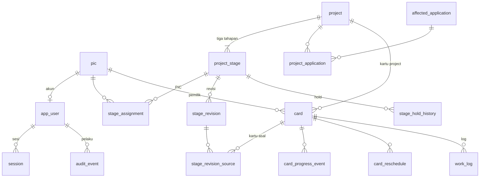

# Database Design: PMCP

| | |
|---|---|
| Project | PMCP |
| Versi | 1.0 |
| Tanggal | 2026-10-28 |
| Status | **APPROVED** (disetujui Pemilik 2026-10-28, CD-176) |
| Disusun oleh | DEV Agent |
| Dasar | `dev/technical-design.md` §9, `ba/fsd.md` v1.1 APPROVED, `dev/technology-baseline.md` v1.0 |
| Database | PostgreSQL di server lokal, satu instance (versi mayor ditentukan bersama infra, OI-01); **tanpa ekstensi tambahan** dan **satu peran aplikasi** (CD-175) |

Penamaan: tabel dan kolom `snake_case`, tabel tunggal. Kunci utama `bigint generated always as identity`
kecuali dinyatakan lain. Nilai enum disimpan dalam bahasa Inggris dan diberi label Indonesia di aplikasi
(label mengikuti FSD). Panjang kolom mengikuti FSD (CD-19: FSD menetapkan data, DEV menetapkan
penyimpanan tanpa mengubah field).

## 1. Prinsip

1. **Tanggal bisnis `DATE`, jam log `TIME`, peristiwa `TIMESTAMPTZ`.** Tidak ada konversi zona pada tanggal bisnis (BL-09, NFR-03). Server berjalan `TZ=Asia/Jakarta`, tetapi perhitungan tidak bergantung padanya.
2. **Tidak ada hapus permanen** untuk project, tahapan, PIC, akun, master, kartu (BL-10); status nonaktif atau dibatalkan menggantikan. Satu pengecualian terdokumentasi: **log aktivitas dapat dihapus** pemilik kartu (BL-30), dan nilai log yang dihapus dicatat di `audit_event`.
3. **Invarian kritis di database** (CHECK, UNIQUE, trigger penjaga), tidak hanya di aplikasi (TD-08, TD-15).
4. **Nama yang dirujuk riwayat disimpan pada baris transaksi** (nama step, kategori, alasan) supaya riwayat tidak berubah saat master diubah (FR-08-02 butir b, BL-28).
5. **Jejak audit append-only** (TD-09).
6. **Konkurensi optimistis** lewat kolom `version` pada tabel yang dapat diubah bersamaan (NFR-10, TD-07).
7. Nilai tidak diketahui memakai `NULL`, bukan string kosong atau tanggal palsu.

## 2. Ekstensi, tipe enum, dan sequence

```sql
-- Tidak ada CREATE EXTENSION: btree_gist tidak diizinkan (CD-175); tumpang tindih log dijaga trigger (§6).

CREATE TYPE stage_t           AS ENUM ('BA','DEV','QA');
CREATE TYPE user_role_t       AS ENUM ('MANAGER','PIC');
CREATE TYPE project_type_t    AS ENUM ('NEW','CHANGE_REQUEST');
CREATE TYPE project_status_t  AS ENUM ('BACKLOG','RUNNING','DEFERRED','CANCELLED','COMPLETED');   -- Backlog, Berjalan, Ditunda, Batal, Selesai
CREATE TYPE stage_status_t    AS ENUM ('NOT_STARTED','RUNNING','HELD','DONE');                       -- Belum Mulai, Berjalan, Ditahan, Selesai
CREATE TYPE card_kind_t       AS ENUM ('PROJECT','ACTIVITY');
CREATE TYPE card_column_t     AS ENUM ('PLANNED','IN_PROGRESS','DONE');
CREATE TYPE audit_category_t  AS ENUM ('PROJECT','CARD','MASTER','ACCOUNT','SECURITY');            -- FR-09-01

CREATE SEQUENCE project_code_seq START 1;   -- PRJ-001, PRJ-002, ... (tiga angka atau lebih, CL-052)
CREATE SEQUENCE card_code_seq    START 1;   -- KB-00001, KB-00002, ... (lima angka, CD-171)
```

Kode dibentuk di database sebagai nilai bawaan kolom:
`'PRJ-' || lpad(nextval('project_code_seq')::text, 3, '0')` dan
`'KB-'  || lpad(nextval('card_code_seq')::text, 5, '0')`. Celah nomor akibat transaksi batal diterima
(NFR-10). Batas format kartu 99.999 (FR-17-01 butir 7).

## 3. Akun, sesi, dan keamanan masuk (FR-01-xx)

### `pic` (master PIC, FR-08-01)

| Kolom | Tipe | Aturan |
|---|---|---|
| id | bigint PK | |
| name | varchar(100) NOT NULL | wajib; dapat diubah nama |
| stage | stage_t NOT NULL | tahapan tetap setelah dibuat (FR-08-01 butir 4) |
| is_active | boolean NOT NULL DEFAULT true | nonaktif menggantikan hapus |
| created_at | timestamptz NOT NULL DEFAULT now() | |

### `app_user` (akun login, FR-01-xx, FR-08-01)

| Kolom | Tipe | Aturan |
|---|---|---|
| id | bigint PK | |
| username | varchar(30) NOT NULL UNIQUE | CHECK `username = lower(username) AND username ~ '^[a-z0-9._-]{4,30}$'` (huruf besar diubah ke kecil oleh aplikasi sebelum simpan) |
| role | user_role_t NOT NULL | |
| pic_id | bigint NULL UNIQUE REFERENCES pic(id) | akun PIC menunjuk PIC; Manager tanpa `pic_id` |
| password_hash | text NOT NULL | argon2id (Security Design) |
| must_change_password | boolean NOT NULL DEFAULT true | FR-01-05 |
| is_active | boolean NOT NULL DEFAULT true | |
| password_changed_at | timestamptz NULL | |
| created_at | timestamptz NOT NULL DEFAULT now() | |

CHECK `(role = 'PIC') = (pic_id IS NOT NULL)`. Aturan "PIC Development tidak punya akun" dan "akun PIC
hanya BA atau QA" ditegakkan oleh use case (lintas tabel) dan diuji integrasi; opsional trigger
pelindung (FR-08-01, EC-08-01.02). Rilis ini satu akun Manager (FR-01-06), dijaga skrip bootstrap.

### `session`

| Kolom | Tipe | Aturan |
|---|---|---|
| token_hash | bytea PK | SHA-256 dari token acak 256 bit; token mentah hanya ada di cookie |
| user_id | bigint NOT NULL REFERENCES app_user(id) | indeks |
| created_at | timestamptz NOT NULL DEFAULT now() | |
| last_seen_at | timestamptz NOT NULL | untuk idle 2 jam (diperbarui terbatas, mis. paling sering tiap menit) |
| expires_at | timestamptz NOT NULL | `created_at + 12 jam` |
| revoked_at | timestamptz NULL | diisi saat keluar, ganti password, atau reset (FR-01-02, FR-01-05) |

Validasi sesi: ada, `revoked_at IS NULL`, `now() < expires_at`, `now() - last_seen_at < 2 jam`.

### `login_throttle` (FR-01-01 butir 3, CL-056)

| Kolom | Tipe | Aturan |
|---|---|---|
| scope | varchar(4) NOT NULL | CHECK `scope IN ('USER','IP')` |
| key | varchar(100) NOT NULL | username ternormalisasi, atau alamat sumber; username tak dikenal tetap dicatat agar perilaku sama |
| failures | integer NOT NULL DEFAULT 0 | |
| locked_until | timestamptz NULL | diisi 15 menit ke depan pada kegagalan ke-5 berturut-turut |
| updated_at | timestamptz NOT NULL | |

PRIMARY KEY `(scope, key)`. Penghitung di-reset oleh login berhasil. Salah password saat ganti
password memakai baris `USER` yang sama.

## 4. Master (FR-08-xx, FR-19-01)

| Tabel | Kolom | Aturan |
|---|---|---|
| `affected_application` | id; name varchar(50) NOT NULL; is_active; created_at | UNIQUE index `lower(name)` |
| `revision_category` | id; name varchar(50); is_active; system_key varchar(20) NULL UNIQUE | UNIQUE `lower(name)`; `system_key` ∈ `HOLD_RESUMED`, `LATE` untuk dua kategori bawaan yang terkunci (TD-12, FR-08-03) |
| `activity_category` | id; name varchar(60); is_active | UNIQUE `lower(name)` |
| `reschedule_reason` | id; name varchar(60); is_active | UNIQUE `lower(name)` |
| `stage_step` | id; stage stage_t; name varchar(60); sort_order integer; is_active | CHECK `stage IN ('BA','QA')`; UNIQUE `(stage, lower(name))`; indeks `(stage, sort_order)` |
| `app_setting` | key varchar(40) PK; int_value integer | CHECK `int_value BETWEEN 1 AND 20`; baris `revision_warn_threshold`=3 dan `reschedule_warn_threshold`=3 |

"Minimal satu item aktif" (FR-08-02 butir e) ditegakkan di use case dalam transaksi dengan
`SELECT ... FOR UPDATE` pada baris master sejenis, sehingga dua penonaktifan serentak tidak melewati
batas (EC-08-02.06). Nilai awal master (aplikasi, kategori, alasan, step) dimasukkan oleh migrasi data awal
sesuai FSD (FR-08-02 sampai FR-19-01).

## 5. Project dan tahapan (FR-02, FR-03, FR-05, FR-10 sampai FR-14)

### `project`

| Kolom | Tipe | Aturan |
|---|---|---|
| id | bigint PK | |
| code | varchar(12) NOT NULL UNIQUE | nilai bawaan dari `project_code_seq`; tidak dapat diubah |
| name | varchar(100) NOT NULL | wajib |
| reference_no | varchar(50) NULL | |
| project_type | project_type_t NULL | |
| business_owner | varchar(100) NULL | |
| department | varchar(100) NULL | |
| request_date | date NULL | |
| description | varchar(1000) NULL | |
| status | project_status_t NOT NULL DEFAULT 'BACKLOG' | `COMPLETED` hanya bila semua tahapan DONE (use case, BL-21) |
| status_reason | varchar(200) NULL | CHECK `(status IN ('DEFERRED','CANCELLED')) = (status_reason IS NOT NULL)` (BL-20) |
| version | integer NOT NULL DEFAULT 1 | penguncian optimistis |
| created_by | bigint NOT NULL REFERENCES app_user(id) | |
| created_at, updated_at | timestamptz NOT NULL | |

`project_application(project_id, application_id)` PRIMARY KEY gabungan, kedua kolom referensi.
Indeks: `project(status)`, `project(lower(name))` pendukung pencarian, `project(reference_no)`.
Pencarian teks (ID, nama, referensi, aplikasi, nama PIC) memakai `ILIKE` terparameter pada kolom yang
diindeks trigram bila uji performa menuntut (rencana perbaikan §10).

### `project_stage` (tepat tiga baris per project, BL-01)

| Kolom | Tipe | Aturan |
|---|---|---|
| id | bigint PK | |
| project_id | bigint NOT NULL REFERENCES project(id) | UNIQUE `(project_id, stage)` |
| stage | stage_t NOT NULL | |
| status | stage_status_t NOT NULL DEFAULT 'NOT_STARTED' | |
| est_start, est_end | date NULL | estimasi terkini; CHECK keduanya NULL atau keduanya terisi dan `est_end >= est_start` (BL-03) |
| baseline_start, baseline_end | date NULL | estimasi awal; CHECK sama; terisi saat estimasi pertama; **tidak berubah** (BL-11) |
| actual_start, actual_end | date NULL | BL-15 |
| hold_since | date NULL | CHECK `(status = 'HELD') = (hold_since IS NOT NULL)` |
| hold_reason | varchar(300) NULL | wajib bila `HELD` |
| manual_progress | smallint NULL | CHECK `BETWEEN 0 AND 99`; angka manual tetap sampai dikembalikan (FR-05-02) |
| manual_progress_note | varchar(300) NULL | |
| manual_progress_by | bigint NULL REFERENCES app_user(id) | |
| manual_progress_at | timestamptz NULL | |
| version | integer NOT NULL DEFAULT 1 | |

Indeks: `(project_id)`, `(status)`, `(est_end)` untuk jatuh tempo dan keterlambatan, `(est_start)` untuk
urutan Gantt (tanggal mulai project = `MIN(est_start)` dari tiga tahapan, dihitung dengan subquery
terindeks, CL-031). Progres efektif **tidak disimpan**: dihitung domain dari kartu dan `manual_progress`
(`stageProgress`, FR-05-02); status Selesai menetapkan 100% secara aturan, bukan kolom.

### `stage_assignment` (penugasan dan penanda "baru", FR-07-02)

| Kolom | Tipe | Aturan |
|---|---|---|
| stage_id | bigint NOT NULL REFERENCES project_stage(id) | |
| pic_id | bigint NOT NULL REFERENCES pic(id) | PRIMARY KEY `(stage_id, pic_id)` |
| assigned_at | timestamptz NOT NULL DEFAULT now() | |
| assigned_by | bigint NOT NULL REFERENCES app_user(id) | |
| seen_at | timestamptz NULL | diisi saat PIC membuka detail project; `NULL` = Assignment baru |

Baris dihapus saat PIC dilepas dari tahapan (penanda hilang, EC-07-02.03); menambahkan kembali
membuat baris baru (Assignment baru lagi). PIC menambahkan dirinya sendiri atau PIC tanpa akun:
`seen_at` langsung terisi saat dibuat (EC-07-02.02). Riwayat penugasan lengkap tetap ada di
`audit_event` (OI TD: entitas riwayat penugasan terpisah tidak diperlukan pada rilis ini).

### `stage_revision` dan `stage_revision_source`

| Kolom | Tipe | Aturan |
|---|---|---|
| id | bigint PK | |
| stage_id | bigint NOT NULL REFERENCES project_stage(id) | UNIQUE `(stage_id, seq)` |
| seq | integer NOT NULL | Revisi 1, 2, ... |
| prev_start, prev_end | date NOT NULL | estimasi sebelum revisi (untuk revisi digabung: sebelum revisi pertama hari itu) |
| new_start, new_end | date NOT NULL | CHECK `new_end >= new_start` |
| category_name | varchar(50) NOT NULL | nama disimpan (BL-12) |
| note | varchar(2000) NOT NULL | catatan; revisi digabung menambahkan catatan dengan pemisah (FR-13-05 butir 3) |
| created_by | bigint NOT NULL REFERENCES app_user(id) | |
| created_at, updated_at | timestamptz NOT NULL | `updated_at` berubah saat digabung |

`stage_revision_source(revision_id, card_id)` PRIMARY KEY gabungan: kartu asal revisi otomatis.
Revisi manual tidak memiliki baris sumber.

### `stage_hold_history`

`id`, `stage_id`, `hold_since date`, `resumed_on date`, `reason varchar(300)`, `held_by`, `resumed_by`;
satu baris per periode hold yang sudah berakhir (hold berjalan ada di `project_stage`). Dipakai
Gantt, riwayat estimasi dan penahanan, dan pengecualian hari hold pada laju (FR-05-02 butir 6).

## 6. Kanban dan log (FR-16 sampai FR-21)

### `card`

| Kolom | Tipe | Aturan |
|---|---|---|
| id | bigint PK | |
| code | varchar(8) NOT NULL UNIQUE | `KB-nnnnn` dari `card_code_seq` |
| kind | card_kind_t NOT NULL | |
| owner_pic_id | bigint NOT NULL REFERENCES pic(id) | pemilik; satu-satunya yang boleh mengelola |
| project_id | bigint NULL REFERENCES project(id) | wajib bila `PROJECT` |
| stage | stage_t NULL | `BA` atau `QA`, otomatis dari tahapan PIC (EC-17-01.04) |
| step_name | varchar(60) NULL | nama step disimpan |
| category_name | varchar(60) NULL | wajib bila `ACTIVITY` |
| title | varchar(120) NOT NULL | CHECK `char_length(btrim(title)) >= 3` |
| board_column | card_column_t NOT NULL DEFAULT 'PLANNED' | |
| progress | smallint NOT NULL DEFAULT 0 | CHECK `IN (0,25,50,75)`; efektif 0 untuk Planned, 100 untuk Done (aturan domain) |
| progress_needs_input | boolean NOT NULL DEFAULT false | "Progres perlu diisi" (EC-16-02.01) |
| plan_start, plan_end | date NOT NULL | CHECK `plan_end >= plan_start`; rencana terkini |
| plan_baseline_start, plan_baseline_end | date NOT NULL | rencana awal; tidak berubah |
| est_minutes | integer NULL | CHECK `est_minutes > 0 AND est_minutes <= 4800` (lebih dari 0 sampai 80 jam) |
| is_adhoc | boolean NOT NULL DEFAULT false | dadakan (tidak masuk penyebut kepatuhan) |
| done_on | date NULL | CHECK `(board_column = 'DONE') = (done_on IS NOT NULL)` |
| cancelled_at | timestamptz NULL | |
| cancel_reason | varchar(200) NULL | CHECK `(cancelled_at IS NULL) = (cancel_reason IS NULL)` |
| extends_stage | boolean NOT NULL DEFAULT false | kartu asal perpanjangan otomatis, permanen (FR-13-05 butir 5 dan CL-056b) |
| extension_note | varchar(300) NULL | catatan revisi otomatis |
| version | integer NOT NULL DEFAULT 1 | |
| created_at | timestamptz NOT NULL DEFAULT now() | |

CHECK konsistensi jenis:
`(kind = 'PROJECT' AND project_id IS NOT NULL AND stage IN ('BA','QA') AND category_name IS NULL) OR (kind = 'ACTIVITY' AND project_id IS NULL AND stage IS NULL AND category_name IS NOT NULL)`.
UNIQUE `(id, owner_pic_id)` (untuk foreign key komposit `work_log`). Indeks: `(owner_pic_id, board_column)`,
`(project_id, stage)`, `(plan_end)`, `(plan_start)` serta `(extends_stage) WHERE extends_stage`.

### `card_progress_event` dan `card_reschedule`

`card_progress_event(id, card_id, old_value smallint, new_value smallint, source varchar(30), created_by, created_at)`:
riwayat progres kartu (FR-16-02 butir 4, FR-16-03).
`card_reschedule(id, card_id, old_start, old_end, new_start, new_end, reason_name varchar(60), note varchar(200), created_by, created_at)`:
riwayat jadwal ulang; jumlah baris = "Jadwal ulang n×" (FR-21-03).

### `work_log` (FR-18-01)

| Kolom | Tipe | Aturan |
|---|---|---|
| id | bigint PK | |
| card_id, owner_pic_id | bigint NOT NULL | foreign key **komposit** `(card_id, owner_pic_id)` → `card(id, owner_pic_id)`: pemilik log selalu sama dengan pemilik kartu |
| work_date | date NOT NULL | tidak di masa depan: dicek aplikasi terhadap `Clock` (bukan constraint karena bergantung waktu) |
| start_time, end_time | time(0) NOT NULL | CHECK `end_time > start_time` |
| step_name | varchar(60) NULL | wajib untuk kartu project (aplikasi); nama disimpan |
| description | varchar(300) NOT NULL | CHECK `char_length(btrim(description)) >= 1` |
| created_at | timestamptz NOT NULL DEFAULT now() | |

```sql
-- BL-28: log tidak boleh bentrok waktu dengan log PIC yang sama pada tanggal yang sama (lintas kartu).
-- Tanpa ekstensi btree_gist (tidak diizinkan, CD-175): trigger dengan kunci advisory per PIC (TD-15).
CREATE FUNCTION work_log_guard_overlap() RETURNS trigger AS $$
BEGIN
  PERFORM pg_advisory_xact_lock(7001, NEW.owner_pic_id::int);   -- serialkan penulisan log per PIC
  IF EXISTS (
    SELECT 1 FROM work_log w
     WHERE w.owner_pic_id = NEW.owner_pic_id
       AND w.work_date    = NEW.work_date
       AND w.id IS DISTINCT FROM NEW.id
       AND w.start_time < NEW.end_time
       AND w.end_time   > NEW.start_time
  ) THEN
    RAISE EXCEPTION 'work_log_overlap' USING ERRCODE = '23P01';
  END IF;
  RETURN NEW;
END; $$ LANGUAGE plpgsql;

CREATE TRIGGER work_log_no_overlap
  BEFORE INSERT OR UPDATE ON work_log
  FOR EACH ROW EXECUTE FUNCTION work_log_guard_overlap();
```

Perbandingan `start_time < NEW.end_time AND end_time > NEW.start_time` memperlakukan rentang sebagai
setengah-terbuka, sehingga log berimpit tepat (selesai 11:00 dan mulai 11:00) tidak bentrok (FR-18-01
butir 2). Kunci advisory dua-bagian (`7001`, id PIC) mencegah dua sesi PIC yang sama menulis serentak
dan lolos pemeriksaan, tanpa mengunci PIC lain. Aplikasi memeriksa tumpang tindih lebih dulu agar pesan
menyebut log yang bentrok, dan memetakan galat `23P01` dari trigger sebagai cadangan. Indeks
`(owner_pic_id, work_date, start_time)` dan `(card_id)`. Peringatan lebih dari 8 jam per hari dihitung
aplikasi (tidak memblokir, CL-005). Trigger dibuat lewat SQL migrasi mentah (Prisma tidak memodelkan
trigger).

## 7. Jejak audit (FR-09-01, NFR-04, BL-07)

### `audit_event`

| Kolom | Tipe | Aturan |
|---|---|---|
| id | bigint PK | urut naik |
| occurred_at | timestamptz NOT NULL DEFAULT now() | waktu server |
| actor_user_id | bigint NULL REFERENCES app_user(id) | NULL untuk percobaan login username tak dikenal |
| actor_label | varchar(120) NOT NULL | nama pelaku saat itu |
| category | audit_category_t NOT NULL | |
| action | varchar(60) NOT NULL | mis. `project.created`, `card.rescheduled` |
| project_code | varchar(12) NULL | untuk riwayat per project |
| entity_type | varchar(30) NOT NULL | |
| entity_id | varchar(40) NULL | |
| summary | varchar(300) NOT NULL | ringkasan terbaca |
| changes | jsonb NOT NULL DEFAULT '[]' | daftar `{field, old, new}`; **tidak pernah memuat password, token, atau nilai kolom username tak dikenal** (CL-056d) |

Indeks: `(occurred_at DESC)`, `(project_code, occurred_at DESC)`, `(category, occurred_at DESC)`,
`(actor_user_id, occurred_at DESC)`. Pagination 10, 20, 50 (FR-09-01).

Penegakan append-only. Dua peran database tidak tersedia (CD-175), jadi perlindungan utama adalah trigger
penolak di bawah ini, ditambah aturan bahwa **kode aplikasi tidak pernah menerbitkan `UPDATE` atau `DELETE`**
pada `audit_event` (diuji) dan pemeriksaan integritas skema saat proses mulai (trigger audit dan trigger
log harus ada; bila tidak, proses menolak melayani dan mencatat galat). Bila dua peran tersedia kelak,
tambahkan `REVOKE UPDATE, DELETE, TRUNCATE ON audit_event FROM pmcp_app;` sebagai pengerasan.

```sql
CREATE FUNCTION audit_event_block_change() RETURNS trigger AS $$
BEGIN RAISE EXCEPTION 'audit_event bersifat append-only'; END; $$ LANGUAGE plpgsql;
CREATE TRIGGER audit_event_no_update_delete
  BEFORE UPDATE OR DELETE ON audit_event FOR EACH ROW EXECUTE FUNCTION audit_event_block_change();
```

Audit ditulis **dalam transaksi yang sama** dengan perubahan (semua atau tidak sama sekali). Untuk
percobaan login gagal dan akses ditolak, audit ditulis di luar transaksi bisnis (transaksi kecil sendiri)
agar tetap tercatat saat bisnis dibatalkan.

## 8. Diagram hubungan (ringkas)



## 9. Peran, hak, dan transaksi

| Peran | Hak | Dipakai oleh |
|---|---|---|
| `pmcp_app` (satu peran, pemilik skema; dua peran tidak tersedia, CD-175) | DDL (hanya langkah migrasi saat rilis), `SELECT`/`INSERT`/`UPDATE`/`DELETE` pada tabel aplikasi; pada `audit_event` aplikasi hanya `SELECT` dan `INSERT` (aturan kode dan trigger); `USAGE` sequence | langkah migrasi saat rilis dan proses aplikasi |

Risiko satu peran: pemilik skema secara teknis dapat menonaktifkan trigger lewat DDL. Mitigasi: aplikasi
tidak menjalankan DDL di luar migrasi rilis, pemeriksaan skema saat start, dan kredensial hanya diketahui infra
dan aplikasi (Security Design SR-06).

Aturan transaksi: satu use case mutasi = satu transaksi; tingkat isolasi bawaan `READ COMMITTED` cukup
dengan penguncian eksplisit (`FOR UPDATE` pada `project_stage` untuk revisi otomatis dan pada master
untuk "minimal satu aktif") dan versi optimistis; tidak memakai `SERIALIZABLE` global. Tidak ada kerja
panjang atau panggilan jaringan di dalam transaksi.

## 10. Pola kueri penting dan indeks

| Layar atau fungsi | Pola | Dukungan |
|---|---|---|
| Daftar Project, Gantt | `project` + tahapan, filter (status, jenis, kelengkapan, PIC, tahapan), urut `MIN(est_start)`, `LIMIT/OFFSET` atau keyset, agregat `GROUP BY status` terpisah | indeks `project(status)`, `project_stage(project_id)`, `(est_start)`, `stage_assignment(pic_id)` |
| Dashboard Head | tahapan belum selesai pada project berjalan (SQL), lalu hitung domain; kartu pada periode; log pada periode per PIC | `project_stage(status)`, `(est_end)`, `card(owner_pic_id, board_column)`, `(plan_start, plan_end)`, `work_log(owner_pic_id, work_date)` |
| Dashboard PIC, Kanban | kartu milik PIC dan kartu terbuka; periode | `card(owner_pic_id, board_column)` |
| Kepatuhan | kartu rencana non-dadakan menurut `plan_end` pada periode | indeks `card(plan_end)` |
| Riwayat aktivitas | log PIC per rentang tanggal | `work_log(owner_pic_id, work_date)` |
| Jejak Perubahan | urut waktu desc dengan saringan jenis dan pelaku | indeks `audit_event` di §7 |

Bila uji performa pada data acuan (CL-057) menunjukkan pencarian teks lambat, tambahkan indeks trigram
(`pg_trgm`, perlu izin ekstensi) pada nama project dan nama PIC; ini perbaikan terarah, bukan bagian
skema awal.

## 11. Migrasi dan data awal

1. **Urutan migrasi:** (1) ekstensi, enum, sequence; (2) tabel master dan akun; (3) project dan tahapan; (4) kartu dan log; (5) audit, trigger, dan hak peran; (6) data awal master. Setiap langkah SQL terversi di `prisma/migrations/`, dapat diulang pada database kosong, dan diuji di CI.
2. **Data awal (idempotent):** nilai awal master sesuai FSD: aplikasi (7 nilai), kategori alasan revisi (6 nilai termasuk "Pekerjaan dadakan" dan dua `system_key`), kategori activity (8), alasan jadwal ulang (6), step BA (9) dan QA (9), `app_setting` ambang 3 dan 3. Tidak ada data project, kartu, atau PIC awal (data dimulai bersih, CL-003). Akun Manager dibuat oleh `scripts/bootstrap-manager`.
3. **Kompatibilitas:** perubahan skema berikutnya maju saja dan kompatibel mundur satu rilis: kolom baru nullable atau berbawaan; penghapusan atau perubahan tipe destruktif memakai urutan ekspansi lalu kontraksi dan backup (skill deployment dan database).
4. **Backup:** oleh tim infra; backup tambahan sebelum migrasi production (Technology Baseline §10, CD-157).
5. **Retensi:** jejak audit dan riwayat tidak dibatasi pada rilis ini (NFR-06); sesi kedaluwarsa dibersihkan berkala.

## 12. Keterlacakan constraint ke aturan

| Constraint | Aturan |
|---|---|
| trigger `work_log_no_overlap` (`work_log_guard_overlap`) | BL-28, FR-18-01 butir 2 |
| `project.status_reason` CHECK | BL-20 |
| `project_stage` pasangan tanggal, `baseline_*` tidak berubah | BL-03, BL-11 |
| `project_stage.hold_*` CHECK | BL-13 |
| `card` CHECK jenis, tanggal, progres, estimasi jam | BR-16, BR-21, BL-39, FR-17-01 |
| `app_user.username` CHECK dan UNIQUE | FR-08-01 butir 2 |
| UNIQUE `lower(name)` pada master | FR-08-02 butir a |
| `audit_event` append-only | BL-07, NFR-04 |
| `stage_assignment` PK dan `seen_at` | FR-07-02 |
| Kode dari sequence | FR-02-01 butir 2, FR-17-01 butir 7, NFR-10 |

## 13. Status

```yaml
status: approved
version: 1.0
approved_by: Pemilik (Head of Business Analyst, Human Approver)
approved_at: 2026-10-28
ref: CD-176
```
